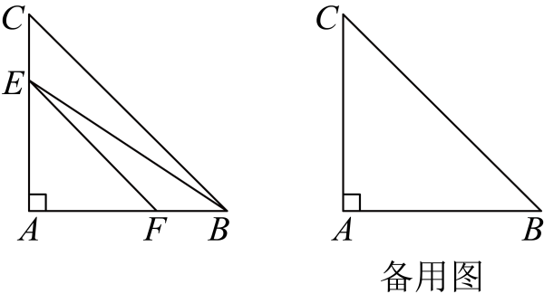

# Mathematics - 题目 3394

**ID**: 451bfa4414684d248bd19d3b653c6bde
**年级**: Grade 9
**难度**: Medium-Hard
**题型**: Calculation

## 题目
如图，在等腰直角三角形 $ABC$ 中， $\angle A=90{}\degree $ ， $AB=4{\rm{c}}{\rm{m}}$ ．动点E，F分别从点A，B同时出发，点E沿折线A→C→B向终点B运动，在AC上的速度为2cm/s，在CB上的速度为 $2\sqrt {2}{\rm cm}$ /s，点F以1cm/s的速度沿线段 $BA$ 向终点A运动，连接 $EF$ ， $BE$ ．设运动时间为 ${\rm \mathit{x}（s），}△BEF$ 的面积为y（cm^{2}）（ $y＞0$ ）．(1) $AE$ 的长为cm（用含x的代数式表示）．(2)求y关于x的函数解析式，并写出x的取值范围．(3)当 $△BEF$ 为钝角三角形时，直接写出x的取值范围．​​​​​​​‌

## 解答

1. （1）当 $0<x\leqslant 2$ 时， 点E运动的路程就是 $AE$ 的长，即： $AE{\rm =}$  $2x$ ，
2. 当 $2<x\leqslant 4$ 时，作 $EG\bot AC$ 于点 $G$ ，如图所示，
3. 
4. 在 ${\rm{R}}{\rm{t}}△CEG$ 中， $CE=2\sqrt {2}(x-2)$ ， $CG=GE=\frac {\sqrt {2}}{2}CE=2(x-2)=2x-4$ ，
5. 在 ${\rm{R}}{\rm{t}}\mathrm{△}AEG$ 中， $AG=AC-CG=8-2x$ ， $AE=\sqrt {AG{^{2}}+GE{^{2}}}=2\sqrt {2x{^{2}}-12x+20}$ 。
6. （2）点F运动的路程就是线段 $BF$ 的长，即 $BF=x$
7. 当 $0<x\leqslant 2$ 时， $S{{}_{\vartriangle BEF}}=\frac {1}{2}BF\cdot AE$ ，即 $y=\frac {1}{2}\times 2x\cdot x=x{^{2}}$ ；
8. 当 $2<x<4$ 时，作 $EH\bot AB$ 于点 $H$ ，如图所示，
9. 
10. ∴ $EH=AG=8-2x$ ，
11. ∵ $S{{}_{\mathrm{△}BEF}}=\frac {1}{2}BF\cdot EH$ ，
12. ∴ $y=\frac {1}{2}x(8-2x)=-x{^{2}}+4x$ ，
13. 综上可得，求y关于x的函数解析式为： $y=\begin{cases}y=x{^{2}}(0<x\leqslant 2)\\y=-x{^{2}}+4x(2<x<4)\end{cases}$ ；
14. （3）当 $EF\bot AB$ 时， $△BEF$ 是直角三角形，如图所示，
15. 
16. 在 ${\rm{R}}{\rm{t}}△BEF$ 中， $EF=AG=8-2x$ ， $BF=x$ ， $EF=BF$ ，
17. ∴ $8-2x=x$ ，
18. 解得： $x=\frac {8}{3}$ ，
19. 当 $EF⊥BC$ 时， $△BEF$ 是直角三角形，如图所示，
20. 
21. 在 ${\rm{R}}{\rm{t}}△BEF$ 中， $BE=BC-CE=\sqrt {2}AB-CE=4\sqrt {2}-2\sqrt {2}(x-2)=8\sqrt {2}-2\sqrt {2}x$ ， $BF=x$ ， $BF=\sqrt {2}BE$ ，
22. ∴ $x=\sqrt {2}(8\sqrt {2}-2\sqrt {2}x)$ ，
23. 解得： $x=\frac {16}{5}$ ，
24. ∴当 $△BEF$ 为钝角三角形时，x的取值范围是： $0<x<\frac {8}{3}$ 或 $\frac {16}{5}<x<4$ ．

## 知识点

**中文**:
  - 求自变量的取值范围
  - 等腰直角三角形的性质

**English**:
  - Finding Range of Independent Variable
  - Properties of Isosceles Right Triangles

---
