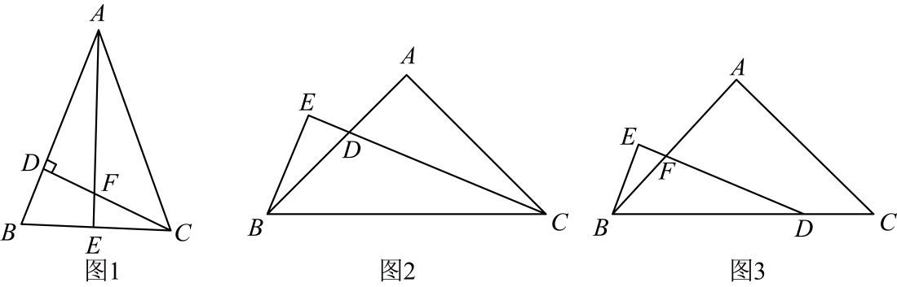

# Mathematics - 题目 2812

**ID**: 45ef3f142bb843f8891c9e8835fc470b
**年级**: Grade 9
**难度**: Medium-Hard
**题型**: Calculation

## 题目
【基础探究】如图①， $\vartriangle ABC$ 中， $AB=AC$ ， $∠BAC=45{}\degree $ ， $AE$ 平分 $∠BAC$ 交 $BC$ 于点E，作 $CD\bot AB$ 于点 ${\rm \mathit{D}，}CD$ 与 $AE$ 交于点F，则 $\vartriangle BDC≌$．（直接写出结论，不需写证明过程）【发现规律】如图②， $\vartriangle ABC$ 中， $AB=AC$ ， $∠BAC=90{}\degree $ ， $CE$ 平分 $∠ACB$ 交 $AB$ 于点D，作 $BE\bot CD$ 交 $CD$ 延长线于点E．若 $CD=6$ ，则 $BE=$．（直接写出结论，不需写解答过程）【变式拓展】如图③， $\vartriangle ABC$ 中， $AB=AC$ ， $∠BAC=90{}\degree $ ，点D在线段 $BC$ 上，作 $\angle BDE=\frac {1}{2}\angle ACB$ ， $DE$ 交 $AB$ 于点F，作 $BE\bot DE$ 于点E．试探究线段 $BE$ 与 $DF$ 的数量关系，写出并证明你的结论．​​​​​​​‌

## 解答

1. [基础探究]∵ $∠BAC=45{}\degree $ ， $CD\bot AB$ ，
2. ∴ $∠ACD=∠BAC=45{}\degree $ ，
3. ∴ $CD=AD$ ， $∠BDC=∠FDA=90{}\degree $ ，
4. ∴ $∠BCD=90{}\degree -∠B$ ，
5. ∵ $AB=AC$ ， $AE$ 平分 $∠BAC$ ，
6. ∴ $AE\bot BC$ ，
7. ∴ $∠FAD=90{}\degree -∠B$ ，
8. ∴ $∠BCD=∠FAD$ ，
9. ∴ $\vartriangle BDC≌\vartriangle FDA\left ({{\rm{A}}{\rm{A}}{\rm{S}}}\right )$ .
10. [发现规律]延长 $BE$ 交 $CA$ 延长线于F，
11. ∵ $CD$ 平分 $∠ACB$ ，
12. ∴ $∠FCE=∠BCE$ ，
13. 又∵ $CE=CE,\angle CEF=\angle CEB=90{}\degree $ ，
14. ∴ $\vartriangle CEF≌\vartriangle CEB\left ({{\rm{A}}{\rm{S}}{\rm{A}}}\right )$ ，
15. ∴ $FE=BE=\frac {1}{2}BF$ ，
16. ∵ $∠DAC=∠CEF=∠BAF=90{}\degree $ ，
17. ∴ $\angle ACD+\angle F=\angle ABF+\angle F=90{}\degree $ ，
18. ∴ $∠ACD=∠ABF$ ，
19. ∵ $AC=AB,\angle CAD=\angle BAF=90{}\degree $ ，
20. ∴ $\vartriangle ACD≌\vartriangle ABF\left ({{\rm{A}}{\rm{S}}{\rm{A}}}\right )$ ，
21. ∴ $CD=BF$ ，
22. ∴ $BE=\frac {1}{2}CD=\frac {1}{2}\times 6=3$ .
23. [变式拓展] $BE=\frac {1}{2}DF$ ．理由如下：
24. 过点D作 $DG\parallel AC$ ，交 $BE$ 的延长线于点G，与 $AF$ 相交于H，
25. ∵ $DG\parallel AC$ ，
26. ∴ $∠GDB=∠C$ ， $∠BHD=∠A=90{}\degree $ ，
27. ∵ $\angle EDB=\frac {1}{2}\angle C$ ，
28. ∴ $\angle EDB=\angle EDG=\frac {1}{2}\angle C$ ，
29. ∵ $BE\bot ED$ ，
30. ∴ $∠BED=90{}\degree $ ，
31. ∴ $∠BED=∠BHD$ ，
32. ∵ $∠EFB=∠HFD$ ，
33. ∴ $∠EBF=∠HDF$ ，
34. ∵ $AB=AC$ ， $∠BAC=90{}\degree $ ，
35. ∴ $∠C=∠ABC=45{}\degree $ ，
36. ∵ $DG\parallel AC$ ，
37. ∴ $∠GDB=∠C=45{}\degree $ ，
38. ∴ $∠GDB=∠ABC=45{}\degree $ ，
39. ∴ $BH=DH$ ，
40. ∵ $\angle HBE=\angle HDF$ ，
41. ∴ $\vartriangle BGH≌\vartriangle DFH\left ({{\rm{A}}{\rm{S}}{\rm{A}}}\right )$ ，
42. ∴ $BG=DF$ ，
43. 又∵ $\angle BDE=\angle GDE$ ，
44. ∴ $\vartriangle BDE≌\vartriangle GE\left ({{\rm{A}}{\rm{S}}{\rm{A}}}\right )$ ，
45. ∴ $BE=EG$ ，
46. ∴ $BE=\frac {1}{2}BG=\frac {1}{2}DF$ ．
47. 

## 知识点

**中文**:
  - 两直线平行同位角相等
  - 等腰三角形的判定与性质
  - 全等三角形的判定与性质

**English**:
  - Parallel Lines have Equal Corresponding Angles
  - Determination and Properties
  - Determination and Properties

---
