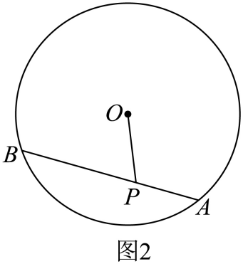

# Mathematics - 题目 1722

**ID**: 46851b83b46b47f082af9ef9f75d658a
**年级**: Grade 9
**难度**: Medium-Hard
**题型**: Calculation

## 题目
阅读与思考：小刚学习了圆这章知识后，在某本课外书上看到还有一个相交弦定理（圆内的两条弦相交，这两条弦被交点分成的两条线段长的积相等），下面是书上的证明过程，请仔细阅读，并完成相应的任务．圆内的两条弦相交，这两条弦被交点分成的两条线段长的积相等．已知：如图 $1$ ， $\odot O$ 的两条弦 $AB，CD$ 相交于点 $P$ ．求证： $AP\centerdot BP=CP\centerdot DP$ ．证明：如图 $1$ ，连接 $AC，BD$ ，∵ $\angle C=\angle B$ ， $\angle A=\angle D$ ，∴①，$\therefore \frac {AP}{DP}=②$∴ $AP\centerdot BP=CP\centerdot DP$ ，∴两条弦相交，被交点分成的两条线段长的积相等．任务：（1）请将上述证明过程补充完整；​​​​​​​‌（2）小刚又看到一道课后习题：如图 $2$ ， $AB$ 是 $\odot O$ 的弦， $P$ 是 $AB$ 上一点， $PB=6{\rm{c}}{\rm{m}}$ ， $PA=4{\rm{c}}{\rm{m}}$ ， $OP=5{\rm{c}}{\rm{m}}$ ，求 $\odot O$ 的半径．

## 解答

1. （1）证明：如图 $1$ ，连接 $AC，BD$ ，
2. ∵ $\angle C=\angle B$ ， $\angle A=\angle D$ ，
3. ∴ $△ACP∽△DBP$ ，
4. $\therefore \frac {AP}{DP}=\frac {CP}{BP}$ ，
5. ∴ $AP\centerdot BP=CP\centerdot DP$ ，
6. ∴两条弦相交，被交点分成的两条线段长的积相等.
7. （2）解：延长 $OP$ 交 $\odot O$ 于点 $D$ ，延长 $PO$ 交 $\odot O$ 于点 $F$ ，
8. 
9. 设 $\odot O$ 的半径为 $x{\rm{c}}{\rm{m}}$ ，则 $PD=\left ({x-5}\right ){\rm{c}}{\rm{m}}$ ， $PF=\left ({x+5}\right ){\rm{c}}{\rm{m}}$ ，
10. 由（ $1$ ）可得， $PD·PF=PB·PA$ ，
11. ∴ $\left ({x-5}\right )\left ({x+5}\right )=6\times 4$ ，
12. 解得 $x=7$ ，
13. ∴ $\odot O$ 的半径为 $7{\rm{c}}{\rm{m}}$ ．

## 知识点

**中文**:
  - 同弧或等弧所对的圆周角相等
  - 相似三角形的判定与性质综合

**English**:
  - Angles Subtended by Same Arc are Equal
  - Determination and Properties

---
