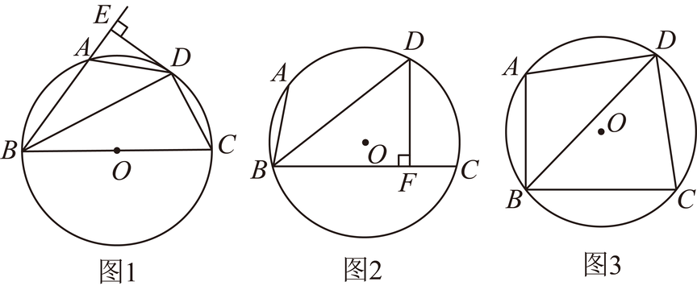

# Mathematics - 题目 132

**ID**: 48cba620fc4b4d1896725d873e460c57
**年级**: Grade 9
**难度**: Medium-Hard
**题型**: Calculation

## 题目
【特例感知】（1）如图 ${\rm 1，}∠ABC$ 是 $\odot O$ 的圆周角， $BC$ 为直径， $BD$ 平分 $∠ABC$ 交 $\odot O$ 于点 $D$ ， $DE⊥AB$ ，若 $BC=5$ ， $BD=4$ ，则 $AD=$， $DE=$．【类比迁移】（2）如图 ${\rm 2，}∠ABC$ 是 $\odot O$ 的圆周角， $BC$ 为 $\odot O$ 的弦， $BD$ 平分 $∠ABC$ 交 $\odot O$ 于点 $D$ ，过点 $D$ 作 $DF\bot BC$ ，垂足为 $F$ ，探索线段 $AB$ 、 $BF$ 、 $BC$ 之间的数量关系，并说明理由．【问题解决】（3）如图 ${\rm 3，}∠ABC$ 是 $\odot O$ 的圆周角， $BC$ 为 $\odot O$ 的弦， $BD$ 平分 $∠ABC$ 交 $\odot O$ 于点 $D$ ，若 $\angle ABC=90{}\degree $ ， $BD=7\sqrt {2}$ ， $AB=6$ ，则 $\vartriangle ABC$ 的内心与外心之间的距离为．​​​​​​​‌

## 解答

1. （1）作 $DF\bot BC$ 于点 $F$ ，
2. 
3. ∵ $BD$ 平分 $\angle ABC$ ， $DE\bot AB$ ， $DF\bot BC$ ，
4. ∴ $DE=DF$ ， $\angle BED=\angle BFD=90{}\degree $ ，
5. 又∵ $ABCD$ 是圆内接四边形，
6. ∴ $\angle EAD+\angle BAD=\angle BCD+\angle BAD=180{}\degree $ ，即 $\angle EAD=\angle BCD$ ，
7. ∴ $\vartriangle ADE≌\vartriangle CDF$ ，
8. ∴ $AD=CD$ ，
9. ∵ $BC$ 为 $\odot O$ 的直径，
10. ∴ $\angle BDC=90{}\degree $ .
11. ∵ $BC=5$ ， $BD=4$ ，
12. ∴ $AD=CD=\sqrt {BC{^{2}}-BD{^{2}}}=3.$
13. ∵ $S{{}_{\vartriangle BDC}}=\frac {1}{2}BD·CD=\frac {1}{2}BC\cdot DF$ ，
14. ∴ $DE=DF=\frac {12}{5}$ .
15. （2） $AB+BC=2BE$ ，理由如下：
16. 过点 $D$ 作 $DF\bot BA$ ，交 $BA$ 的延长线于点 $F$ ，连接 $AD$ ， $DC$ ，如图所示：
17. 
18. ∵ $BD$ 平分 $\angle ABC$ ， $DE\bot BC$ ， $DF\bot BA$ ，
19. ∴ $DF=DE$ ， $\angle DFB=\angle DEB=90{}\degree $ .
20. ∵ $\angle DFB=90{}\degree $ ， $\angle DEB=90{}\degree $ ，
21. ∴ $\angle ABC+\angle EDF=180{}\degree $ .
22. 又∵ $\angle ABC+\angle ADC=180{}\degree $ ，
23. ∴ $\angle ADC=\angle EDF$ ，
24. ∴ $\angle FDA=\angle CDE$ ，
25. ∵ $\angle DFA=\angle DEC=90{}\degree $ ，
26. ∴ $\vartriangle DFA≌\vartriangle DEC$ ，
27. ∴ $AF=CE$ .
28. ∵ $BD=BD$ ， $DF=DE$ ，
29. ∴ ${\rm{R}}{\rm{t}}\vartriangle BDF≌{\rm{R}}{\rm{t}}\vartriangle BDE\left ({{\rm{H}}{\rm{L}}}\right )$ ，
30. ∴ $BF=BE$ ，
31. ∴ $AB+BC=BF-AF+BE+CE=2BE$ ；
32. （3）如图，过点 $D$ 作 $DF\bot AB$ ，交 $BA$ 的延长线于点 $F$ ， $DE\bot BC$ 于点 $E$ ，连接 $AC$ ，
33. 
34. ∵ $\angle ABC=90{}\degree $ ，
35. ∴点 $O$ 在 $AC$ 上，
36. 作 $\vartriangle ABC$ 的内切圆，圆心为点 $M$ ，切点为 $N$ ，连接 $MN$ ， $OM$ ，
37. 由（2）可知，四边形 $BEDF$ 是正方形， $BD$ 是对角线，
38. ∵ $BD=7\sqrt {2}$ ，
39. ∴正方形 $BEDF$ 的边长为 $7$ ，
40. 由（2）可知， $BC=2BE-AB=8$ ，
41. ∴ $AC=\sqrt {AB{^{2}}+BC{^{2}}}=10$ ，
42. ∴ $AO=\frac {1}{2}AC=5$ ，
43. 由切线长定理可知， $AN=\frac {6+10-8}{2}=4$ ，
44. ∴ $ON=5-4=1$ ，
45. 设内切圆的半径为 $r$ ，则 $\frac {1}{2}r\times 10+\frac {1}{2}r\times 6+\frac {1}{2}r\times 8=\frac {1}{2}\times 6\times 8$ ，
46. 解得 $r=2$ ，
47. 即 $MN=2$ ，
48. 在 $Rt\vartriangle OMN$ 中， $OM=\sqrt {MN{^{2}}+ON{^{2}}}=\sqrt {5}$ .

## 知识点

**中文**:
  - 三角形内切圆
  - 切线长定理
  - 圆内接四边形
  - 圆周角定理

**English**:
  - Incircle of Triangle
  - Tangent Length Theorem
  - Cyclic Quadrilaterals
  - Inscribed Angle Theorem

---
