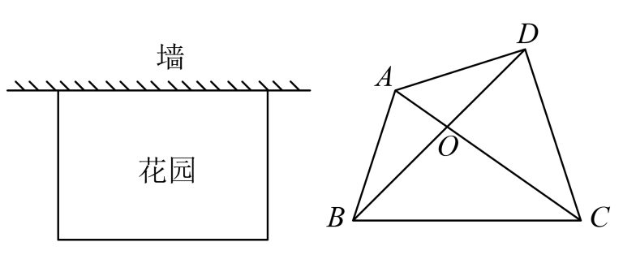

# Mathematics - 题目 3295

**ID**: 49c5075516d64c5ab329720f0c04ef16
**年级**: Grade 9
**难度**: Medium-Hard
**题型**: Calculation

## 题目
【发现问题】由 $(a-b){^{2}}\geqslant 0$ 得， $a{^{2}}+b{^{2}}\geqslant 2ab$ ；​​​​​​​‌如果两个正数 $a$ ， $b$ ，即 $a>0$ ， $b>0$ ，则有下面的不等式：$a+b\geqslant 2\sqrt {ab}$ ，当且仅当 $a=b$ 时取到等号．【提出问题】若 $a>0$ ， $b>0$ ，利用配方能否求出 $a+b$ 的最小值呢？【分析问题】例如：已知 $x>0$ ，求式子 $x+\frac {4}{x}$ 的最小值．解：令 $a=x,b=\frac {4}{x}$ ，则由 $a+b\geqslant 2\sqrt {ab}$ ，得 $x+\frac {4}{x}\geqslant 2\sqrt {x\cdot \frac {4}{x}}=4$ ，当且仅当 $x=\frac {4}{x}$ 时，即 $x=2$ 时，式子有最小值，最小值为4．【解决问题】请根据上面材料回答下列问题：（1） $2+3$$2\sqrt {2\times 3}$ （用“ $=$ ”“ $>$ ”“ $<$ ”填空）；当 $x>0$ ，式子 $x+\frac {1}{x}$ 的最小值为；【能力提升】（2）用篱笆围一个面积为32平方米的长方形花园，使这个长方形花园的一边靠墙（墙长20米），问这个长方形的长、宽各为多少时，所用的篱笆最短，最短的篱笆是多少？（3）如图，四边形 $ABCD$ 的对角线 $AC$ 、 $BD$ 相交于点 $O$ ， $\vartriangle AOB$ 、 $△COD$ 的面积分别是8和14，求四边形 $ABCD$ 面积的最小值．

## 解答

1. 解：（1）∵ $2>0,3>0$ ，且 $2\ne 3$ ，
2. ∴ $2+3>2\sqrt {2\times 3}$ ；
3. 当 $x>0$ 时， $x+\frac {1}{x}\geqslant 2\sqrt {x\times \frac {1}{x}}=2$
4. （2）设这个长方形花园靠墙的一边的长为 $x$ 米，另一边为 $y$ 米，
5. 则 $xy=32$ ，
6. $\therefore y=\frac {32}{x}$ ，
7. $\therefore $ 这个篱笆长 $=\frac {32}{x}\times 2+x=\left ({\frac {64}{x}+x}\right )$ 米，
8. 根据材料可得， $\frac {64}{x}+x\geqslant 2\sqrt {\frac {64}{x}\times x}$ ，当 $\frac {64}{x}=x$ 时， $\frac {64}{x}+x$ 的值最小，
9. $\therefore x=8$ 或 $-8$ （舍弃），
10. $\therefore y=\frac {32}{x}=\frac {32}{8}=4$ ，
11. ∴当长、宽分别为8米，4米时，所用的篱笆最短，最短的篱笆是 $\frac {64}{x}+x=8+8=16$ 米．
12. （3）设 $S{{}_{\mathrm{△}BOC}}=x$ ，已知 $S{{}_{\mathrm{△}AOB}}=8$ ， $S{{}_{△COD}}=14$ ，
13. 则由等高三角形可知： $S{{}_{\vartriangle BOC}}:S{{}_{\vartriangle COD}}=BO:OD=S{{}_{\vartriangle AOB}}:S{{}_{\vartriangle AOD}}$ ，
14. $\therefore x:14=8:S{{}_{\vartriangle AOD}}$ ，
15. $\therefore S{{}_{\vartriangle AOD}}=\frac {112}{x}$ ，
16. $\therefore $ 四边形 $ABCD$ 面积 $=8+14+x+\frac {112}{x}\geqslant 22+2\sqrt {x\times \frac {112}{x}}=22+8\sqrt {7}$
17. 当且仅当 $x=\frac {112}{x}$ ，即 $x=4\sqrt {7}$ 时，取等号，
18. $\therefore $ 四边形 $ABCD$ 面积的最小值为 $22+8\sqrt {7}$ ．

## 知识点

**中文**:
  - 列代数式

**English**:
  - Writing Algebraic Expressions

---
