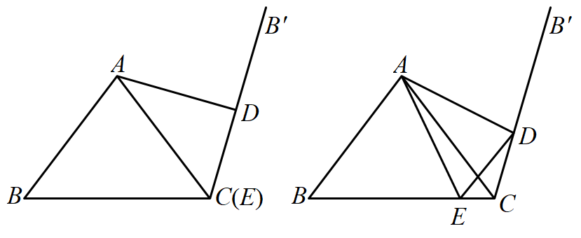

# Mathematics - 题目 3955

**ID**: 49cc444812a946a9b7395e6a7f4630da
**年级**: Grade 9
**难度**: Medium-Hard
**题型**: Calculation

## 题目
在 $\vartriangle ABC$ 中， $AB=AC$ ，过点 $C$ 作射线 $CB^{′}$ ，使 $\angle ACB^{′}=\angle ACB$ （点 $B^{′}$ 与点 $B$ 在直线 $AC$ 的异侧）点 $D$ 是射线 $CB^{′}$ 上一动点（不与点 $C$ 重合），点 $E$ 在线段 $BC$ 上，且 $\angle DAE+\angle ACD=90{}^\circ $ ．(1)如图1，当点 $E$ 与点 $C$ 重合时， $AD$ 与 $CB^{′}$ 的位置关系是，若 $BC=a$ ，则 $CD$ 的长为；​​​​​​​‌（用含a的式子表示）(2)如图2，当点 $E$ 与点 $C$ 不重合时，连接 $DE$ ．①用等式表示 $∠BAC$ 与 $∠DAE$ 之间的数量关系，并证明；②用等式表示线段 $BE$ ， $CD$ ， $DE$ 之间的数量关系，并证明．

## 解答

1. （1）解：当点 $E$ 与点 $C$ 重合时， $\angle DAE=\angle DAC$ ，
2. $\because \angle DAE+\angle ACD=90{}^\circ $ ，
3. $\therefore \angle DAC+\angle ACD=90{}^\circ $ ，
4. $\therefore \angle ADC=90{}^\circ $ ，
5. $\therefore AD\bot CB^{′}$ ，
6. 即 $AD$ 与 $CB^{′}$ 的位置关系是互相垂直，
7. 若 $BC=a$ ，过点 $A$ 作 $AM\bot BC$ 于点 $M$ ，如图：
8. 
9. 则 $∠AMC=90{}^\circ =∠ADC$ ，
10. ∵ $AB=AC$ ，
11. $\therefore CM=BM=\frac {1}{2}BC=\frac {1}{2}a$ ，
12. 在 $\vartriangle ACD$ 与 $△ACM$ 中，
13. $\left \{\hspace{-0.5em}\begin{array}{}\angle ADC=\angle AMC\\\angle ACD=\angle ACM\\AC=AC\end{array}\hspace{-0.5em}\right.$ ，
14. $\therefore \mathrm{△}ACD≌\mathrm{△}ACM\left ({{\rm{A}}{\rm{A}}{\rm{S}}}\right )$ ，
15. $\therefore CD=CM=\frac {1}{2}a$ ，
16. 即 $CD$ 的长为 $\frac {1}{2}a$ ，
17. 故答案为：互相垂直； $\frac {1}{2}a$ ；
18. （2）解：①当点 $E$ 与点 $C$ 不重合时，用等式表示 $∠BAC$ 与 $∠DAE$ 之间的数量关系是： $\angle BAC=2\angle DAE$ ，证明如下：
19. 过点 $A$ 作 $AM\bot BC$ 于点 $M$ 、 $AN\bot CB^{′}$ 点 $N$ ，如图：
20. 
21. 则 $\angle AMC=\angle ANC=90{}^\circ $ ，
22. $\therefore \angle CAN+\angle ACB^{′}=90{}^\circ $ ，
23. $\because \angle DAE+\angle ACD=90{}^\circ $ ，
24. 即 $\angle DAE+\angle ACB^{′}=90{}^\circ $ ，
25. $\therefore \angle DAE=\angle CAN$ ，
26. ∵ $AB=AC$ ， $AM\bot BC$ ，
27. $\therefore \angle BAC=2\angle CAM=2\angle BAM$ ，
28. 在 $△ACN$ 与 $△ACM$ 中，
29. $\left \{\hspace{-0.5em}\begin{array}{}\angle ANC=\angle AMC\\\angle ACN=\angle ACM\\AC=AC\end{array}\hspace{-0.5em}\right.$ ，
30. $\therefore \mathrm{△}ACN≌\mathrm{△}ACM\left ({{\rm{A}}{\rm{A}}{\rm{S}}}\right )$ ，
31. $\therefore \angle CAN=\angle CAM$ ，
32. $\therefore \angle BAC=2\angle CAM=2\angle CAN=2\angle DAE$ ；
33. ②用等式表示线段 $BE$ 、 $CD$ 、 $DE$ 之间的量关系是： $BE=CD+DE$ ，证明如下：
34. 在 $BC$ 上截取 $BF=CD$ ，连接 $AF$ ，如图：
35. 
36. ∵ $AB=AC$ ，
37. $\therefore \angle B=\angle ACB$ ，
38. $\because \angle ACB^{′}=\angle ACB$ ，
39. $\therefore \angle B=\angle ACB\prime =\angle ACD$ ，
40. 在 $\mathrm{△}ABF$ 和 $\vartriangle ACD$ 中，
41. $\left \{\hspace{-0.5em}\begin{array}{}AB=AC\\\angle B=\angle ACD\\BF=CD\end{array}\hspace{-0.5em}\right.$ ，
42. $\therefore \mathrm{△}ABF≌\mathrm{△}ACD\left ({{\rm{S}}{\rm{A}}{\rm{S}}}\right )$ ，
43. $\therefore AF=AD$ ， $\angle BAF=\angle CAD$ ，
44. $\therefore \angle BAF+\angle CAE=\angle CAD+\angle CAE=\angle DAE$ ，
45. 由①知： $\angle BAC=2\angle DAE$ ，
46. 即 $\angle DAE=\frac {1}{2}\angle BAC$ ，
47. $\therefore \angle BAF+\angle CAE=\frac {1}{2}\angle BAC$ ，
48. $\therefore \angle FAE=\angle BAC-\left ({\angle BAF+\angle CAE}\right )=\frac {1}{2}\angle BAC$ ，
49. $\therefore \angle FAE=\angle DAE$ ，
50. 在 $\vartriangle FAE$ 和 $\vartriangle DAE$ 中，
51. $\left \{\hspace{-0.5em}\begin{array}{}AF=AD\\\angle FAE=\angle DAE\\AE=AE\end{array}\hspace{-0.5em}\right.$ ，
52. $\therefore \mathrm{△}FAE≌\mathrm{△}DAE\left ({{\rm{S}}{\rm{A}}{\rm{S}}}\right )$ ，
53. $\therefore FE=DE$ ，
54. $\therefore BE=FE+BF=CD+DE$ ．
55. 【点睛】此题是三角形综合题，考查了等腰三角形的性质、全等三角形的判定与性质、三角形内角和定理、垂直定义等知识，熟练掌握等腰三角形的性质、全等三角形的判定与性质并作出合理的辅助线是解题的关键．

## 知识点

**中文**:
  - 三角形的综合
  - 等腰三角形的性质
  - 全等三角形的判定与性质

**English**:
  - Comprehensive Triangle Problems
  - Properties of Isosceles Triangles
  - Determination and Properties

---
