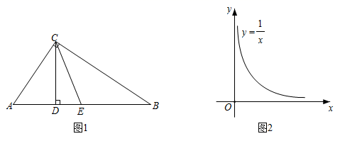

# Mathematics - 题目 2272

**ID**: 4a00781a54674109a8171df0a81a38b1
**年级**: Grade 9
**难度**: Medium-Hard
**题型**: Calculation

## 题目
通过构造恰当的图形，可以对线段长度、图形面积大小等进行比较，直观地得到一些不等关系或最值，这是“数形结合”思想的典型应用．（理解）（1）如图1， $AC\bot BC,CD\bot AB$ ，垂足分别为C、D，E是 $AB$ 的中点，连接 $CE$ ．已知 $AD=a$ ， $BD=b\left ({0<a<b}\right )$ ．①分别求线段 $CE$ 、 $CD$ 的长（用含a、b的代数式表示）；​​​​​​​‌②比较大小： $CE$$CD$ （填“＜”、“＝”或“＞”），并用含a、b的代数式表示该大小关系．（应用）（2）如图2，在平面直角坐标系 $xOy$ 中，点M、N在反比例函数 $y=\frac {1}{x}\left ({x>0}\right )$ 的图像上，横坐标分别为m、n．设 $p=m+n,q=\frac {1}{m}+\frac {1}{n}$ ，记 $l=\frac {1}{4}pq$ ．①当 $m=1,n=2$ 时， $l=$；当 $m=3,n=3$ 时， $l=$；②通过归纳猜想，可得l的最小值是．请利用图2构造恰当的图形，并说明你的猜想成立．

## 解答

1. 解：（1）①∵ $AC\bot BC,CD\bot AB$ ，
2. ∴∠ACD+∠A=∠ACD+∠BCD=90°，即：∠A=∠BCD，
3. 又∵∠ADC=∠CDB=90°，
4. ∴ $\mathrm{△}ADC\mathrm{∽}\mathrm{△}CDB$ ，
5. ∴ $\frac {AD}{CD}=\frac {CD}{BD}$ ，即： $\frac {a}{CD}=\frac {CD}{b}$ ，
6. ∴ $CD{^{2}}=ab$ ，即： $CD=\sqrt {ab}$ （负值舍去），
7. ∵E是 $AB$ 的中点，
8. ∴ $CE$ = $\frac {1}{2}AB$ = $\frac {1}{2}\left ({a+b}\right )$ ；
9. ②∵ $CD\bot AB$ ， $0<a<b$ ，
10. ∴ $CE$ ＞ $CD$ ，即： $\frac {1}{2}\left ({a+b}\right )$ ＞ $\sqrt {ab}$ ．
11. 故答案是：＞；
12. （2）①当 $m=1,n=2$ 时， $l=$  $\frac {1}{4}pq$ = $\frac {1}{4}\left ({m+n}\right )\left ({\frac {1}{m}+\frac {1}{n}}\right )$ = $\frac {1}{4}\times \left ({1+2}\right )\times \left ({\frac {1}{1}+\frac {1}{2}}\right )=\frac {9}{8}$ ，
13. 当 $m=3,n=3$ 时， $l=$  $\frac {1}{4}pq$ = $\frac {1}{4}\left ({m+n}\right )\left ({\frac {1}{m}+\frac {1}{n}}\right )$ = $\frac {1}{4}\times \left ({3+3}\right )\times \left ({\frac {1}{3}+\frac {1}{3}}\right )=1$ ，
14. 故答案是： $\frac {9}{8}$ ，1；
15. ②l的最小值是：1，理由如下：
16. 由题意得：M(m， $\frac {1}{m}$ )，N(n， $\frac {1}{n}$ )，过点M作x，y轴的平行线，过点N作x，y轴的平行线，如图所示，则A(n， $\frac {1}{m}$ )，B(m， $\frac {1}{n}$ )，
17. $l=$  $\frac {1}{4}pq$ = $\frac {1}{4}\left ({m+n}\right )\left ({\frac {1}{m}+\frac {1}{n}}\right )$ = $\frac {1}{4}\left ({m\times \frac {1}{m}+m\times \frac {1}{n}+n\times \frac {1}{n}+n\times \frac {1}{m}}\right )$
18. = $\frac {1}{4}$ [（①的面积+②的面积）+②的面积+（②的面积+④的面积）+（①的面积+②的面积+③的面积 +④的面积）]
19. = $\frac {1}{4}$  [（①的面积+②的面积）+（②的面积+④的面积）+（①的面积+②的面积）+（②的面积+④的面积）+③的面积]
20. = $\frac {1}{4}$ (1+1+1+1+③的面积)⩾1，
21. ∴l的最小值是1．
22. 

## 知识点

**中文**:
  - 反比例函数的图象
  - 反比例函数的性质
  - 反比例函数综合
  - 直角三角形的性质
  - 相似三角形的判定与性质综合

**English**:
  - Graph of Inverse Proportionality Functions
  - Properties of Inverse Proportionality Functions
  - Comprehensive Inverse Proportionality Problems
  - Properties of Right Triangles
  - Determination and Properties

---
