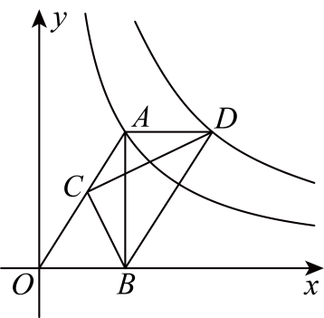

# Mathematics - 题目 3544

**ID**: 4a442b3a6bb741eca54c32f5e8c2db79
**年级**: Grade 9
**难度**: Medium-Hard
**题型**: Calculation

## 题目
如图，在平面直角坐标系 $xOy$ 中， $\vartriangle AOB$ 为直角三角形， $AB\bot OB$ ，点A在第一象限，点B在x轴上，C为斜边 $OA$ 上一点且 $OB=BC$ ，过点C作 $DC\bot BC$ （点D在直线 $AB$ 的右侧），已知 $AB=CD$ ，点D在反比例函数 $y=\frac {2}{x}$ 的图象上，反比例函数 $y=\frac {k}{x}$ 的图象过点A．(1)证明：四边形 $AOBD$ 是平行四边形；​​​​​​​‌(2)求k的值；(3)取 $BD$ 的中点E，证明：直线 $AE$ 与反比例函数 $y=\frac {k}{x}$ 的图象仅有一个交点A．

## 解答

1. （1）证明：∵ $AB\bot OB$ ， $DC\bot BC$ ，
2. ∴ $\angle OBA=\angle BCD=90{}\degree $ ，
3. ∵ $OB=BC$ ， $AB=CD$ ，
4. ∴ $\vartriangle OBA≌\vartriangle BCD\left ({SAS}\right )$ ，
5. ∴ $OA=BD$ ， $\angle AOB=\angle DBC$ ，
6. ∵ $OB=BC$ ，
7. ∴ $\angle AOB=\angle OCB$ ，
8. ∴ $\angle DBC=\angle OCB$ ，
9. ∴ $OA\mathrm{/\mskip-4mu/}BD$ ，
10. ∵ $OA=BD$ ，
11. ∴四边形 $AOBD$ 是平行四边形；
12. （2）解：∵四边形 $AOBD$ 是平行四边形；
13. ∴ $AD=OB,AD\parallel OB$ ，
14. 延长 $DA$ 交 $y$ 轴于一点 $E$ ，过点 $D$ 作 $DF\bot x$ 轴，如图所示：
15. 
16. ∵ $AD\mathrm{/\mskip-4mu/}OB$ ，
17. ∴ $\angle OED=180{}\degree -\angle FOE=90{}\degree $ ，
18. ∵ $DF\bot x$ 轴， $\angle FOE=90{}\degree $ ， $\angle OED=90{}\degree $ ，
19. ∴四边形 $OFDE$ 是矩形，
20. 同理，得证四边形 $OBAE$ 是矩形，
21. ∵点D在反比例函数 $y=\frac {2}{x}$ 的图象上，
22. ∴矩形 $OFDE$ 的面积是2，
23. ∴ $ED=OF$ ，
24. ∵ $AD=OB$ ，
25. ∴ $AE=BF$ ，
26. 即 $OB=BF$ ，
27. ∴矩形 $OBAE$ 的面积是1；
28. ∵反比例函数 $y=\frac {k}{x}$ 的图象过点A．
29. ∴ $k=1$ ；
30. （3）解：依题意，反比例函数 $y=\frac {1}{x}$ 的图象过点A．
31. 设 $A\left ({a,\frac {1}{a}}\right )$ ，
32. ∴ $B\left ({a,0}\right )$ ，
33. ∵四边形 $AOBD$ 是平行四边形；
34. ∴ $AD=OB,AD\parallel OB$ ，
35. ∴点D的纵坐标为 $\frac {1}{a}$ ，
36. ∵点D在反比例函数 $y=\frac {2}{x}$ 的图象上，
37. 把 $y=\frac {1}{a}$ 代入 $y=\frac {2}{x}$ ，得 $\frac {1}{a}=\frac {2}{x}$ ，
38. 解得 $x=2a$ ，
39. ∴ $D\left ({2a,\frac {1}{a}}\right )$ ，
40. ∵点E是 $BD$ 的中点，
41. ∴ $E\left ({\frac {3}{2}a,\frac {1}{2a}}\right )$ ，
42. 设直线 $AE$ 的解析式为 $y=kx+b\left ({k\ne 0}\right )$ ，
43. 把 $E\left ({\frac {3}{2}a,\frac {1}{2a}}\right )$ ， $A\left ({a,\frac {1}{a}}\right )$ 分别代入 $y=kx+b$ ，
44. 得 $\begin{cases}\frac {1}{2a}=\frac {3}{2}ak+b\\\frac {1}{a}=ak+b\end{cases}$
45. 解得 $\begin{cases}k=-\frac {1}{a{^{2}}}\\b=\frac {2}{a}\end{cases}$ ，
46. ∴直线 $AE$ 解析式为 $y=-\frac {1}{a{^{2}}}x+\frac {2}{a}$ ，
47. 依题意，得 $\begin{cases}y=\frac {1}{x}\\y=-\frac {1}{a{^{2}}}x+\frac {2}{a}\end{cases}$ ，
48. ∴ $\frac {1}{x}=-\frac {1}{a{^{2}}}x+\frac {2}{a}$ ，
49. 整理得 $\frac {1}{a{^{2}}}x{^{2}}-\frac {2}{a}x+1=0$
50. ∴ ${\rm{Δ}}=b{^{2}}-4ac={\left({-\frac {2}{a}}\right)^{2}}-4\times \frac {1}{a{^{2}}}\times 1=0$ ，
51. ∴直线 $AE$ 与反比例函数 $y=\frac {k}{x}$ 的图象仅有一个交点
52. ∵反比例函数 $y=\frac {1}{x}$ 的图象过点A．
53. ∴直线 $AE$ 与反比例函数 $y=\frac {k}{x}$ 的图象仅有一个交点A．

## 知识点

**中文**:
  - 反比例函数的性质
  - 反比例函数系数k的几何意义及应用
  - 待定系数法求一次函数解析式

**English**:
  - Properties of Inverse Proportionality Functions
  - Geometric Meaning and Application of Coefficient k
  - Finding Expressions by Undetermined Coefficients

---
