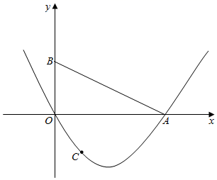

# Mathematics - 题目 1013

**ID**: 4a49f6aed8cb4d298b0a46da299ddb66
**年级**: Grade 9
**难度**: Medium-Hard
**题型**: Calculation

## 题目
如图，在平面直角坐标系xOy中，已知B（0，2），C（1，﹣ $\frac {3}{2}$ ），点A在x轴正半轴上，且OA＝2OB，抛物线y＝ax^{2}＋bx（a≠0）经过点A、C．（1）求这条抛物线的表达式；​​​​​​​‌（2）将抛物线先向右平移m个单位，再向上平移1个单位，此时点C恰好落在直线AB上的点C′处，求m的值；（3）设点B关于原抛物线对称轴的对称点为B′，联结AC，如果点F在直线AB′上，∠ACF＝∠BAO，求点F的坐标．

## 解答

1. 解：（1）∵B（0，2），
2. ∴OB＝2，
3. ∵点A在x轴正半轴上，且OA＝2OB，
4. ∴A（4，0），
5. ∴将A（4，0），C（1，﹣ $\frac {3}{2}$ ）代入y＝ax^{2}＋bx得：
6. $\begin{cases}0=16a+4b\\-\frac {3}{2}=a+b\end{cases}$ ，解得 $\begin{cases}a=\frac {1}{2}\\b=-2\end{cases}$ ，
7. ∴抛物线的表达式为y＝ $\frac {1}{2}$x^{2}﹣2x；
8. （2）设直线AB的解析式是y＝mx＋n，
9. 将A（4，0），B（0，2）代入得：
10. $\begin{cases}0=4m+n\\2=n\end{cases}$ ，解得 $\begin{cases}m=\frac {1}{2}\\n=2\end{cases}$ ，
11. ∴直线AB的解析式是y＝﹣ $\frac {1}{2}$x＋2，
12. ∵抛物线y＝ $\frac {1}{2}$x^{2}﹣2x向右平移m个单位，再向上平移1个单位，则其上的点C也向右平移m个单位，再向上平移1个单位，而C（1，﹣ $\frac {3}{2}$ ），
13. ∴C′（1＋m，﹣ $\frac {1}{2}$ ），
14. ∵C′（1＋m，﹣ $\frac {1}{2}$ ）在直线AB上，
15. ∴﹣ $\frac {1}{2}$ ＝﹣ $\frac {1}{2}$ （1＋m）＋2，
16. ∴m＝4；
17. （3）∵y＝ $\frac {1}{2}$x^{2}﹣2x对称轴为x＝2，B（0，2），点B关于原抛物线对称轴的对称点为B′，
18. ∴B′（4，2），
19. ∵A（4，0），
20. ∴直线AB′为x＝4，
21. 点F在直线AB′上，∠ACF＝∠BAO，分两种情况：
22. ①F在A上方，如图：
23. 
24. 过A作AG⊥CF于G，过G作GH//x轴交直线x＝4于H，过C作CM⊥x轴交直线GH于M，
25. ∵B（0，2），A（4，0），
26. ∴tan∠BAO＝ $\frac {1}{2}$ ，
27. ∵∠ACF＝∠BAO，AG⊥CF，
28. ∴tan∠ACF＝ $\frac {1}{2}$ ，即 $\frac {AG}{CG}=\frac {1}{2}$ ，
29. 而∠MCG＝90°﹣∠MGC＝∠AGH，∠M＝∠AHG，
30. ∴△MCG∽△HGA，
31. ∴ $\frac {AH}{MG}=\frac {GH}{MC}=\frac {AG}{CG}=\frac {1}{2}$ ，
32. ∴MC＝GH，MG＝2AH，
33. 设G（m，n），则MC＝n＋1.5，MG＝m﹣1，GH＝4﹣m．AH＝n，
34. ∴n＋1.5＝2（4﹣m），且m﹣1＝2n，
35. 解得m＝2.8，n＝0.9，
36. ∴G（2.8，0.9），
37. 又C$(1,-1.5)$ ，
38. ∴直线GC解析式为：y＝ $\frac {4}{3}$x﹣ $\frac {17}{6}$ ，
39. 令x＝4得y＝ $\frac {5}{2}$
40. ∴F（4， $\frac {5}{2}$ ），
41. ②F在A下方，
42. 
43. 延长AC交y轴于D，过C作CF//x轴交直线x＝4于F，
44. ∵A（4，0），C（1，﹣1.5），
45. ∴直线AC解析式为y＝ $\frac {1}{2}$x﹣2，
46. ∴D（0，﹣2），
47. ∵B（0，2），
48. ∴B，D关于x轴对称，
49. ∴∠BAO＝∠DAO，
50. 若∠ACF＝∠BAO，
51. 则∠ACF＝∠DAO，
52. ∴CF//x轴，
53. ∴F$(4,-1.5)$
54. 综上所述，∠ACF＝∠DAO，F坐标为或 $(4,\frac {5}{2})$ 或 $(4,-1.5)$ ．

## 知识点

**中文**:
  - 二次函数图象的平移
  - 二次函数的综合
  - 相似三角形的判定与性质综合

**English**:
  - Translation of Quadratic Graphs
  - Comprehensive Quadratic Function Problems
  - Determination and Properties

---
