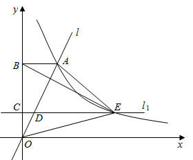

# Mathematics - 题目 3627

**ID**: 4a51d2a2c024416fb4a50776b1bdb7f1
**年级**: Grade 9
**难度**: Medium-Hard
**题型**: Calculation

## 题目
如图所示，在平面直角坐标系 $Oxy$ 中，一次函数 $y=2x$ 的图像 $l$ 与函数 $y=\frac {k}{x}\left ({k>0,x>0}\right )$ 的图像（记为 $Γ$ ）交于点A，过点A作 $AB\bot y$ 轴于点 $B$ ，且 $AB=1$ ，点 $C$ 在线段 $OB$ 上（不含端点），且 $OC=t$ ，过点 $C$ 作直线 $l{{}_{1}}//x$ 轴，交 $l$ 于点 $D$ ，交图像 $Γ$ 于点 $E$ ．（1）求 $k$ 的值，并且用含 $t$ 的式子表示点 $D$ 的横坐标；​​​​​​​‌（2）连接 $OE$ 、 $BE$ 、 $AE$ ，记 $\mathrm{△}OBE$ 、 $\vartriangle ADE$ 的面积分别为 $S{{}_{1}}$ 、 $S{{}_{2}}$ ，设 $U=S{{}_{1}}-S{{}_{2}}$ ，求 $U$ 的最大值．

## 解答

1. 解：（1）∵ $AB=1$ ，
2. ∴A点横坐标为1,
3. ∵A点在一次函数 $y=2x$ 的图像上，
4. ∴ $2\times 1{\rm{=}}2$ ，
5. ∴ $A\left ({1,2}\right )$ ,
6. ∵A点也在反比例函数图像上，
7. ∴ $k{\rm{=}}2\times 1{\rm{=}}2$ ，
8. ∴反比例函数解析式为： $y=\frac {2}{x}$ ，
9. ∵ $OC=t$ ，直线 $l{{}_{1}}//x$ 轴，
10. ∴D点纵坐标为t，
11. ∵D点在直线l上，
12. ∴D点横坐标为 $\frac {t}{2}$ ，
13. 综上可得： $k{\rm{=}}2$ ，D点横坐标为 $\frac {t}{2}$ ．
14. （2）直线 $l{{}_{1}}//x$ 轴，交 $l$ 于点 $D$ ，交图像 $Γ$ 于点 $E$ ，
15. ∴E点纵坐标为t，
16. 将纵坐标t代入反比例函数解析式中得到E点坐标为 $\left ({\frac {2}{t},t}\right )$ ，
17. ∴ $DE=\frac {2}{t}-\frac {t}{2}$ ，A点到DE的距离为 $2-t$ ，
18. ∴ $S{{}_{2}}=\frac {1}{2}\times \left ({\frac {2}{t}-\frac {t}{2}}\right )\left ({2-t}\right )=\frac {t{^{2}}}{4}+\frac {2}{t}-\frac {t}{2}-1$ ，
19. ∵ $AB\bot y$ 轴于点 $B$ ，
20. ∴ $OB=2$ ，
21. ∴ $S{{}_{1}}=\frac {1}{2}OB\times EC=\frac {1}{2}\times 2\times \frac {2}{t}=\frac {2}{t}$ ，
22. ∴ $U=S{{}_{1}}-S{{}_{2}}=\frac {2}{t}-\left ({\frac {t{^{2}}}{4}+\frac {2}{t}-\frac {t}{2}-1}\right )=-\frac {t{^{2}}}{4}+\frac {t}{2}+1=-{\left({\frac {1}{2}t-\frac {1}{2}}\right)^{2}}+\frac {5}{4}$ ，
23. ∴当 $t=1$ 时， $U$_{最大}= $\frac {5}{4}$ ；
24. ∴ $U$ 的最大值为 $\frac {5}{4}$ ．

## 知识点

**中文**:
  - 一次函数的实际应用
  - 反比例函数综合

**English**:
  - Applications of Linear Functions
  - Comprehensive Inverse Proportionality Problems

---
