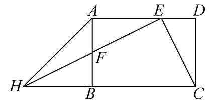

# Mathematics - 题目 3691

**ID**: 4bd9622a1b0a4bef8cb99e6520614a0a
**年级**: Grade 9
**难度**: Medium-Hard
**题型**: Calculation

## 题目
如图点E，F分别是矩形ABCD的边AD，AB上一点，若AE=DC=2ED，且EF⊥EC（1）求证：点F为AB的中点．（2）延长EF与CB的延长线相交于点H，连接AH，已知ED=2，求AH的值．​​​​​​​‌

## 解答

1. （1）证明：∵EF⊥EC，
2. ∴∠CEF=90°，
3. ∴∠AEF+∠DEC=90°，
4. ∵四边形ABCD是矩形，
5. ∴∠AEF+∠AFE=90°，
6. ∴∠DEC+∠DCE=90°，
7. ∴∠AEF=∠DCE，∠AFE=∠DEC，
8. ∵AE=DC，
9. ∴△AEF≌△DCE（AAS），
10. ∴DE=AF，
11. ∵AE=DC=AB=2DE，
12. ∴AB=2AF，
13. ∴F为AB的中点；
14. （2）由（1）知AF=FB，且AE∥BH，
15. ∴∠FBH=∠FAE=90°，∠AEF=∠FHB，
16. ∴△AEF≌△BHF（AAS），
17. ∴HB=AE，
18. ∵DE=2，且AE=2DE，
19. ∴AE=4，
20. ∴HB=AB=AE=4，
21. ∴ $AH{^{2}}=AB{^{2}}+BH{^{2}}=16+16=32$ ，
22. ∴ $AH=4\sqrt {2}$ ，
23. 故答案为： $4\sqrt {2}$ ．

## 知识点

**中文**:
  - 全等三角形实际应用
  - 矩形的判定与性质综合

**English**:
  - Applications of Congruent Triangles
  - Determination and Properties of Rectangles

---
