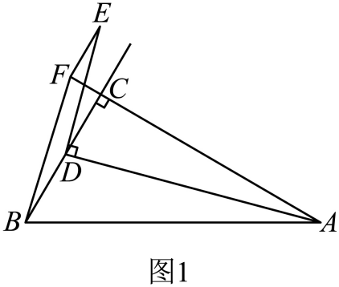
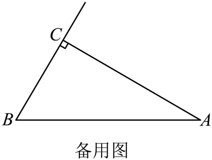

# Mathematics - 题目 2794

**ID**: 4bf79468361a423f848e9bd26056cde6
**年级**: Grade 9
**难度**: Medium-Hard
**题型**: Calculation

## 题目
如图， $\vartriangle ABC$ 中， $\angle ACB=90{}^\circ $ ， $BC=2$ ， $AC=4$ ，点D为射线 $BC$ 上的动点，连接 $AD$ 并作如下变换，将 $AD$ 绕点D逆时针旋转 $90{}^\circ $ 到 $DE$ ，且始终保持 $\frac {DE}{AD}=\frac {1}{2}$ ，过B作 $BF{\rm{/\mskip-4mu/}}DE$ 交直线 $AC$ 于点F，连接 $EF$ ．(1)如图1，求证 $△ADC{\rm{∽}}△BFC$ ；​​​​​​​‌(2)当点D在射线 $BC$ 上从点B向上运动时，四边形 $BDEF$ 的面积如何变化，请说明理由；(3)设四边形 $BDEF$ 面积为 $S(S\ne 0)$ ，若仅存在两个不同的点D，使得S相等，设这两个不同的点D之间的距离为d，求d的值．

## 解答

1. （1）证明： $\because $  $AD$ 绕点D逆时针旋转 $90{}^\circ $ 到 $DE$ ，
2. $\therefore \angle ADE=90{}^\circ =\angle ADC+\angle CDE$ ，
3. $\because $  $BF{\rm{/\mskip-4mu/}}DE$ ，
4. $\therefore \angle CBF=\angle CDE$ ，
5. $\because \angle ACB=90{}^\circ $ ，
6. $\therefore \angle BCF=90{}^\circ $ ，
7. $\therefore \angle ACB=\angle BCF$ ，
8. $\therefore $  $\angle CBF+\angle BFC=90{}^\circ $ ，
9. $\therefore \angle ADC=\angle BFC$ ，
10. $\therefore $  $△ADC{\rm{∽}}△BFC$ ；
11. （2）解：由（1）知 $△ADC{\rm{∽}}△BFC$ ，
12. $\therefore \frac {BF}{AD}=\frac {BC}{AC}$ ，
13. $\because $  $BC=2$ ， $AC=4$ ，
14. $\therefore \frac {BF}{AD}=\frac {1}{2}$ ，
15. $\because $  $\frac {DE}{AD}=\frac {1}{2}$ ，
16. $\therefore BF=DE$ ，
17. $\because $  $BF{\rm{/\mskip-4mu/}}DE$ ，
18. $\therefore $ 四边形 $BDEF$ 是平行四边形，
19. 如图，当点D在 $BC$ 上时，过点D作 $BF$ 的垂线，垂足为 $H$ ，
20. $S{{}_{▱BDEF}}=DE\cdot DH=\frac {1}{2}AD\cdot BD\cdot DH=\frac {1}{2}AD\cdot BD\cdot {\sin}\angle HBD$ ，
21. $\because \angle HBD=\angle CAD$ ，
22. $\therefore $  $S{{}_{▱BDEF}}=\frac {1}{2}AD\cdot {\sin}\angle CAD=\frac {1}{2}AD\cdot BD\cdot \frac {CD}{AD}=\frac {1}{2}BD\cdot CD$ ，
23. 设 $BD=a$ ，则 $CD=BC-BD=2-a$
24. $\therefore $  $S{{}_{▱BDEF}}=\frac {1}{2}a\left ({2-a}\right )=a-\frac {1}{2}a{^{2}}=-\frac {1}{2}{\left({a-1}\right)^{2}}+\frac {1}{2}\left ({0<a\leqslant 2}\right )$ ，
25. 当 $a=1$ 时， $S{{}_{▱BDEF}}$ 有最大值 $\frac {1}{2}$ ；
26. 当 $0<a<1$ 时， $S{{}_{▱BDEF}}$ 随 $a$ 的增大而增大，
27. 当 $a=1$ 时， $S{{}_{▱BDEF}}$ 有最大值 $\frac {1}{2}$ ，
28. 当 $1<a\leqslant 2$ 时， $S{{}_{▱BDEF}}$ 随 $a$ 的增大而减小， $a=2$ 时，即点D与点C重合， $S{{}_{▱BDEF}}=0$ ；
29. 如图，当点D在 $BC$ 延长线上时，过点D作 $BF$ 的垂线，垂足为 $H$ ，
30. $S{{}_{▱BDEF}}=DE\cdot DH=\frac {1}{2}AD\cdot BD\cdot DH=\frac {1}{2}AD\cdot BD\cdot {\sin}\angle HED$ ，
31. $\because $ 四边形 $BDEF$ 是平行四边形， $\angle HBD=\angle CAD$ ，
32. $\therefore \angle HBD=\angle HED$ ，
33. $\therefore \angle HED=\angle CAD$ ，
34. $\therefore $  $S{{}_{▱BDEF}}=\frac {1}{2}AD\cdot BD\cdot {\sin}\angle HBD$ ，
35. $\therefore $  $S{{}_{▱BDEF}}=\frac {1}{2}BD\cdot CD=\frac {1}{2}a\left ({a-2}\right )=\frac {1}{2}a{^{2}}-a=\frac {1}{2}{\left({a-1}\right)^{2}}-\frac {1}{2}\left ({a>2}\right )$ ，
36. 此时， $S{{}_{▱BDEF}}$ 随 $a$ 的增大而增大；
37. 综上，点D在射线 $BC$ 上从点B向上运动时，四边形 $BDEF$ 的面积先增大到 $\frac {1}{2}$ ，再减小到0，再增大；
38. （3）解：设 $BD=a$ ，由（2）知：
39. 点D在 $BC$ 上时， $S=a-\frac {1}{2}a{^{2}}\left ({0<a\leqslant 2}\right )$ ，
40. 点D在 $BC$ 延长线上， $S=\frac {1}{2}a{^{2}}-a\left ({a>2}\right )$ ，
41. $\because $  $S(S\ne 0)$ ，若仅存在两个不同的点D，使得S相等，
42. $\therefore $ 当 $a=1$ 时， $S=\frac {1}{2}$ ，
43. $\therefore $ 当 $a>2$ ，另 $S=\frac {1}{2}$ 时，
44. 即 $\frac {1}{2}a{^{2}}-a=\frac {1}{2}$ ，
45. 解得： $a=1+\sqrt {2}$ （负值舍去），
46. $\therefore d=1+\sqrt {2}-1=\sqrt {2}$ ．

## 知识点

**中文**:
  - 二次函数的最值
  - 几何变换——旋转综合题
  - 相似三角形的判定与性质综合

**English**:
  - Maximum/Minimum of Quadratic Functions
  - Rotation Comprehensive Problems
  - Determination and Properties

---
