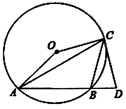

# Mathematics - 题目 3808

**ID**: 4c09936cfecb4c1783f1ec736ea0261c
**年级**: Grade 9
**难度**: Medium-Hard
**题型**: Calculation

## 题目
如图： $\vartriangle ABC$ 是 $\odot O$ 的内接三角形， $\angle ACB=45{}^\circ $ ， $\angle AOC=150{}^\circ $ ，过点 $C$ 作 $\odot O$ 的切线交 $AB$ 的延长线于点 $D$ ．（1）求证： $CD=CB$ ；​​​​​​​‌（2）如果 $\odot O$ 的半径为2，求 $AC$ 的长．

## 解答

1. （1）证明：连接OB，则∠AOB＝2∠ACB＝2×45°＝90°，
2. ∵OA＝OB，
3. ∴∠OAB＝OBA＝45°，
4. ∵∠AOC＝150°，OA＝OC，
5. ∴∠OCA＝∠OAC＝15°，
6. ∴∠OCB＝∠OCA+∠ACB＝60°，
7. ∴△OBC是等边三角形，
8. ∴∠BOC＝∠OBC＝60°，
9. ∴∠CBD＝180°﹣∠OBA﹣∠OBC＝75°，
10. ∵CD是⊙O的切线，
11. ∴OC⊥CD，
12. ∴∠D＝360°﹣∠OBD﹣∠BOC﹣∠OCD＝360°﹣（60°+75°）﹣60°﹣90°＝75°，
13. ∴∠CBD＝∠D，
14. ∴CB＝CD；
15. （2）在Rt△AOB中， $AB=\sqrt {2}OA=2\sqrt {2}$ ，
16. ∵CD是⊙O的切线，
17. ∴∠DCB＝∠CAD，
18. ∵∠D是公共角，
19. ∴△DBC∽△DCA，
20. ∴ $\frac {CD}{AD}=\frac {BD}{CD}$
21. ∴CD^{2}＝AD•BD＝BD•（BD+AB），
22. ∵CD＝BC＝OC＝2，
23. ∴ $4=BD\cdot (2\sqrt {2}+BD)$ ，
24. 解得： $BD=\sqrt {6}-\sqrt {2}$ ，
25. ∴ $AC=AD=AB+BD=\sqrt {2}+\sqrt {6}$ ．
26. 

## 知识点

**中文**:
  - 三角形的外接圆
  - 切线的性质定理
  - 相似三角形的判定与性质综合

**English**:
  - Circumcircle of Triangle
  - Tangent Properties Theorem
  - Determination and Properties

---
