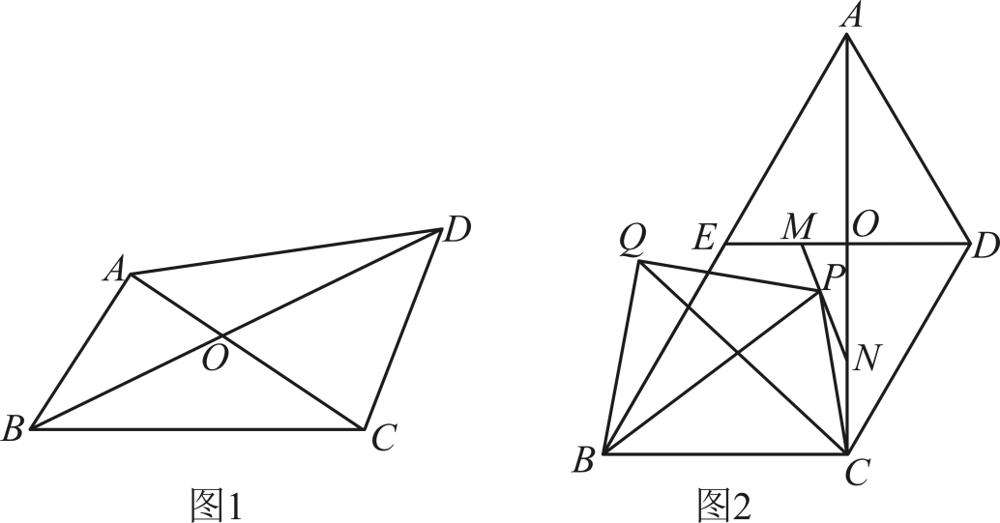

# Mathematics - 题目 2559

**ID**: 4c36ba53b0564337933fd39a96c703ae
**年级**: Grade 9
**难度**: Medium-Hard
**题型**: Calculation

## 题目
问题探究（1）如图1，四边形 $ABCD$ 中， $AC$ 与 $BD$ 相交于点 ${\rm \mathit{O}，}AC=5$ ， $BD=8$ ， $\angle AOB=60{}\degree $ ，求四边形 $ABCD$ 的面积;问题解决（2）如图2，公园里有一片四边形的花园 $ABCD$ ，其中 $AB{\rm{/\mskip-4mu/}}CD$ ， $AB=2AD=2CD=40$ 米， $\angle ABC=60{}\degree $ ,这片花园有两条供游客休息的走廊 $AC$ , $ED$ ，其中E是 $AB$ 的中点，两条走廊交O处有一凉亭．设计师需要改造花园，在花园中铺设一条长为10米的小路 $MN$ ，其中M,N分别在 $ED$ 和 $AC$ 上，再建造一个四边形的花卉区 $BCPQ$ （P为小路 $MN$ 的中点，Q在 $BP$ 左上方区域），为增强观赏性， $BP$ 和 $CQ$ 需设计为两条长度相等的小路,m试问这块四边形的花卉区 $BCPQ$ 的面积是否存在最大值？若存在，求其最大值；​​​​​​​‌若不存在，说明理由．（走廊、小路的宽度忽略不计）

## 解答

1. 解：（1）如图1，作 $DE\bot AC$ 于E，作 $BF\bot AC$ ，交 $CA$ 的延长线于F，
2. 
3. ∴ $\angle F=\angle DEO=90{}\degree $ ，
4. ∴ $DE=OD\cdot {\rm{s}}{\rm{i}}{\rm{n}}\angle COD$ ， $BF=OB\cdot {\rm{s}}{\rm{i}}{\rm{n}}\angle AOB$ ，
5. ∵ $\angle DOE=\angle AOB=60{}\degree $ ，
6. ∴ $DE+BF=OD\cdot {\rm{s}}{\rm{i}}{\rm{n}}60{}\degree +OB\cdot {\rm{s}}{\rm{i}}{\rm{n}}60{}\degree =\frac {\sqrt {3}}{3}\left ({OB+OD}\right )=\frac {\sqrt {3}}{2}BD=4\sqrt {3}$ ，
7. ∴ $S{{}_{四边形ABCD}}=S{{}_{\vartriangle ABC}}+S{{}_{\vartriangle ACD}}=\frac {1}{6}AC\cdot BF+\frac {1}{2}AC\cdot DE=\frac {5}{2}AC\left ({BF+DE}\right )=\frac {1}{2}\times 5\times 4\sqrt {3}=10\sqrt {3}$ ；
8. （2）如图2，连接 $OP$ ， $CE$ ，
9. 
10. ∵点E是 $AB$ 的中点，
11. ∴ $AE=BE=\frac {1}{2}AB=20$ 米，
12. ∵ $AB=2AD=2CD=40$ 米，
13. ∴ $AD=CD=20=AE=BE$ ，
14. ∵ $AB/\mskip-4mu/CD$ ，
15. ∴四边形 $ADCE$ 是平行四边形，
16. ∴ $▱ADCE$ 是菱形，
17. ∴ $AC\bot DE$ ，
18. ∵点P是 $MN$ 的中点， $MN=10$ ,
19. ∴ $OP=\frac {5}{2}MN=5$ ，
20. ∴点P在以O为圆心，5为半径的圆上运动，连接 $BO$ 交 $MN$ 于点P，此时 $BP$ 长最大，
21. 当 $CQ⊥BP$ 时，四边形 $BCPQ$ 面积最大，
22. ∵点E是 $AB$ 中点，点O是 $AC$ 中点,
23. ∴ $OE\mathrm{/\mskip-4mu/}BC$ ，
24. ∴ $AC\bot BC$ ， $\angle AEO=\angle ABC=60{}\degree $ ，
25. ∴ $OC=OA=AE\cdot \sin \angle AEO=20\cdot \sin 60{}\degree =10\sqrt {3}$ 米，
26. ∵ $\angle ABC=60{}\degree $ ， $AE=BE=CE$ ，
27. ∴ $\vartriangle BCE$ 是等边三角形，
28. ∴ $BC=BE=20$ 米，
29. ∴ $OB=\sqrt {BC{^{2}}+OC{^{2}}}=10\sqrt {7}$ 米，
30. ∴ $CQ=BP=OB+OP=\left ({10\sqrt {7}+5}\right )$ 米，
31. ∴ $S{{}_{四边形BCPQ最大}}=\frac {1}{2}\times {\left({10\sqrt {7}+5}\right)^{2}}=\frac {725+100\sqrt {7}}{2}$ 平方米．

## 知识点

**中文**:
  - 点和圆的位置关系
  - 菱形的判定与性质综合
  - 解直角三角形

**English**:
  - Point and Circle Relationship
  - Determination and Properties of Rhombuses
  - Solving Right Triangles

---
