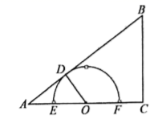
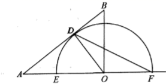

# Mathematics - 题目 1794

**ID**: 4cdb4249060d48b5aafe169b6a712810
**年级**: Grade 9
**难度**: Medium-Hard
**题型**: Calculation

## 题目
如图，在Rt△ABC中，∠ACB=90°，AB=10，BC=6，点O在射线 $AC$ 上（点 $O$ 不与点 $A$ 重合），过点 $O$ 作 $OD\bot AB$ ，垂足为 $D$ ，以点 $O$ 为圆心， $OD$ 为半径画半圆 $O$ ，分别交射线 $AC$ 于 $E$ 、 $F$ 两点，设 $OD=x$ ．（1）如图，当点 $O$ 为 $AC$ 边的中点时，求 $x$ 的值；​​​​​​​‌（2）如图，当点 $O$ 与点 $C$ 重合时，连接 $DF$ ，求弦 $DF$ 的长；（3）当半圆 $O$ 与 $BC$ 无交点时，直接写出 $x$ 的取值范围．

## 解答

1. （1）在Rt△ABC中，∵AB=10，BC=6，
2. ∴ $AC=\sqrt {AB{^{2}}-BC{^{2}}}=\sqrt {10{^{2}}-6{^{2}}}=8$ ，
3. ∵点O为AC边的中点，
4. ∴ $AO=\frac {1}{2}AC=\frac {1}{2}\times 8=4$ ．
5. ∵OD⊥AB，∠ACB=90°，
6. ∴∠ADO=∠ACB，
7. 又∵∠A=∠A，
8. ∴△AOD∽△ABC．
9. ∴ $\frac {OD}{BC}=\frac {AO}{AB}$ ，即 $\frac {x}{6}=\frac {4}{10}$ ，∴ $x=\frac {12}{5}$ ．
10. （2） ∵点O与点C重合，OD⊥AB,
11. ∴ $\frac {1}{2}$OD·AB= $\frac {1}{2}$AC·BC，即10x=8×6，
12. ∴ $x=\frac {24}{5}$ ． 即OD= $\frac {24}{5}$
13. 过点D作DH⊥AC，垂足为H，则有∠DHO=∠ACB=90°．
14. 
15. ∵∠DOH+∠BOD=90°，∠ABO+∠BOD=90°，
16. ∴∠DOH=∠ABO，
17. ∴△DOH∽△ABO，
18. ∴ $\frac {DH}{AO}=\frac {OH}{BO}=\frac {DO}{AB}$ ，即 $\frac {DH}{8}=\frac {OH}{6}=\frac {\frac {24}{5}}{10}$ ，
19. ∴ $DH=\frac {96}{25}$ ， $OH=\frac {72}{25}$ ．
20. ∵OF=OD= $\frac {24}{5}$ ，
21. ∴FH=OH+OF= $\frac {192}{25}$ ．
22. ∴在Rt△DFH中，根据勾股定理，得：
23. ∴ $DF=\sqrt {DH{^{2}}+FH{^{2}}}=\sqrt {(\frac {96}{25}){^{2}}+(\frac {192}{25}){^{2}}}=\frac {96}{25}\sqrt {5}$ ．
24. （3）①当点O在点C左侧，且与BC相切时，如图，
25. 
26. 设OD=x，则OC=x，
27. ∴AO=8-x，
28. ∵∠ADO=∠ACB，∠A=∠A，
29. ∴△AOD∽△ABC，
30. ∴ $\frac {AO}{AB}=\frac {OD}{BC}$ ，
31. ∵AB=10，BC=6，AO=8-x，
32. ∴ $\frac {8-x}{10}=\frac {x}{6}$ ，解得，x=3,
33. ∴当半圆O在BC的左侧，且与BC无交点时，x的取值范围为：0＜x＜3；
34. ②当点O在点C右侧，且与BC相切时，如图，
35. 
36. 方法同①，得x=12，
37. ∴当半圆O在BC的右侧，且与BC无交点时，x的取值范围为：x＞12；
38. 综上，当半圆 $O$ 与 $BC$ 无交点时，x的取值范围是0＜x＜3或x＞12．

## 知识点

**中文**:
  - 直线和圆的位置关系
  - 相似三角形的判定与性质综合

**English**:
  - Line and Circle Relationship
  - Determination and Properties

---
