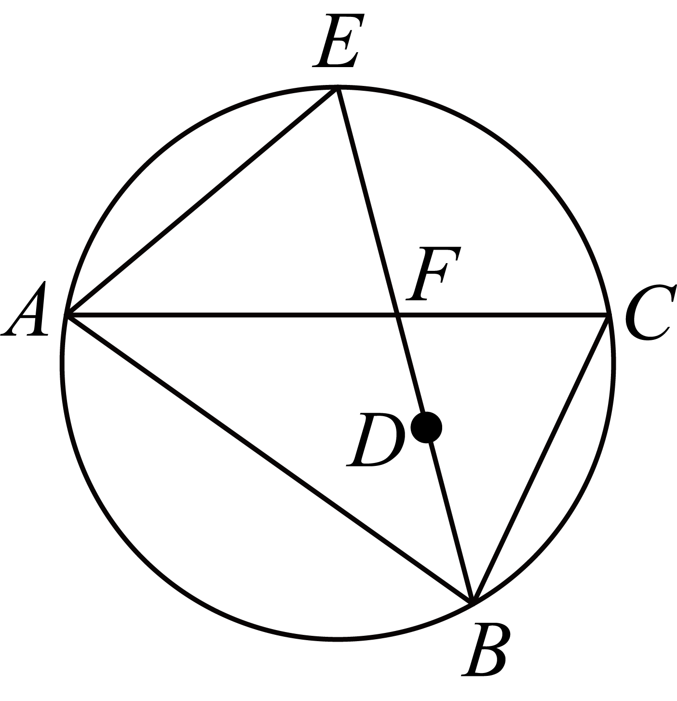

# Mathematics - 题目 861

**ID**: 4cfac7fac0d64128ae79f772f4bc3046
**年级**: Grade 9
**难度**: Medium-Hard
**题型**: Calculation

## 题目
如图，点D是 $\vartriangle ABC$ 的内心，连接 $BD$ 并延长交 $\vartriangle ABC$ 的外接圆于点 ${\rm \mathit{E}，}BE$ 与 $AC$ 交于点F，连接 $AE$ ．（1）设 $\angle ABC=α$ ，则 $\angle EAC=$ _；​​​​​​​‌（用含 $α$ 的式子表示）（2）求证： $AE=DE$ ；（3）若 $DE=2,BD=1$ ，求 $EF$ 的长．

## 解答

1. （1）解：∵点D是 $\vartriangle ABC$ 的内心，
2. ∴ $\angle ABE=\angle CBE$ ，
3. ∵ $\angle ABC=α$
4. ∴ $\angle ABE=\angle CBE=\frac {1}{2}α$ ，
5. ∵ $\angle EAC=\angle CBE$ ，
6. ∴ $\angle EAC=\frac {1}{2}α$ ，
7. 故答案为： $\frac {1}{2}α$ ．
8. （2）证明：连接 $AD$ ，
9. ∵点D是 $\vartriangle ABC$ 的内心，
10. ∴ $\angle BAD=\angle CAD$ ， $\angle ABE=\angle CBE$ ，
11. 
12. ∵ $\angle EAD=\angle EAC+\angle CAD$ ， $\angle ADE=\angle ABE+\angle BAD$ ，
13. $\angle EAC=\angle CBE$ ，
14. ∴ $\angle EAD=\angle ADE$ ，
15. ∴ $AE=DE$ ．
16. （3）解：设 $EF=x$ ，根据题意 $AE=DE=2,BE=DE+BD=3$ ，
17. ∵ $\angle EAF=\angle CBF=\angle EBA,\angle AEF=\angle BEA$ ，
18. ∴ $\mathrm{△}EAF∽\mathrm{△}EBA$ ，
19. ∴ $\frac {EA}{EB}=\frac {EF}{EA}$ ，
20. ∵ $AE=2$ ， $BE=3$ ，
21. ∴ $\frac {2}{3}=\frac {EF}{2}$ ，
22. 解得 $EF=\frac {4}{3}$ ．
23. 故 $EF$ 的长为 $\frac {4}{3}$ ．

## 知识点

**中文**:
  - 三角形内切圆
  - 等腰三角形的判定
  - 相似三角形的判定与性质综合

**English**:
  - Incircle of Triangle
  - Determination of Isosceles Triangles
  - Determination and Properties

---
