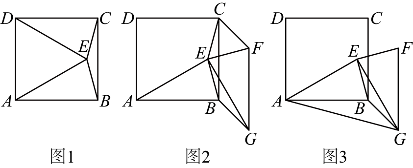

# Mathematics - 题目 3014

**ID**: 4d648b53358f4ae599d44311b79cac51
**年级**: Grade 9
**难度**: Medium-Hard
**题型**: Calculation

## 题目
在正方形 $ABCD$ 中， $E$ 为正方形内部的一点， $AE=AB$ ，连接 $BE$ ．(1)如图1，若 $\angle EAB=30{}\degree $ ，连接 $CE，DE$ ，求证： $BE=CE$ ．(2)将 $\vartriangle ABE$ 绕点 $E$ 逆时针旋转至 $\vartriangle GFE$ ，连接 $BG$ ，如图2，连接 $CE，CF$ ，若 $\angle EAB=30{}\degree ，\angle CEF=60{}\degree $ ，试判断四边形 $CBGF$ 的形状，并说明理由；​​​​​​​‌(3)如图3，若点 $B$ 在 $\mathrm{△}AEG$ 内部且 $\angle GEB=\angle GAB$ ，求 $\angle BGA$ 的度数．

## 解答

1. （1）证明：∵四边形 $ABCD$ 是正方形，
2. ∴ $AB=BC=CD=AD，\angle BAD=90{}\degree $ ，∵ $\angle EAB=30{}\degree $ ，∴ $\angle EAD=60{}\degree $ ，
3. ∴ $\vartriangle ADE$ 是等边三角形，∴ $AE=AD=DE，\angle ADE=60{}\degree $ ，∴ $DE=CD，\angle CDE=30{}\degree $ ，
4. 又∵ $AE=CD$ ，∴ $△ABE≌△DCE$ ，∴ $BE=CE$ ；
5. （2）解：四边形 $CBGF$ 是平行四边形，理由如下：
6. 由旋转可知， $AB=GF，AE=EG，BE=EF，\angle EAB=\angle EGF=30{}\degree $ ，又∵ $BE=CE$ ，
7. ∴ $CE=EF$ ，又∵ $\angle CEF=60{}\degree $ ，∴ $△CEF$ 是等边三角形，又∵ $AB=BC，AB=GF$ ，
8. ∴ $BC=GF=GE$ ，在 $\vartriangle ABE$ 中， $AB=AE，\angle EAB=30{}\degree $ ，∴ $\angle ABE=\angle AEB=75{}\degree $ ，
9. ∴ $\angle GEF=75{}\degree ，\angle CBE=15{}\degree $ ，∵ $BE=CE$ ，∴ $\angle CBE=\angle BCE=15{}\degree $ ，
10. ∴ $\angle CEB=150{}\degree $ ，∴ $\angle GEB=\angle BEC-\angle CEF-\angle GEF=150{}\degree -60{}\degree -75{}\degree =15{}\degree $ ，
11. 在 $\vartriangle BCE$ 与 $\vartriangle EGB$ 中， $\begin{cases}BE=EB\\\angle CBE=\angle GEB\\BC=EG\end{cases}$ ，∴ $\vartriangle BCE≌\vartriangle EGB\left ({{\rm{S}}{\rm{A}}{\rm{S}}}\right )$ ，∴ $CE=BG$ ，
12. ∴ $CF=BG$ ，在四边形 $CBGF$ 中， $CF=BG，BC=GF$ ，∴四边形 $CBGF$ 为平行四边形；
13. （3）解：在 $\vartriangle ABE$ 与 $\mathrm{△}AEG$ 中， $\angle EAB+\angle AEB+\angle ABE=180{}\degree ，\angle EAB+\angle AEB+\angle GEB+\angle GAB+\angle AGE=180{}\degree ，$
14. 又∵ $\angle GEB=\angle GAB$ ，∴ $2\angle GAB+\angle AGE=\angle ABE=75{}\degree $ ，
15. ∵ $AE=EG$ ，∴ $\angle EAG=\angle AGE$ ，即 $\angle GAB+30{}\degree =\angle AGE$ ，
16. ∴ $3\angle GAB+30{}\degree =75{}\degree $ ，
17. ∴ $\angle GAB=\angle GEB=15{}\degree $ ，
18. ∵ $△BCE≌△EGB，△EGB$ 为等腰三角形，
19. ∴ $\angle BGE=15{}\degree $ ，
20. ∴ $\angle BGA=\angle AGE-\angle BGE=30{}\degree $ ．

## 知识点

**中文**:
  - 两组对边分别相等的四边形是平行四边形
  - 正方形的性质
  - 几何变换——旋转综合题
  - 全等三角形的判定与性质

**English**:
  - Two Pairs of Equal Opposite Sides
  - Properties of Squares
  - Rotation Comprehensive Problems
  - Determination and Properties

---
