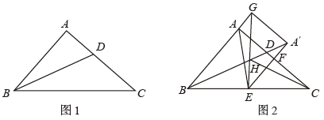

# Mathematics - 题目 3382

**ID**: 4fc36f3b39f84602af0ba8abaf03ff09
**年级**: Grade 9
**难度**: Medium-Hard
**题型**: Calculation

## 题目
如图1，在△ABC中，BD为∠ABC的平分线，点D在AC上．（1）求证： $\frac {AD}{CD}=\frac {AB}{BC}$ ；​​​​​​​‌（2）如图2，已知AE为BC边的中线，且AE=BE．在射线BD上取一点A'使AE=A'E，A'E交AC于点F，过点A'作AB的垂线，交BA的延长线于点G，连接EG交BD于点H，连接CH．①求证：四边形AGA′F为矩形；②若 ${\tan}\angle ACB=\frac {3}{4}$ ，△BGH的面积为S，请求出△CEH的面积（用含S的代数式表示）．

## 解答

1. （1）证明：过点D作DM∥AB交BC于点M．
2. 
3. ∴△ABC∽△DMC，∠1=∠2，
4. ∴ $\frac {AD}{CD}=\frac {BM}{CM}$ ，
5. ∵BD为∠ABC的平分线，
6. ∴∠1=∠3，
7. ∴∠2=∠3，
8. ∴DM=BM，
9. $\therefore \frac {AD}{CD}=\frac {BM}{CM}=\frac {DM}{CM}=\frac {AB}{BC}$  ，即 $\frac {AD}{CD}=\frac {AB}{BC}$ ；
10. （2）解：①证明：由题意知，AE=BE=CE，
11. ∴∠BAC=90°即AC⊥AB，
12. ∵ $A^{′}G$ ⊥AB，
13. ∴A′G∥AC，
14. ∵AE=A'E，
15. ∴BE=A'E，
16. ∴∠3=∠4，
17. 又∠1=∠3，
18. ∴∠1=∠4，
19. ∴A′E∥AB，
20. ∴四边形AGA′F为平行四边形，
21. ∵A′G⊥AB，
22. ∴四边形AGA′F为矩形；
23. ②解：由题意，在Rt△ABC中，由 ${\tan}\angle ACB=\frac {3}{4}$ ，
24. 可设AB=3t，AC=4t，则BC=5t，
25. 
26. $\therefore EF=\frac {3}{2}t，A^{′}E=\frac {5}{2}t$ ，
27. $\therefore AG=A^{′}F=\frac {5}{2}t-\frac {3}{2}t=t$ ，
28. 在△BEG中由（1）可得：  $\frac {EH}{GH}=\frac {BE}{BG}=\frac {\frac {5}{2}t}{3t+t}=\frac {5}{8}$ ，
29. ∵AE为BC边的中线，
30. $\therefore S{{}_{\vartriangle CEH}}=S{{}_{\vartriangle BEH}}$ ，
31. $\therefore \frac {S{{}_{\vartriangle CEH}}}{S{{}_{\vartriangle BGH}}}=\frac {S{{}_{\vartriangle BEH}}}{S{{}_{\vartriangle BGH}}}=\frac {EH}{GH}=\frac {5}{8}$ ，
32. $\therefore S{{}_{\vartriangle CEH}}=\frac {5}{8}S{{}_{\vartriangle BGH}}=\frac {5}{8}S$ ．

## 知识点

**中文**:
  - 直角三角形斜边上的中线
  - 等腰三角形的判定与性质
  - 矩形的判定
  - 相似三角形的判定与性质综合

**English**:
  - Median to Hypotenuse of Right Triangle
  - Determination and Properties
  - Determination of Rectangles
  - Determination and Properties

---
