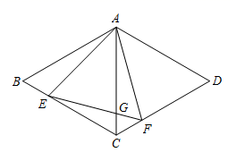

# Mathematics - 题目 1507

**ID**: 50190e6e2a9d4e2ea2b7f848a6f6366b
**年级**: Grade 9
**难度**: Medium-Hard
**题型**: Calculation

## 题目
已知：如图，在菱形 $ABCD$ 中， $AC=2$ ， $\angle B=60{}^\circ $ ．点 $E$ 为边 $BC$ 上的一个动点（与点 $B$ 、 $C$ 不重合）， $\angle EAF=60{}^\circ $ ， $AF$ 与边 $CD$ 相交于点 $F$ ，联结 $EF$ 交对角线 $AC$ 于点 $G$ ．设 $CE=x$ ， $EG=y$ ．（1）求证： $\vartriangle AEF$ 是等边三角形；​​​​​​​‌（2）求 $y$ 关于 $x$ 的函数解析式，并写出 $x$ 的取值范围；（3）点 $O$ 是线段 $AC$ 的中点，联结 $EO$ ，当 $EG=EO$ 时，求 $x$ 的值．

## 解答

1. （1）证明：∵四边形ABCD是菱形，
2. ∴AB=BC=CD=AD，∠B=∠D=60°，
3. ∴△ABC，△ACD都是等边三角形，
4. ∴AB=AC，∠B=∠ACF=60°，
5. ∵∠BAC=∠EAF=60°，
6. ∴∠BAE=∠CAF，
7. ∴△BAE≌△CAF（ASA），
8. ∴AE=AF，又∠EAF=60°，
9. ∴△AEF为等边三角形．
10. （2）解：过点E作EH⊥AC于点H，过点F作FM⊥AC于点M，
11. 
12. ∵∠ECH=60°，∴CH= $\frac {x}{2}$ ，EH= $\frac {\sqrt {3}}{2}$ x，
13. ∵∠FCM=60°，由（1）知，CF=BE=2-x，∴CM= $\frac {1}{2}$ （2-x），FM= $\frac {\sqrt {3}}{2}$ （2-x），
14. ∴HM=CH-CM= $\frac {x}{2}$ - $\frac {1}{2}$ （2-x）=x-1．
15. ∵∠EHG=∠FMG=90°，∠EGH=∠FGM，
16. ∴△EGH∽△FGM，∴ $\frac {GM}{HG}=\frac {FM}{EH}=\frac {2-x}{x}$ ，∴ $\frac {HM-HG}{HG}=\frac {2-x}{x}$ ，
17. ∴ $\frac {x-1-HG}{HG}=\frac {2-x}{x}$ ，∴HG= $\frac {x(x-1)}{2}$ ．
18. 在Rt△EHG中，EG^{2}=EH^{2}+HG^{2}，
19. ∴y^{2}=（ $\frac {\sqrt {3}}{2}$ x）^{2}+[ $\frac {x(x-1)}{2}$ ]^{2}，∴y^{2}= $\frac {x{^{4}}-2x{^{3}}+4x{^{2}}}{4}$ ，∴y= $\frac {\sqrt {x{^{4}}-2x{^{3}}+4x{^{2}}}}{2}$ （舍去负值），
20. 故y关于x的解析式为y= $\frac {\sqrt {x{^{4}}-2x{^{3}}+4x{^{2}}}}{2}$ （0＜x＜2）．
21. （3）解：如图，
22. 
23. ∵O为AC的中点，∴CO= $\frac {1}{2}$ AC=1．
24. ∵EO=EG，EH⊥OC，∴OH=GH，∠EOG=∠EGO，∴∠CGF=∠EOG．
25. ∵∠ECG=60°，EC=x，∴CH= $\frac {x}{2}$ ，∴OH=GH=OC-CH=1- $\frac {x}{2}$ ，∴OG=2OH=2-x，
26. ∴CG=OC-OG=x-1．
27. ∵∠CGF=∠EOC，∠ECO=∠GCF=60°，
28. ∴△COE∽△CGF，
29. ∴ $\frac {CO}{CG}=\frac {CE}{CF}$ ，∴ $\frac {1}{x-1}=\frac {x}{2-x}$ ，整理得x^{2}=2，
30. ∴x= $\sqrt {2}$ （舍去负值），经检验x是原方程的解．
31. 故x的值为 $\sqrt {2}$ ．

## 知识点

**中文**:
  - 全等三角形的判定
  - 等边三角形的判定与性质
  - 菱形的性质

**English**:
  - Determination of Congruent Triangles
  - Determination and Properties
  - Properties of Rhombuses

---
