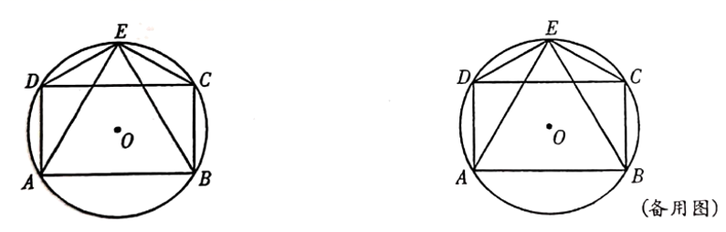

# Mathematics - 题目 3206

**ID**: 50965c49709e45d48eb9ae793db9a52f
**年级**: Grade 9
**难度**: Medium-Hard
**题型**: Calculation

## 题目
如图，等边三角形 $△ABE$ 和矩形 $ABCD$ 有共同的外接圆⊙O，且 $AB=30$ ．（1）求证： $\angle CED=120{}^\circ $ ；​​​​​​​‌（2）在劣弧 $\overset ⌢{{AB}}$ 上有动点 $F$ ，连接 $DF$ 、 $CF$ 、 $BF$ ， $DF$ 分别交 $AE$ 、 $AB$ 于点 $M$ 、 $P$ ， $CF$ 交 $BE$ 于点 $N$ ．①设 $\vartriangle MNF$ 与 $\vartriangle CDF$ 的周长分别为 $C{{}_{1}}$ 和 $C{{}_{2}}$ ，试判断 $C{{}_{2}}-C{{}_{1}}$ 的值是否发生变化，若不变则求出该值；若变化请说明理由；②若 $PN=5\sqrt {3}$ ，求 $BF$ 的长．

## 解答

1. 证明：（1）如图，连接 $AC$ ，
2. 
3. $\because $ 等边 $△ABE$ 和矩形 $ABCD$ 有共同的外接圆 $\odot O$ ，
4. $\therefore $ 点 $O$ 在 $AC$ 上，且 $AC$ 平分 $\angle BAE$ ，
5. $\because \vartriangle ABE$ 是等边三角形，四边形 $ABCD$ 是矩形，
6. $\therefore \angle BAE=60{}^\circ ,\angle BAD=90{}^\circ $ ，
7. $\therefore \angle BAC=\frac {1}{2}\angle BAE=30{}^\circ $ ，
8. $\therefore \angle DAC=\angle BAD-\angle BAC=60{}^\circ $ ，
9. 由圆内接四边形的性质得： $\angle CED=180{}^\circ -\angle DAC=120{}^\circ $ ；
10. （2）① $C{{}_{2}}-C{{}_{1}}=30$ ，不变，理由如下：
11. 如图，连接 $AC,BD,OE,OM,ON$ ，
12. 
13. $\because \vartriangle ABE$ 是等边三角形，四边形 $ABCD$ 是矩形， $AB=30$ ，
14. $\therefore \angle ABE=\angle AEB=60{}^\circ ,\angle ABC=90{}^\circ ,CD=AB=30$ ，
15. $\therefore \angle CBE=\angle ABC-\angle ABE=30{}^\circ $ ，
16. $\therefore \angle COE=2\angle CBE=60{}^\circ $ ，
17. 又 $\because OE=OC$ ，
18. $\therefore \vartriangle COE$ 是等边三角形，
19. 同理可证： $\mathrm{△}DOE$ 是等边三角形，
20. $\therefore \angle OEC=60{}^\circ ,OE=CE$ ， $\angle DOE=60{}^\circ $ ，
21. $\because \odot O$ 是等边 $△ABE$ 的外接圆，
22. $\therefore \angle OEN=\frac {1}{2}\angle AEB=30{}^\circ $ ，
23. $\therefore \angle CEN=\angle OEC-\angle OEN=30{}^\circ =\angle OEN$ ，
24. 在 $\vartriangle OEN$ 和 $\vartriangle CEN$ 中， $\begin{cases}OE=CE\\\angle OEN=\angle CEN\\EN=EN\end{cases}$ ，
25. $\therefore \vartriangle OEN\cong \vartriangle CEN(SAS)$ ，
26. $\therefore ON=CN$ ，
27. $\therefore \angle CON=\angle OCN$ ，
28. 同理可证： $OM=DM,\angle DOM=\angle ODM$ ，
29. $\because \angle OCN+\angle ODM$ 所对的弧为劣弧 $\overset ⌢{{AB}}$ ，
30. $\therefore \angle OCN+\angle ODM=\angle AEB=60{}^\circ $ ，
31. $\therefore \angle CON+\angle DOM=60{}^\circ $ ，
32. $\therefore \angle CON+\angle DOM+\angle DOE+\angle COE=60{}^\circ +60{}^\circ +60{}^\circ =180{}^\circ $ ，
33. $\therefore $ 点 $M,O,N$ 在同一条直线上，
34. $\therefore MN=OM+ON=DM+CN$ ，
35. $\therefore C{{}_{2}}-C{{}_{1}}=(CD+DF+CF)-(MN+MF+NF)$ ，
36. $=30+DF+CF-(DM+CN+MF+NF)$ ，
37. $=30+DF+CF-(DF+CF)$ ，
38. $=30$ ，
39. 即 $C{{}_{2}}-C{{}_{1}}=30$ ；
40. ②如图，连接 $BD$ ，
41. 
42. 由（1）已证： $\angle CED=120{}^\circ $ ，
43. $\therefore \angle PFN=180{}^\circ -\angle CED=60{}^\circ =\angle ABE$ ，
44. $\therefore $ 点 $B,F,P,N$ 共圆，
45. $\because \angle DAB=90{}^\circ $ ，
46. $\therefore BD$ 是 $\odot O$ 的直径，
47. $\mathbf{∴}\angle BFD=90{}^\circ $ ，
48. $\therefore \angle BNP=180{}^\circ -\angle BFD=90{}^\circ $ ，
49. 在 $Rt△BNP$ 中， $BP=\frac {PN}{{\sin}\angle PBN}=\frac {5\sqrt {3}}{{\sin}60{}^\circ }=10$ ，
50. $\therefore AP=AB-BP=20$ ，
51. 由圆周角定理得： $\angle ADB=\angle AEB=60{}^\circ $ ，
52. 在 $\mathrm{R}\mathrm{t}△ABD$ 中， $AD=\frac {AB}{{\tan}\angle ADB}=\frac {30}{{\tan}60{}^\circ }=10\sqrt {3}$ ，
53. 在 $\mathrm{R}\mathrm{t}△ADP$ 中， $DP=\sqrt {AD{^{2}}+AP{^{2}}}=10\sqrt {7}$ ，
54. 在 $\mathrm{△}ADP$ 和 $\vartriangle FBP$ 中， $\begin{cases}\angle DAP=\angle BFP=90{}^\circ \\\angle APD=\angle FPB\end{cases}$ ，
55. $\therefore \vartriangle ADP\mathrm{∼}\vartriangle FBP$ ，
56. $\therefore \frac {BF}{AD}=\frac {BP}{DP}$ ，即 $\frac {BF}{10\sqrt {3}}=\frac {10}{10\sqrt {7}}$ ，
57. 解得 $BF=\frac {10\sqrt {21}}{7}$ ．

## 知识点

**中文**:
  - 圆内接四边形
  - 相似三角形的判定与性质综合
  - 解直角三角形

**English**:
  - Cyclic Quadrilaterals
  - Determination and Properties
  - Solving Right Triangles

---
