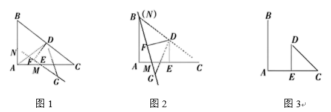

# Mathematics - 题目 3307

**ID**: 5182e583906d41bca8e4d7c3f62bb8ee
**年级**: Grade 9
**难度**: Medium-Hard
**题型**: Calculation

## 题目
如图1，在直角三角形纸片 $ABC$ 中， $\angle BAC=90{}^\circ $ ， $AB=6$ ， $AC=8$ ．[数学活动]将三角形纸片 $ABC$ 进行以下操作：第一步：折叠三角形纸片 $ABC$ 使点 $C$ 与点 $A$ 重合，得到折痕 $DE$ ，然后展开铺平；​​​​​​​‌第二步：将 $\vartriangle DEC$ 绕点 $D$ 顺时针方向旋转得到 $\vartriangle DFG$ ，点E，C的对应点分别是点F，G，直线 $GF$ 与边 $AC$ 交于点 $M$ （点 $M$ 不与点 $A$ 重合），与边 $AB$ 交于点 $N$ ．(1)折痕 $DE$ 的长为；(2)在 $\vartriangle DEC$ 绕点 $D$ 旋转的过程中，试判断 $MF$ 与 $ME$ 的数量关系，并证明你的结论；[数学探究](3)如图2，在 $\vartriangle DEC$ 绕点 $D$ 旋转的过程中，当直线 $GF$ 经过点 $B$ 时，求 $AM$ 的长；[问题延伸](4)如图3，若直角三角形 $ABC$ 的两直角边 $AB=AC=4$ ，按上边的[数学活动]的步骤操作，在点 $G$ 从点 $C$ 开始顺时针旋转 $45{}^\circ $ 的过程中，设 $\vartriangle DFG$ 与 $\vartriangle ABC$ 的重叠部分的面积为 $S$ ，直接写出 $S$ 的最小值．

## 解答

1. （1）解：如图，
2. 
3. 由折叠可知： $AE=EC$ ， $DE⊥AC$ ，而 $\angle BAC=90{}^\circ $ ，
4. ∴ $DE{\rm{/\mskip-4mu/}}AB$ ，
5. $\therefore \frac {CD}{BD}=\frac {EC}{AE}=1$ ，
6. $\therefore DC=BD$ ，
7. $\therefore DE$ 是 $\vartriangle ABC$ 的中位线，而 $AB=6$ ，
8. $\therefore DE=\frac {1}{2}AB=3$ ；
9. （2） $MF=ME$ ，理由如下：
10. 如图，连接 $DM$ ，由旋转知， $DE=DF$ ， $\angle DFM=\angle DEM=90{}^\circ $ ，
11. 
12. 在 ${\rm{R}}{\rm{t}}\mathrm{△}DMF$ 和 ${\rm{R}}{\rm{t}}\mathrm{△}DME$ 中， $\left \{\begin{array}{l}DF=DE,\\DM=DM,\end{array}\right.$ ，
13. $\therefore $  ${\rm{R}}{\rm{t}}△DMF≌{\rm{R}}{\rm{t}}△DME({\rm{H}}{\rm{L}})$ ，
14. $\therefore MF=ME$ ；
15. （3）如图，
16. 
17. $\because DG=DB=DC$ ，
18. $\therefore \angle DGB=\angle DBG$ ，
19. $\because \angle DGB=\angle C$ ，
20. $\therefore \angle MBC=\angle C$ ，
21. $\therefore BM=MC$ ，
22. 设 $BM=MC=x$ ，在 ${\rm{R}}{\rm{t}}\vartriangle ABM$ 中， $BM{{}^{2}}=AB{{}^{2}}+AM{{}^{2}}$ ，
23. 即 $6{{}^{2}}+(8-x){{}^{2}}=x{{}^{2}}$ ，解得 $x=\frac {25}{4}$ ，
24. $\therefore AM=AC-CM=8-\frac {25}{4}=\frac {7}{4}$ ；
25. （4）设 $DG$ 交 $AC$ 边于 $R$ ，由（2）知 ${\rm{R}}{\rm{t}}△DMF≌{\rm{R}}{\rm{t}}△DME$ ，
26. 
27. 由旋转变化知当 ${\rm{R}}{\rm{t}}△DMF≌{\rm{R}}{\rm{t}}△DME≌{\rm{R}}{\rm{t}}△DRE$ 时，
28. 即当旋转角为 $30{}^\circ $ 时 $△GMR$ 的面积最大，此时 $S$ 有最小值，如图所示，
29. $\because AB=AC=4$ ，
30. $\therefore DE=DF=2$ ，延长DF交AC于点 $T$ ，
31. 则 $\angle TDE=30{}^\circ $ ， $\angle DTM=60{}^\circ $ ，
32. $\therefore DT=\frac {DE}{{\cos}30{}^\circ }=\frac {4\sqrt {3}}{3}$ ，
33. 即 $FT=DT-DF=\frac {4\sqrt {3}}{3}-2$ ，
34. $\therefore FM=FT\cdot {\tan}60{}^\circ =4-2\sqrt {3}$ ，
35. $\therefore MR=2FM=8-4\sqrt {3}$ ，
36. $\therefore S=S{{}_{△DFM}}+S{{}_{△DMR}}$
37. $=\frac {1}{2}\times 2\times (4-2\sqrt {3})+\frac {1}{2}\times 2\times (8-4\sqrt {3})$
38. $=12-6\sqrt {3}$ ．
39. S的最小值为 $12-6\sqrt {3}$ ．

## 知识点

**中文**:
  - 三角函数综合
  - 平行线分线段成比例定理
  - 全等三角形的判定与性质

**English**:
  - Comprehensive Trig Problems
  - Parallel Lines Intercept Theorem
  - Determination and Properties

---
