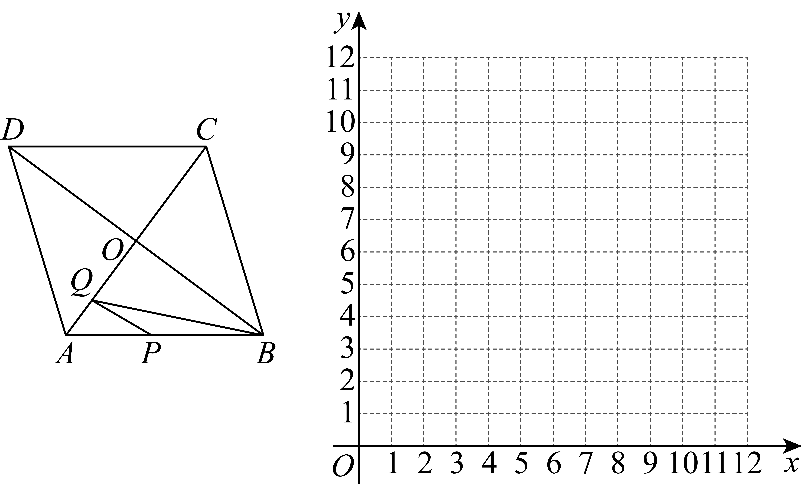

# Mathematics - 题目 2421

**ID**: 51957b8c740443e0a81586b7675470e7
**年级**: Grade 9
**难度**: Medium-Hard
**题型**: Calculation

## 题目
如图，在菱形 $ABCD$ 中， $AB=10$ ，对角线 $AC=12$ ，动点 $P$ 沿 $A\to B\to C$ 以每秒 $\frac {5}{3}$ 个单位长度的速度运动，到达 $C$ 点停止运动；同时，动点 $Q$ 沿 $A\to C$ 以每秒1个单位长度的速度运动，到达 $C$ 点停止运动．连接 $PQ$ ， $BQ$ ，设点 $P$ 的运动时间为 $x$ 秒，点 $P$ ， $Q$ 的距离为 $y{{}_{1}}$ ，菱形 $ABCD$ 的面积与 $\vartriangle ABQ$ 的面积之比为 $y{{}_{2}}$ ．（1）请直接写出 $y{{}_{1}}$ ， $y{{}_{2}}$ 分别关于 $x$ 的表达式，并注明自变量 $x$ 的取值范围；（2）在给定的平面直角坐标系中，画出函数 $y{{}_{1}}$ ， $y{{}_{2}}$ 的图象，并写出函数 $y{{}_{1}}$ 的一条性质；（3）结合函数图象，请直接写出 $y{{}_{1}}<y{{}_{2}}$ 时 $x$ 的取值范围（近似值保留一位小数，误差不超过 $0.​​​​​​​‌2$ ）．

## 解答

1. （1）解：当点 $P$ 在 $AB$ 上时，过点 $Q$ 作 $QH\bot AB$ 于 $H$ ，
2. 
3. ∵四边形 $ABCD$ 是菱形，
4. ∴ $AB=BC=10,AC\bot BD,AO=\frac {1}{2}AC=\frac {1}{2}\times 12=6$ ， $BD=2BO$ ，
5. ∴ $BO=\sqrt {AB{^{2}}-AO{^{2}}}=8$ ，则 $BD=16$
6. ∴在 ${\rm{R}}{\rm{t}}\mathrm{△}ABO$ 中， $\sin \angle OAB=\frac {BO}{AB}=\frac {4}{5},{\cos}\angle OAB=\frac {AO}{AB}=\frac {3}{5}$ ，
7. 由题意得： $AQ=x$ ， $AP=\frac {5}{3}x$ ，
8. ∴在 ${\rm{R}}{\rm{t}}△AQH$ 中， $QH=AQ\times \sin \angle OAB=x\cdot \frac {4}{5}=\frac {4}{5}x$ ， $AH=AQ\cdot {\cos}\angle OAB=x\cdot \frac {3}{5}=\frac {3}{5}x$ ，
9. ∴ $PH=AP-AH=\frac {5}{3}x-\frac {3}{5}x=\frac {16}{15}x$ ，
10. ∴ $PQ=\sqrt {QH{^{2}}+PH{^{2}}}=\sqrt {{\left({\frac {4}{5}x}\right)^{2}}+{\left({\frac {16}{15}x}\right)^{2}}}=\frac {4}{3}x$ ，
11. ∴ $y{{}_{1}}=\frac {4}{3}x\left ({0<x\leqslant 6}\right )$ ；
12. 当点 $P$ 在 $BC$ 上时，此时 $CQ=AC-AQ=12-x$ ， $BP=\frac {5}{3}x-10$
13. 
14. ∵ $BA=BC$ ，
15. ∴ $\angle BCO=\angle BAO$ ，
16. 在 ${\rm{R}}{\rm{t}}\vartriangle QHC$ 中， $QH=CQ\times \sin \angle BCO=\left ({12-x}\right )\times \frac {4}{5}=\frac {48}{5}-\frac {4}{5}x$ ，
17. $CH=CQ\times {\cos}\angle BCO=\left ({12-x}\right )\times \frac {3}{5}=\frac {36}{5}-\frac {3}{5}x$ ，
18. ∴ $PH=BC-CH-BP=10-\left ({7.2-0.6x}\right )-\left ({\frac {5}{3}x-10}\right )=12.8-\frac {16}{15}x$ ，
19. ∴ $PQ=\sqrt {PH{^{2}}+QH{^{2}}}=\sqrt {{\left({12.8-\frac {16}{15}x}\right)^{2}}+{\left({9.6-\frac {4}{5}x}\right)^{2}}}=\sqrt {\left [1.6\left ({8-\frac {2}{3}x}\right )\right ]{^{2}}+\left [1.2\left ({8-\frac {2}{3}x}\right )\right ]{^{2}}}=16-\frac {4}{3}x$ ∴ $y{{}_{1}}=16-\frac {4}{3}x\left ({6<x\leqslant 12}\right )$ ；
20. 如图：
21. $y{{}_{2}}=\frac {S{{}_{菱形}}}{S{{}_{\vartriangle ABQ}}}=\frac {\frac {1}{2}AC\times BD}{\frac {1}{2}AB\times QH}=\frac {16\times 12}{10\times \frac {4}{5}x}=\frac {24}{x}\left ({0<x\leqslant 12}\right )$ ，
22. 综上： $y{{}_{1}}=\begin{cases}\frac {4}{3}x\left ({0<x\leqslant 6}\right )\\-\frac {4}{3}x+16\left ({6<x\leqslant 12}\right )\end{cases}$ ， $y{{}_{2}}=\frac {24}{x}\left ({0<x\leqslant 12}\right )$ ；
23. （2）解：画出函数图象为：
24. 
25. 由函数图象可知，函数 $y{{}_{1}}$ 有如下性质：当 $0<x\leqslant 6$ 时， $y{{}_{1}}$ 随 $x$ 增大而增大，当 $6<x\leqslant 12$ ， $y{{}_{1}}$ 随 $x$ 增大而减小；
26. （3）解：由图象得，当 $y{{}_{1}}<y{{}_{2}}$ ，即函数 $y{{}_{1}}$ 图象在函数 $y{{}_{2}}$ 图象下方时， $x$ 的取值范围为 $0<x<4.3$ 或 $10.2<x\leqslant 12$ ．

## 知识点

**中文**:
  - 反比例函数的应用
  - 菱形的性质
  - 解直角三角形

**English**:
  - Applications of Inverse Proportionality
  - Properties of Rhombuses
  - Solving Right Triangles

---
