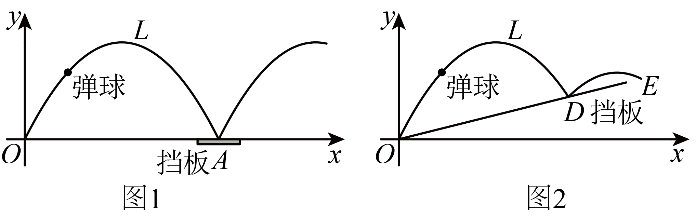

# Mathematics - 题目 2784

**ID**: 54484aa671914a2db06015f699664c3d
**年级**: Grade 9
**难度**: Medium-Hard
**题型**: Calculation

## 题目
如图1，弹球从原点 $O$ 以一定的方向拋出，弹球抛出的路线是拋物线 $L$ 的一部分，若弹球到达最高点的坐标为 $\left ({4,4}\right )$ ，弹球遇挡板后会反弹，反弹后的弹球的运动轨迹仍是拋物线的一部分，且开口大小和方向均与 $L$ 相同．（1）求抛物线 $L$ 的解析式；​​​​​​​‌（2）如图1，弹球在 $x$ 轴的落点为A，在A处放置了一挡板，反弹后弹球运动的最大高度是 $\frac {9}{4}$ ．①求点A的横坐标；②反弹后的小球是否经过点 $\left ({13,2}\right )$ ？请说明理由．（3）如图2，在第一象限内放置一挡板，挡板可以用一次函数 $y=\frac {1}{4}x\left ({x>0}\right )$ 刻画，弹球落到挡板上的点 $D$ 处后反弹，反弹后弹球运动的最大高度是 $\frac {11}{4}$ ．若第一次反弹后的弹球仍然落在挡板上，直接写出挡板端点 $E$ 横坐标 $x{{}_{E}}$ 的取值范围．

## 解答

1. （1）解：根据题意，设抛物线L的解析式为 $y=a{\left({x-4}\right)^{2}}+4$ ，
2. 将 $\left ({0,0}\right )$ 代入，得 $16a+4=0$ ，解得 $a=-\frac {1}{4}$ ，
3. ∴抛物线L的解析式为 $y=-\frac {1}{4}{\left({x-4}\right)^{2}}+4$ ；
4. （2）解：①令 $y=0$ ，由 $0=-\frac {1}{4}{\left({x-4}\right)^{2}}+4$ 得 $x{{}_{1}}=0$ ， $x{{}_{2}}=8$ ，
5. ∴点A的横坐标为8；
6. ②反弹后的小球不经过点 $\left ({13,2}\right )$ ，理由为：
7. ∵反弹后的弹球的运动轨迹仍是拋物线的一部分，且开口大小和方向均与 $L$ 相同，且最大高度是 $\frac {9}{4}$ ，
8. ∴反弹后的抛物线的解析式为 $y=-\frac {1}{4}{\left({x-h}\right)^{2}}+\frac {9}{4}$ ，
9. 由①得 $A\left ({8,0}\right )$ ，代入解析式中，得 $0=-\frac {1}{4}{\left({8-h}\right)^{2}}+\frac {9}{4}$ ，
10. 解得 $h=11$ 或 $h=5$ （舍去），
11. ∴设反弹后的抛物线的解析式为 $y=-\frac {1}{4}{\left({x-11}\right)^{2}}+\frac {9}{4}$ ，
12. 当 $x=13$ 时， $y=-\frac {1}{4}\times {\left({13-11}\right)^{2}}+\frac {9}{4}=\frac {5}{4}\ne 2$ ，
13. ∴反弹后的小球不经过点 $\left ({13,2}\right )$ ；
14. （3）解：联立方程组 $\begin{cases}y=-\frac {1}{4}{\left({x-4}\right)^{2}}+4\\y=\frac {1}{4}x\end{cases}$ ，解得 $\begin{cases}x{{}_{1}}=0\\y{{}_{1}}=0\end{cases}$     （舍去）， $\begin{cases}x{{}_{2}}=7\\y{{}_{2}}=\frac {7}{4}\end{cases}$ ，
15. ∴点D坐标为 $\left ({7,\frac {7}{4}}\right )$ ，
16. 由题意，设反弹后的抛物线解析式为 $y=-\frac {1}{4}{\left({x-m}\right)^{2}}+\frac {11}{4}$ ，
17. 将 $D\left ({7,\frac {7}{4}}\right )$ 代入，得 $\frac {7}{4}=-\frac {1}{4}{\left({7-m}\right)^{2}}+\frac {11}{4}$ ，
18. 解得 $m{{}_{1}}=9$ ， $m{{}_{2}}=5$ （不合题意，舍去），
19. ∴反弹后的抛物线解析式为 $y=-\frac {1}{4}{\left({x-9}\right)^{2}}+\frac {11}{4}$ ，
20. 联立方程组 $\begin{cases}y=-\frac {1}{4}{\left({x-9}\right)^{2}}+\frac {11}{4}\\y=\frac {1}{4}x\end{cases}$ ，解得 $\begin{cases}x{{}_{1}}=7\\y{{}_{1}}=\frac {7}{4}\end{cases}$ （舍去）， $\begin{cases}x{{}_{2}}=10\\y{{}_{2}}=\frac {5}{2}\end{cases}$ ，
21. ∴反弹后抛物线与挡板交点的横坐标为10，
22. ∴挡板端点 $E$ 横坐标 $x{{}_{E}}$ 的取值范围为 $x{{}_{E}}\geqslant 10$ .

## 知识点

**中文**:
  - 投球问题

**English**:
  - Projectile Problems

---
