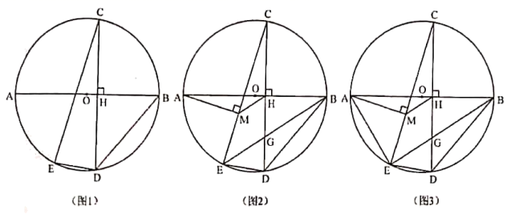

# Mathematics - 题目 3225

**ID**: 54a6a586f5ae4d40b5d63ec49a76aa79
**年级**: Grade 9
**难度**: Medium-Hard
**题型**: Calculation

## 题目
已知： $AB$ 为 $\odot O$ 直径，点 $C$ 为 $\odot O$ 上一点，弦 $CD\bot AB$ ，垂足为 $H$ ，点 $E$ 为 $\overset ⌢{{AD}}$ 上一点，连接 $CE$ 、 $DE$ 、 $DB$ ， $\angle CDE=2\angle CDB$ .​​​​​​​‌（1）如图1，求证： $CE=CD$ ；（2）如图2，过点 $A$ 作 $AM\bot CE$ ，垂足为 $M$ ，连接 $BE$ 交 $CD$ 于 $G$ ，连接 $MH$ ，求证： $MH/\mskip-4mu/EB$ ；（3）如图3，在（2）的条件下，连接 $AE$ ，若 $ED=\frac {3}{2}$ ， $CM=\frac {15}{4}$ ，求 $\Delta ABE$ 的面积.

## 解答

1. （1）∵ $AB$ 为直径， $CD\bot AB$ ，
2. ∴ $\overset ⌢{{BC}}=\overset ⌢{{BD}}$ ，
3. ∴ $\angle CEB=\angle BED=\angle CDB$ ，
4. ∴ $\angle CED=2\angle CDB$ ，
5. 又∵ $\angle CDE=2\angle CDB$ ，
6. ∴ $\angle CED=\angle CDE$ ，
7. ∴ $CE=CD$ ；
8. （2）∵ $\overset ⌢{{AE}}=\overset ⌢{{AE}}$ ，
9. ∴ $\angle ACE=\angle ABE$ ，
10. ∵ $AM\bot CE$ ， $CH\bot AB$ ，
11. ∴ $\angle AHC=\angle AMC$ ，
12. 则∠AHM=∠ACM，
13. ∴∠AHM=∠ABE，
14. ∴MH∥BE；
15. （3）连接 $BC$ 、 $AD$ 、 $AE$ ，过 $A$ 作 $AF\bot DE$ ，
16. 
17. 则 $\angle AEF=\angle ACD=\angle ADC=\angle AEC$ ，AE=AE，
18. ∴ $\Delta AEF\cong \Delta AEM$ （AAS），
19. ∴ $AF=AM$ ，EF=EM，
20. ∵ $AB$ 为直径， $CD\bot AB$ ，
21. ∴ $\overset ⌢{{AC}}=\overset ⌢{{AD}}$ ，
22. ∴ $AC=AD$ ，
23. ∴ $\Delta AFD\cong \Delta AMC$  (HL) ，
24. ∴ $MC=FD=FE+ED$ ，
25. ∴ $MC=EM+ED$ ，
26. ∴ $CM=\frac {3}{2}+\frac {9}{4}=\frac {15}{4}$ ，
27. ∴ $CE=CM+ME=\frac {15}{4}+\frac {9}{4}=6$ ，
28. ∴ $CD=6$ ， $CH=3$ ，
29. ∵ $MH/\mskip-4mu/BE$ ，
30. ∴ $\frac {CM}{ME}=\frac {CH}{HG}$ ，
31. 所以 $HG=\frac {9}{5}$ ， $CG=\frac {24}{5}$ ，
32. $\overset ⌢{{BC}}=\overset ⌢{{BD}}$ ，
33. ∴ $\angle BCD=\angle CEB$ ，
34. ∴ $\Delta CGB\sim \Delta ECB$ ，
35. 相似比 $CG:CE=\frac {24}{5}:6=4:5$ ，
36. ∴设 $BG=16k$ ， $BC=20k$ ， $BE=25k$ ，
37. 过点 $C$ 作 $CN\bot BE$ 于 $N$ ，
38. ∵ $\angle CBE=\angle CDE=2\angle CEB$ ，
39. 作 $NQ=NB$ ，
40. 则 $QC=QE=BC=25k$ ，
41. $BQ=5k$ ， $BN=\frac {5}{2}k$ ， $EN=\frac {45}{2}k$ ，
42. ∵ $CB{^{2}}-BN{^{2}}=CE{^{2}}-EN{^{2}}$ ，
43. ∴ ${\left({20k}\right)^{2}}-{\left({\frac {5}{2}k}\right)^{2}}=6{^{2}}-{\left({\frac {45}{2}k}\right)^{2}}$ ，
44. 解得 $k=\frac {1}{5}$ ，
45. ∴ $BC=20k=4$ ，
46. $BH=\sqrt {7}$ ，
47. $BC{^{2}}=BH\cdot BA$ ，
48. $4{^{2}}=\sqrt {2}BA$ ，
49. $BA=\frac {16\sqrt {7}}{7}=2R$ ，
50. ∴ $\odot O$ 半径为 $\frac {8\sqrt {7}}{7}$ .

## 知识点

**中文**:
  - 圆的综合问题
  - 相似三角形的判定与性质综合

**English**:
  - Comprehensive Circle Problems
  - Determination and Properties

---
