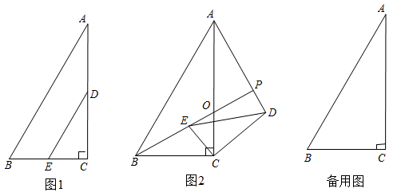

# Mathematics - 题目 3036

**ID**: 55163265bcd04f3789144c61fe3bd9fa
**年级**: Grade 9
**难度**: Medium-Hard
**题型**: Calculation

## 题目
如图1，在Rt△ABC中，∠C＝90°，∠A＝30°，BC＝1，点D，E分别为AC，BC的中点 ${\rm ．△\mathit{CDE}}$ 绕点C顺时针旋转，设旋转角为 ${\rm \mathit{α}（0°\leqslant \mathit{α}\leqslant 360°）}$ ，记直线AD与直线BE的交点为点P．(1)如图1，当 ${\rm \mathit{α}＝0°}$ 时，AD与BE的数量关系为，AD与BE的位置关系为；​​​​​​​‌(2)当0°＜α⩽360°时，上述结论是否成立？若成立，请仅就图2的情形进行证明；若不成立，请说明理由；(3)△CDE绕点C顺时针旋转一周，请直接写出运动过程中P点运动轨迹的长度和P点到直线BC距离的最大值．

## 解答

1. （1）解：在Rt△ABC中，∠C=90°，∠A=30°，BC=1，
2. ∴ ${\rm \mathit{AC}=}\sqrt {3}{\rm \mathit{BC}=}$  $\sqrt {3}{\rm ，\mathit{AB}=2\mathit{BC}=2，\mathit{AD}⊥\mathit{BE}}$
3. ∵点D，E分别为AC，BC的中点
4. ∴ ${\rm \mathit{AD}=\mathit{CD}=}\frac {1}{2}{\rm \mathit{AC}=}$  $\frac {\sqrt {3}}{2}{\rm ，\mathit{BE}=\mathit{EC}=}$  $\frac {1}{2}{\rm \mathit{BC}=}$  $\frac {1}{2}$
5. ∴AD＝ $\sqrt {3}{\rm \mathit{BE}}$ ．
6. （2）解：结论仍然成立，理由如下：
7. ∵ ${\rm \mathit{AC}＝}\sqrt {3}{\rm ，\mathit{BC}＝1，\mathit{CD}＝}$  $\frac {\sqrt {3}}{2}{\rm ，\mathit{EC}＝}$  $\frac {1}{2}$ ，
8. ∴ $\frac {BC}{AC}=\frac {\sqrt {3}}{3}$ ， $\frac {EC}{CD}{\rm ＝}$  $\frac {\sqrt {3}}{3}$ ，
9. ∴ $\frac {BC}{AC}=\frac {EC}{DC}$ ，
10. ∵ ${\rm △\mathit{CDE}}$ 绕点C顺时针旋转，
11. ∴ ${\rm ∠\mathit{BCE}＝∠\mathit{ACD}}$ ，
12. ∴ ${\rm △\mathit{BCE}∽△\mathit{ACD}}$ ，
13. ∴ $\frac {AD}{BE}=\frac {AC}{BC}{\rm ＝}$  $\sqrt {3}{\rm ，∠\mathit{CBO}＝∠\mathit{CAD}}$ ，
14. ∴ ${\rm \mathit{AD}＝}\sqrt {3}{\rm \mathit{BE}}$ ，
15. ∵ ${\rm ∠\mathit{CBO}+∠\mathit{BOC}＝90°}$ ，
16. ∴ ${\rm ∠\mathit{CAD}+∠\mathit{AOP}＝90°}$ ，
17. ∴ ${\rm ∠\mathit{APO}＝90°}$ ，
18. ∴BE⊥AD．
19. （3）解：∵ ${\rm ∠\mathit{APB}＝90°}$ ，
20. ∴点P在以AB为直径的圆上，
21. 如图3，取AB的中点G，作⊙G，以点C为圆心，CE为半径作⊙C，当BE是⊙C切线时，点P到BC的距离最大，过点P作PH⊥BC，交BC的延长线于H，连接GP，
22. 
23. ∵BE是⊙C切线，
24. ∴CE⊥BE，
25. ∵ $\frac {EC}{BC}{\rm ＝}$  $\frac {1}{2}$ ，
26. ∴ ${\rm ∠\mathit{EBC}＝30°}$ ，
27. ∴ ${\rm ∠\mathit{GBP}＝30°}$ ，
28. ∵GB＝GP，
29. ∴ ${\rm ∠\mathit{GBP}＝∠\mathit{GPB}＝30°}$ ，
30. ∴ ${\rm ∠\mathit{BGP}＝120°}$ ，
31. ∵点P的运动轨迹为点C→点P→点C→点B→点C，
32. ∴P点运动轨迹的长度 ${\rm ＝}\frac {120\degree \times π\times 1}{180\degree }{\rm ×2＝}$  $\frac {4}{3}{\rm \mathit{π}}$ ，
33. ∵ ${\rm ∠\mathit{ABP}＝30°，\mathit{BP}⊥\mathit{AP}}$ ，
34. ∴ ${\rm \mathit{AP}＝}\frac {1}{2}{\rm \mathit{AB}＝1，\mathit{BP}＝}$  $\sqrt {3}{\rm \mathit{AP}＝}$  $\sqrt {3}$ ，
35. ∵ ${\rm ∠\mathit{CBP}＝30°，\mathit{PH}⊥\mathit{BH}}$ ，
36. ∴ ${\rm \mathit{PH}＝}\frac {1}{2}{\rm \mathit{BP}＝}$  $\frac {\sqrt {3}}{2}$ ．
37. ∴P点到直线BC距离的最大值 $\frac {\sqrt {3}}{2}$ ．

## 知识点

**中文**:
  - 弧长公式
  - 旋转的性质
  - 相似三角形的判定与性质综合

**English**:
  - Arc Length Formula
  - Properties of Rotation
  - Determination and Properties

---
