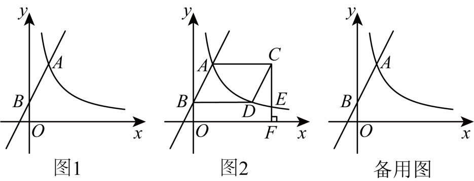

# Mathematics - 题目 1335

**ID**: 56e4cd3804e746db81e14962ed1d0e65
**年级**: Grade 9
**难度**: Medium-Hard
**题型**: Calculation

## 题目
如图1，直线 $y=2x+1$ 与y轴交于点B，与反比例函数 $y=\frac {k}{x}\left ({x>0}\right )$ 的图象交于点 $A\left ({1,a}\right )$ ．(1)求反比例函数表达式．(2)将线段 $AB$ 向右平移m个单位长度 $\left ({m>0}\right )$ ，得到对应线段 $CD$ ，连接 $AC$ ， $BD$ ．①如图2，当点D恰好落在反比例函数图象上时，过点C作 $CF\bot x$ 轴于点F，交反比例函数图象于点E，求 $\frac {CE}{EF}$ 的值；​​​​​​​‌②在①的条件下，在坐标平面内是否存在点N，使得以A，D，C，N为顶点的四边形是平行四边形？若存在，请直接写出N点的坐标；若不存在，请说明理由．

## 解答

1. （1）解：∵点 $A\left ({1,a}\right )$ 在直线 $y=2x+1$ 上，
2. ∴$a=2\times 1+1=3$ ，
3. ∴ $A\left ({1,3}\right )$ ，
4. ∵点 $A\left ({1,3}\right )$ 在反比例函数 $y=\frac {k}{x}\left ({x>0}\right )$ 的图像上，
5. ∴ $3=\frac {k}{1}$ ，
6. ∴ $k=3$ ，
7. ∴反比例函数表达式为 $y=\frac {3}{x}$ ；
8. （2）①∵直线 $y=2x+1$ 与 $y$ 轴交于点 $B$ ，
9. 当 $x=0$ 时，得 $y=1$ ，
10. ∴ $B\left ({0,1}\right )$ ，
11. ∵将线段 $AB$ 向右平移 $m$ 个单位长度 $\left ({m>0}\right )$ ，得到对应线段 $CD$ ，且点 $D$ 恰好落在反比例函数 $y=\frac {3}{x}$ 的图像上， $CF\bot x$ 轴，
12. 当 $y=1$ 时，得： $x=3$ ，
13. ∴ $D\left ({3,1}\right )$ ，
14. ∴ $AC=BD=3$ ，
15. ∴ $C\left ({4,3}\right )$ ，
16. 当 $x=4$ 时，得 $y=\frac {3}{4}$ ，
17. ∴ $EF=\frac {3}{4}$ ， $CF=3$ ，
18. ∴ $CE=CF-EF=3-\frac {3}{4}=\frac {9}{4}$ ，
19. ∴ $\frac {CE}{EF}=\frac {\frac {9}{4}}{\frac {3}{4}}=3$ ；
20. ②在坐标平面内存在点 $N$ ，使得以 ${\rm \mathit{A}，}D$ ， $C$ ， $N$ 为顶点的四边形是平行四边形．
21. 理由如下：
22. 设 $N\left ({m,n}\right )$ ，
23. 由①知 $A\left ({1,3}\right )$ ， $D\left ({3,1}\right )$ ， $C\left ({4,3}\right )$ ，
24. 可分以下三种情况：
25. 当 $AN\mathrm{/\mskip-4mu/}CD$ 且 $AN=CD$ ，以 $AC$ 为对角线时，
26. 即将线段 $AD$ 向右平移 $1$ 个单位再向上平移 $2$ 个单位得到线段 $NC$ ，此时可得平行四边形 $ADCN$ ，
27. 此时点 $N$ 的坐标为 $\left ({2,5}\right )$ ；
28. 当 $AD{\rm{/\mskip-4mu/}}CN$ 且 $AD=CN$ ，以 $CD$ 为对角线时，
29. 即将线段 $AD$ 向右平移 $3$ 个单位得到线段 $CN$ ，此时可得平行四边形 $ADNC$ ，
30. 此时点 $N$ 的坐标为 $\left ({6,1}\right )$ ；
31. 当 $CD\mathrm{/\mskip-4mu/}AN$ 且 $CD=AN$ ，以 $AD$ 为对角线时，
32. 即将线段 $CD$ 向左平移 $3$ 个单位得到线段 $AN$ ，此时可得平行四边形 $ACDN$ ，
33. 此时点 $N$ 的坐标为 $\left ({0,1}\right )$ ；
34. 综上所述，点 $N$ 的坐标为 $\left ({0,1}\right )$ 或 $\left ({6,1}\right )$ 或 $\left ({2,5}\right )$ 时，以 ${\rm \mathit{A}，}D$ ， $C$ ， $N$ 为顶点的四边形是平行四边形．

## 知识点

**中文**:
  - 反比例函数综合
  - 反比例函数解析式
  - 平移的性质

**English**:
  - Comprehensive Inverse Proportionality Problems
  - Analytic Expression of Inverse Proportionality
  - Properties of Translation

---
