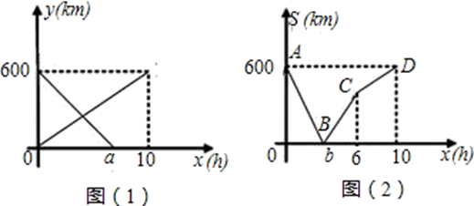

# Mathematics - 题目 2838

**ID**: 573847804afe4340ac2f9bc7bf6965a5
**年级**: Grade 9
**难度**: Medium-Hard
**题型**: Calculation

## 题目
一辆快车从甲地开往乙地，一辆慢车从乙地开往甲地，两车同时出发，设慢车离乙地的距离为y_{1}（km），快车离乙地的距离为y_{2}（km），慢车行驶时间为x（h），两车之间的距离为S（km），y_{1}，y2与x的函数关系图象如图①所示，S与x的函数关系图象如图②所示：（1）图中的a=，b=．（2）求快车在行驶的过程中S关于x的函数关系式．（3）直接写出两车出发多长时间相距200km?​​​​​​​‌

## 解答

1. 解：（1）由s与x之间的函数的图像可知：
2. 当位于C点时，两车之间的距离增加变缓，由此可以得到a=6，
3. ∵快车每小时行驶100千米，慢车每小时行驶60千米，两地之间的距离为600，
4. ∴ $b=600\div (100+60)=\frac {15}{4}$ ；
5. （2）∵从函数的图象上可以得到A、B、C、D点的坐标分别为：（0，600）、（ $\frac {15}{4}$ ，0）、（6，360）、（10，600），
6. ∴设线段AB所在直线解析式为：S=kx+b，
7. ∴ $\begin{cases}b=600\\\frac {15}{4}k+b=0\end{cases}$
8. 解得：k=-160，b=600，
9. 设线段BC所在的直线的解析式为：S=kx+b，
10. ∴ $\begin{cases}\frac {15}{4}k+b=0\\6k+b=360\end{cases}$
11. 解得：k=160，b=-600，
12. 设直线CD的解析式为：S=kx+b，
13. $\begin{cases}6k+b=360\\10k+b=600\end{cases}$
14. 解得：k=60，b=0
15. ∴ $S=\begin{cases}-160x+600\left ({0\mathrm{\leqslant }x<\frac {15}{4}}\right )\\160x-600\left ({\frac {15}{4}\mathrm{\leqslant }x<6}\right )\\60x(6\mathrm{\leqslant }x\mathrm{\leqslant }10)\end{cases}$
16. （3）当两车相遇前相距200km，
17. 此时：S=-160x+600=200，解得： $x=\frac {5}{2}$ ，
18. 当两车相遇后相距200km，
19. 此时：S=160x-600=200，解得：x=5，
20. ∴ $x=\frac {5}{2}$ 或5时两车相距200千米

## 知识点

**中文**:
  - 行程问题

**English**:
  - Distance-Speed-Time Problems

---
