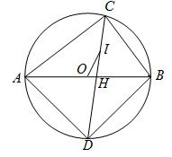

# Mathematics - 题目 1342

**ID**: 5782802eed4a420c991fc248f0e4102f
**年级**: Grade 9
**难度**: Medium-Hard
**题型**: Calculation

## 题目
如图： $AB$ 是 $\odot O$ 的直径， $C$ 为 $\odot O$ 上一点， $CD$ 平分∠ $ACB$ ， $I$ 是 $\vartriangle ABC$ 的内心， $CD$ 与 $AB$ 相交于 $H$ ，连接 $AD$ 、 $BD$ 、 $IO$ ．（1）求证： $BD=AD=DI$ ；​​​​​​​‌（2）求证： $AC\cdot BC-AH\cdot HB=CH{^{2}}$ ；（3）已知 ${\tan}\angle CAB=\frac {3}{4}$ ， $OI=\sqrt {5}$ ，求 $\odot O$ 的半径．

## 解答

1. （1）如图，连接 $BI$ ，
2. 
3. $\because CD$ 平分 $\angle ACB$ ，
4. $\therefore \angle ACD=\angle BCD$ ，
5. $\therefore AD=BD$ ，
6. 由圆周角定理得： $\angle ABD=\angle ACD=\angle BCD$ ，
7. $\therefore \angle DBI=\angle ABD+\angle OBI=\angle BCD+\angle OBI$ ，
8. $\because $ 点 $I$ 是 $\vartriangle ABC$ 的内心，
9. $\therefore \angle OBI=\angle CBI$ ，
10. $\therefore \angle DBI=\angle BCD+\angle OBI=\angle BCD+\angle CBI=\angle DIB$ ，
11. $\therefore BD=DI$ ，
12. $\therefore BD=AD=DI$ ；
13. （2）由圆周角定理得： $\angle BAD=\angle BCD$ ，
14. 在 $\vartriangle ADH$ 和 $\vartriangle CBH$ 中， $\begin{cases}\angle DAH=\angle BCH\\\angle AHD=\angle CHB\end{cases}$ ，
15. $\therefore \vartriangle ADH\mathrm{∼}\vartriangle CBH$ ，
16. $\therefore \frac {AH}{CH}=\frac {HD}{HB}$ ，即 $AH\cdot HB=CH\cdot HD$ ，
17. 由圆周角定理得： $\angle ADC=\angle HBC$ ，
18. 在 $△ACD$ 和 $\vartriangle HCB$ 中， $\begin{cases}\angle ADC=\angle HBC\\\angle ACD=\angle HCB\end{cases}$ ，
19. $\therefore \vartriangle ACD\mathrm{∼}\vartriangle HCB$ ，
20. $\therefore \frac {AC}{CH}=\frac {CD}{BC}$ ，即 $AC\cdot BC=CH\cdot CD$ ，
21. $\therefore AC\cdot BC-AH\cdot HB=CH\cdot CD-CH\cdot HD$ ，
22. $=CH\cdot \left ({CD-HD}\right )$ ，
23. $=CH{^{2}}$ ，
24. 即 $AC\cdot BC-AH\cdot HB=CH{^{2}}$ ；
25. （3）如图，设 $\vartriangle ABC$ 内切圆 $\odot I$ 与 $AB,BC,AC$ 的切点分别为点 $M,E,F$ ，连接 $IM$ ，
26. 
27. 则 $IM\bot AB,AF=AM,BE=BM,CE=CF$ ，
28. $\because AB$ 是 $\odot O$ 的直径，
29. $\therefore \angle ACB=90\mathrm{°}$ ，
30. $\therefore {\tan}\angle CAB=\frac {BC}{AC}=\frac {3}{4}$ ，
31. 设 $BC=3a$ ，则 $AC=4a$ ，
32. $\therefore AB=\sqrt {AC{^{2}}+BC{^{2}}}=5a$ ，
33. 设 $BM=BE=x$ ，则 $AF=AM=5a-x$ ，
34. $\therefore CE=CF=AC-AF=4a-(5a-x)=x-a$ ，
35. $\because CE+BE=BC$ ，
36. $\therefore x-a+x=3a$ ，解得 $x=2a$ ，
37. $\therefore OM=OB-BM=\frac {1}{2}AB-BM=\frac {1}{2}a$ ，
38. $\because S{{}_{\vartriangle ABI}}+S{{}_{\vartriangle ACI}}+S{{}_{\vartriangle BCI}}=S{{}_{\vartriangle ABC}}$ ，
39. $\therefore \frac {1}{2}(AB+AC+BC)\cdot IM=\frac {1}{2}AC\cdot BC$ ，即 $\frac {1}{2}(5a+4a+3a)\cdot IM=\frac {1}{2}\times 4a\cdot 3a$ ，
40. 解得 $IM=a$ ，
41. 在 $Rt\mathrm{△}OIM$ 中， $OM{^{2}}+IM{^{2}}=OI{^{2}}$ ，即 $(\frac {1}{2}a){^{2}}+a{^{2}}=(\sqrt {5}){^{2}}$ ，
42. 解得 $a=2$ 或 $a=-2$ （不符题意，舍去），
43. $\therefore OB=\frac {1}{2}AB=\frac {5}{2}a=5$ ，
44. 即 $\odot O$ 的半径为5．

## 知识点

**中文**:
  - 三角形内切圆
  - 圆周角定理及推论
  - 相似三角形的判定与性质综合

**English**:
  - Incircle of Triangle
  - Inscribed Angle Theorem
  - Determination and Properties

---
