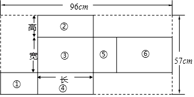

# Mathematics - 题目 3024

**ID**: 57c1610d2f85440c91adc142c3265772
**年级**: Grade 9
**难度**: Medium-Hard
**题型**: Calculation

## 题目
如图是某涌泉蜜桔长方体包装盒的展开图．具体数据如图所示，且长方体盒子的长是宽的2倍．（1）展开图的6个面分别标有如图所示的序号，若将展开图重新围成一个包装盒，则相对的面分别是与，与，与；​​​​​​​‌（2）若设长方体的宽为xcm，则长方体的长为cm，高为cm；(用含x的式子表示)（3）求这种长方体包装盒的体积．

## 解答

1. （1）展开图的6个面分别标有如图所示的序号，若将展开图重新围成一个包装盒，则相对的面分别是①与⑤，②与④，③与⑥．
2. 故答案为：①，⑤，②，④，③，⑥；
3. （2）设长方体的宽为xcm，则长方体的长为2xcm，高为  $\frac {57-x}{2}$cm．
4. 故答案为：2x， $\frac {57-x}{2}$ ；
5. （3）∵长是宽的2倍，
6. ∴(96﹣x$-\frac {57-x}{2}$ ) $\times \frac {1}{2}=$ 2x，
7. 解得：x=15，
8. ∴这种长方体包装盒的体积=15×30×21=9450cm^{3}，
9. 答：这种长方体包装盒的体积是9450cm^{3}．

## 知识点

**中文**:
  - 几何体的展开图

**English**:
  - Nets of Geometric Solids

---
