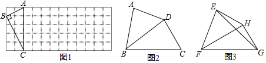

# Mathematics - 题目 876

**ID**: 58076b0be8d642efbacaa28ff81ffcec
**年级**: Grade 9
**难度**: Medium-Hard
**题型**: Calculation

## 题目
定义：我们知道，四边形的一条对角线把这个四边形分成了两个三角形，如果这两个三角形相似（不全等），我们就把这条对角线叫做这个四边形的“相似对角线”．理解：（1）如图1，已知Rt△ABC在正方形网格中，请你只用无刻度的直尺在网格中找到一点D，使四边形ABCD是以AC为“相似对角线”的四边形（保留画图痕迹，找出3个即可）；​​​​​​​‌（2）如图2，在四边形ABCD中，∠ABC=80°，∠ADC=140°，对角线BD平分∠ABC．求证：BD是四边形ABCD的“相似对角线”；（3）如图3，已知FH是四边形EFCH的“相似对角线”，∠EFH=∠HFG=30°，连接EG，若△EFG的面积为2 $\sqrt {3}$ ，求FH的长．

## 解答

1. （1）由图1知，AB= $\sqrt {5}$ ，BC=2 $\sqrt {5}$ ，∠ABC=90°，AC=5，
2. ∵四边形ABCD是以AC为“相似对角线”的四边形，
3. 当∠ACD=90°时，△ACD∽△ABC或△ACD∽△CBA，
4. ∴ $\frac {AC}{CD}=\frac {AB}{BC}=\frac {1}{2}$ 或 $\frac {AC}{CD}=\frac {BC}{AB}=2$ ，
5. ∴CD=10或CD=2.5
6. 同理：当∠CAD=90°时，AD=2.5或AD=10，
7. （2）∵∠ABC=80°，BD平分∠ABC，
8. ∴∠ABD=∠DBC=40°，
9. ∴∠A+∠ADB=140°
10. ∵∠ADC=140°，
11. ∴∠BDC+∠ADB=140°，
12. ∴∠A=∠BDC，
13. ∴△ABD∽△BDC，
14. ∴BD是四边形ABCD的“相似对角线”；
15. 
16. （3）如图3，
17. ∵FH是四边形EFGH的“相似对角线”，
18. ∴△EFH与△HFG相似，
19. ∵∠EFH=∠HFG，
20. ∴△FEH∽△FHG，
21. ∴ $\frac {FE}{FH}=\frac {FH}{FG}$ ，
22. ∴FH^{2}=FE•FG，
23. 过点E作EQ⊥FG于Q，
24. ∴EQ=FE•sin60°= $\frac {\sqrt {3}}{2}$ FE，
25. ∵ $\frac {1}{2}$ FG×EQ=2 $\sqrt {3}$ ，
26. ∴ $\frac {1}{2}$ FG× $\frac {\sqrt {3}}{2}$ FE=2 $\sqrt {3}$ ，
27. ∴FG•FE=8，
28. ∴FH^{2}=FE•FG=8，
29. ∴FH=2 $\sqrt {2}$ ．

## 知识点

**中文**:
  - 相似三角形的综合问题

**English**:
  - Comprehensive Similar Triangle Problems

---
