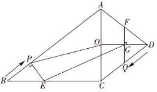

# Mathematics - 题目 73

**ID**: 59d4be7466fe4eb2b1036e9ca92fd7cb
**年级**: Grade 9
**难度**: Medium-Hard
**题型**: Calculation

## 题目
如图，在四边形 $ABCD$ 中， $AB//CD$ ， $\angle ACB=90{}^\circ $ ， $AB=10cm$ ， $BC=8cm$ ， $OD$ 垂直平分 $AC$ ．点 $P$ 从点 $B$ 出发，沿 $BA$ 方向匀速运动，速度为 $1cm/s$ ；​​​​​​​‌同时，点 $Q$ 从点 $D$ 出发，沿 $DC$ 方向匀速运动，速度为 $1cm/s$ ．当一个点停止运动，另一个点也停止运动，过点 $P$ 作 $PE\bot AB$ ，交 $BC$ 于点 $E$ ，过点 $Q$ 作 $QF//AC$ ，分别交 $AD$ ， $OD$ 于点 $F$ ， $G$ ，连接 $OP$ ， $EG$ ．设运动时间为 $t$ （单位： $s$ ） $\left ({0<t<5}\right )$ ．解答下列问题：（1）当 $t$ 为何值时，点 $E$ 在 $\angle BAC$ 的平分线上？（2）设四边形 $PEGO$ 的面积为 $S$ （单位： $cm{^{2}}$ ），求 $S$ 与 $t$ 的函数关系式；（3）在运动过程中，是否存在某一时刻 $t$ ，四边形 $PEGO$ 的面积最大？若存在，求出 $t$ 的值；若不存在，请说明理由．

## 解答

1. （1）在 $ΔABC$ 中， $AB=10cm$ ， $BC=8cm$ ， $\angle ACB=90{}^\circ $ ，
2. ∴ $AC=\sqrt {AB{^{2}}-BC{^{2}}}=\sqrt {10{^{2}}-8{^{2}}}=6cm$ ．
3. ∴ ${\tan}B=\frac {PE}{PB}=\frac {AC}{BC}$ ， ${\cos}B=\frac {BP}{BE}=\frac {BC}{BA}$ ，
4. 即 $\frac {PE}{t}=\frac {6}{8}$ ， $\frac {t}{BE}=\frac {8}{10}$ ．
5. ∴ $PE=\frac {3}{4}tcm$ ， $BE=\frac {5}{4}tcm$
6. ∴ $EC=BC-BE=\left ({8-\frac {5}{4}t}\right )cm$
7. 当点 $E$ 在 $\angle BAC$ 的平分线上时，则有 $PE=CE$ ．
8. 即 $\frac {3}{4}t=8-\frac {5}{4}t$ ，
9. 解得 $t=4$ ．
10. ∴当 $t=4$ 时，点 $E$ 在 $\angle BAC$ 的平分线上．
11. 故答案为： $t=4$
12. （2）过点 $P$ 作 $PH\bot AC$ 于点 $H$ ，
13. 
14. 则 $\angle AHP=\angle ACB=90{}^\circ $ ， $\angle PAH=\angle BAC$ ．
15. ∴ $\Delta APH\sim \Delta ABC$
16. ∴ $\frac {AP}{AB}=\frac {PH}{BC}$ ，
17. 即 $\frac {10-t}{10}=\frac {PH}{8}$
18. ∴ $PH=\frac {40-4t}{5}cm$
19. ∵ $AB//CD$ ，
20. ∴ $\angle DCO=\angle BAC$ ．
21. ∵ $OD$ 垂直平分 $AC$ ，
22. ∴ $AO=CO=\frac {1}{2}AC=\frac {1}{2}\times 6=3cm$ ，
23. $\angle DOC=\angle BCA=90{}^\circ $
24. ∴ $ΔCOD\sim ΔACB$ ．
25. ∴ $\frac {OD}{CB}=\frac {OC}{CA}=\frac {CD}{AB}$ ，即 $\frac {OD}{8}=\frac {3}{6}=\frac {CD}{10}$ ．
26. ∴ $OD=4cm$ ， $CD=5cm$ ．
27. ∵ $QF//AC$ ，
28. ∴ $\angle DGQ=\angle DOC=90{}^\circ $
29. ∴ ${\sin}\angle GDQ=\frac {GQ}{DQ}=\frac {OC}{DC}$ ， ${\cos}\angle GDQ=\frac {DG}{DQ}=\frac {OD}{DC}$
30. 即 $\frac {GQ}{t}=\frac {3}{5}$ ， $\frac {DG}{t}=\frac {4}{5}$
31. ∴ $GQ=\frac {3}{5}tcm$ ， $DG=\frac {4}{5}tcm$ ．
32. ∴ $S=S{{}_{ΔABC}}+S{{}_{ΔACD}}-S{{}_{ΔAOP}}-S{{}_{ΔAOD}}-S{{}_{ΔBEP}}-S{{}_{四边形{\rm{\;}}CDGE}}$
33. $=\frac {1}{2}\times 6\times 8+\frac {1}{2}\times 6\times 4-\frac {1}{2}\times 3\times \left ({8-\frac {4}{5}t}\right )-\frac {1}{2}\times 3\times 4-\frac {1}{2}t\cdot \frac {3}{4}t-\frac {1}{2}\times \left ({\frac {4}{5}t+8-\frac {5}{4}t}\right )\times 3$
34. $=-\frac {3}{8}t{^{2}}+\frac {15}{8}t+6$
35. ∴ $S$ 与 $t$ 的函数关系式为 $S=-\frac {3}{8}t{^{2}}+\frac {15}{8}t+6$  $(0<t<5)$ ．
36. 故答案为： $S=-\frac {3}{8}t{^{2}}+\frac {15}{8}t+6$  $(0<t<5)$
37. （3）存在．由（2），
38. 得 $S=-\frac {3}{8}t{^{2}}+\frac {15}{8}t+6=-\frac {3}{8}{\left({t-\frac {5}{2}}\right)^{2}}+\frac {267}{32}$
39. ∵ $-\frac {3}{8}<0$ ，
40. ∴抛物线开口向下
41. 又 $0<t<5$ ，
42. ∴当 $t=\frac {5}{2}$ 时， $S$ 有最大值 $\frac {267}{32}$ ．
43. 故答案为：存在， $t=\frac {5}{2}$

## 知识点

**中文**:
  - 图形问题
  - 角平分线的性质
  - 相似三角形的判定与性质综合

**English**:
  - Geometric Problems
  - Properties of Angle Bisectors
  - Determination and Properties

---
