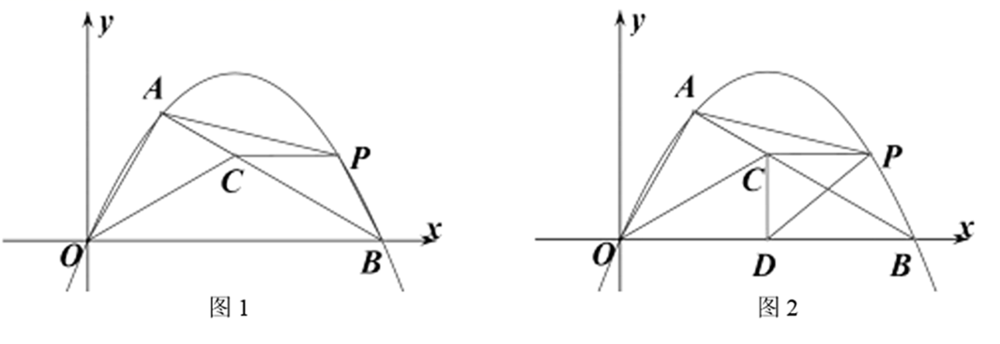

# Mathematics - 题目 2918

**ID**: 5cb5d63c7b7047598b1ad6d25c60a472
**年级**: Grade 9
**难度**: Medium-Hard
**题型**: Calculation

## 题目
如图  $1$ ，在平面直角坐标系中， $Rt\Delta AOB$ 的直角顶点 $A$ 在第一象限， $OB$ 在 $x$ 轴上， 且 $OB=2\sqrt {3}$ , $\mathrm{∠}ABO=30{^{\circ }}$ ， $OC$ 是 $ΔAOB$ 的角平分线．抛物线 $y=ax{^{2}}+bx$ 过点 $A$ ， $B$ ，点  $P$ 在直线 $AB$  上方的抛物线上，连接 $PA$ ， $PB$ ， $PC$ ．（1）填空：抛物线解析式为，直线 $AB$ 解析式为；​​​​​​​‌（2）当 $\angle APC=\angle ABP$ 时，求 $\frac {PB}{PC}$ 的值；（3）如图 $2$ ，作 $CD\mathrm{⊥}x$ 轴于点 $D$ ，连接 $PD$ ，若 $ΔACP$ 与 $\Delta DCP$ 的面积相等，求点 $P$ 的坐标

## 解答

1. 解：（1）∵ $Rt\Delta AOB$ ， $OB=2\sqrt {3}$ , $\mathrm{∠}ABO=30{^{\circ }}$ ，
2. ∴B( $2\sqrt {3}$ ,0)，A $\left ({\frac {\sqrt {3}}{2},\frac {3}{2}}\right )$
3. 将B( $2\sqrt {3}$ ,0)，A $\left ({\frac {\sqrt {3}}{2},\frac {3}{2}}\right )$ 代入 $y=ax{^{2}}+bx$ ，得
4. $\begin{cases}a{\left({2\sqrt {3}}\right)^{2}}+2\sqrt {3}b=0\\a{\left({\frac {\sqrt {3}}{2}}\right)^{2}}+\frac {\sqrt {3}}{2}b=\frac {3}{2}\end{cases}$
5. 解得 $\begin{cases}a=-\frac {2}{3}\\b=\frac {4}{3}\sqrt {3}\end{cases}$
6. 抛物线： $y=-\frac {2}{3}x{^{2}}+\frac {4\sqrt {3}}{3}x$
7. 设直线AB的解析式为：y=kx+c，
8. 将B( $2\sqrt {3}$ ,0)，A $\left ({\frac {\sqrt {3}}{2},\frac {3}{2}}\right )$ 代入y=kx+c，
9. $\begin{cases}2\sqrt {3}k+c=0\\\frac {\sqrt {3}}{2}k+c=\frac {3}{2}\end{cases}$
10. 解得 $\begin{cases}k=-\frac {\sqrt {3}}{3}\\c=2\end{cases}$
11. 直线 $AB$ ： $y=-\frac {\sqrt {3}}{3}x+2$
12. （2）在 $Rt\Delta AOB$ 中， $\mathrm{∠}ABO=30{^{\circ }}$ ， $OB=2\sqrt {3}$
13. $\therefore AO=\sqrt {3}$ ， $AB=3$
14. $\because OC$ 平分 $\angle AOB$
15. 即 $\angle AOC=30{^{\circ }}$
16. $\therefore AC=1$
17. $\because \angle APC=\angle ABP$ ， $\angle PAC=\angle PAB$
18. $\therefore ΔAPC\sim ΔABP$
19. $\therefore \frac {AP}{AB}=\frac {AC}{AP}=\frac {PC}{BP}$
20. $\therefore AP{^{2}}=AB\cdot AC$
21. 即 $AP=\sqrt {3}$
22. $\therefore \frac {BP}{PC}=\frac {AB}{AP}=\frac {3}{\sqrt {3}}=\sqrt {3}$
23. （3）作 $PF\bot x$ 轴于 $F$ 交 $AB$ 于 $E$
24. 作 $PM\bot AB$ 于 $M$ ， $PN\bot CD$ 于 $N$
25. $\because OC$ 平分 $\angle AOB$ ， $\angle OAC=\angle ODC=90{^{\circ }}$
26. $\therefore CA=CD$ ， $OA=OD=\sqrt {3}$
27. $\because S{{}_{ΔACP}}=S{{}_{ΔDCP}}$
28. $\therefore \frac {1}{2}AC\cdot PM=\frac {1}{2}DC\cdot PN$
29. $\therefore PM=PN$
30. 设 $P(t,-\frac {2}{3}t{^{2}}+\frac {4\sqrt {3}}{3})$ ，则 $E(t,-\frac {\sqrt {3}}{3}t+2)$
31. 
32. $PN=t-\sqrt {3}$
33. $\hspace{-0.5em}\begin{array}{l}PM=PE\cdot {\sin}60{^{\circ }}=\frac {\sqrt {3}}{2}\times \left [-\frac {2}{3}t{^{2}}+\frac {4\sqrt {3}}{3}t-(-\frac {\sqrt {3}}{3}t+2)\right ]\\=\frac {\sqrt {3}}{2}\times (-\frac {2}{3}t{^{2}}+\frac {5\sqrt {3}}{3}t-2)\\=-\frac {\sqrt {3}}{3}t{^{2}}+\frac {5}{2}t-\sqrt {3}\end{array}\hspace{-0.5em}$
34. 由 $PM=PN$ ，代入解得 $t=0$ （舍去）， $t=\frac {3\sqrt {3}}{2}$
35. $\therefore $ 点 $P\left ({\frac {3\sqrt {3}}{2},\frac {3}{2}}\right )$

## 知识点

**中文**:
  - 待定系数法求一次函数解析式
  - 相似三角形的判定与性质综合
  - 正弦
  - 待定系数法求二次函数解析式

**English**:
  - Finding Expressions by Undetermined Coefficients
  - Determination and Properties
  - Sine
  - Finding Quadratic Expressions by Undetermined Coefficients

---
