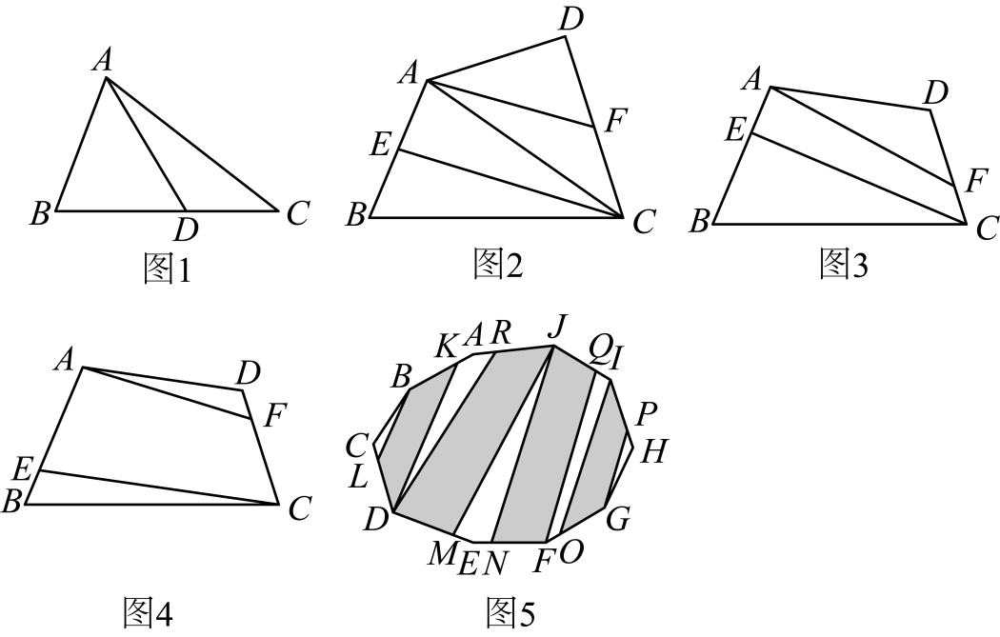

# Mathematics - 题目 3785

**ID**: 5cd4bf4f0b874940bf0b1d6087b4ac9c
**年级**: Grade 9
**难度**: Medium-Hard
**题型**: Calculation

## 题目
【模型】同高的两个三角形面积之比等于底边长度之比．已知，如图 $1$ ， $\vartriangle ABC$ 中， $D$ 为线段 $BC$ 上任意一点，连接 $AD$ ，则有： $\frac {S{{}_{\vartriangle ABD}}}{S{{}_{\vartriangle ACD}}}=\frac {BD}{CD}$ ．【模型应用】（1）如图 $2$ ，任意四边形 $ABCD$ 中， $E$ 、 $F$ 分别是 $AB$ 、 $CD$ 边的中点，连接 $CE$ 、 $AF$ ，若四边形 $ABCD$ 的面积为 $S$ ，则 $S{{}_{四边形AECF}}=$．（2）如图 $3$ ，在任意四边形 $ABCD$ 中，点 $E$ 、 $F$ 分别是边 $AB$ 、 $CD$ 上离点 $A$ 和点 $C$ 最近的三等分点，连接 $AF$ 、 $CE$ ，若四边形 $ABCD$ 的面积为 $S$ ，则 $S{{}_{四边形AECF}}=$．（3）如图 $4$ ，在任意四边形 $ABCD$ 中，点 $E$ 、 $F$ 分别是边 $AB$ 、 $CD$ 上离点 $B$ 和点 $D$ 最近的 $n$ 等分点，连接 $AF$ 、 $CE$ ，若四边形 $ABCD$ 的面积为 $S$ ，则 $S{{}_{四边形{\rm{A}}ECF}}=$．【拓展与应用】（4）如图 $5$ ，若任意的十边形的面积为 $100$ ，点 $K$ 、 $L$ 、 $M$ 、 $N$ 、 $O$ 、 $P$ 、 $Q$ 、 $R$ 分别是 $AB$ 、 $CD$ 、 $DE$ 、 $EF$ 、 $FG$ 、 $HI$ 、 $IJ$ 、 $JA$ 边上离点 $A$ 、 $C$ 、 $E$ 、 $E$ 、 $F$ 、 $H$ 、 $I$ 、 $A$ 最近的四等分点，连接 $BL$ 、 $DK$ 、 $DR$ 、 $MJ$ 、 $NJ$ 、 $FQ$ 、 $OI$ 、 $GP$ ，则图中阴影部分的面积是．​​​​​​​‌

## 解答

1. 解：[模型应用]（（1）E、 $F$ 分别是 $AB$ 、 $CD$ 边的中点，
2. $\therefore AE=\frac {1}{2}AB$ ， $CF=\frac {1}{2}CD$ ，
3. $\therefore S{{}_{\vartriangle AEC}}=\frac {1}{2}S{{}_{\vartriangle ABC}}$ ， $S{{}_{\vartriangle AFC}}=\frac {1}{2}S{{}_{\vartriangle ACD}}$ ，
4. $\because S{{}_{四边形ABCD}}=S{{}_{\vartriangle ABC}}+S{{}_{\vartriangle ACD}}$ ， $S{{}_{四边形AECF}}=S{{}_{\vartriangle AEC}}+S{{}_{\vartriangle AFC}}$ ，
5. $\therefore S{{}_{四边形AECF}}=\frac {1}{2}S{{}_{四边形ABCD}}=\frac {S}{2}$
6. （2）如图，连接 $AC$ ，
7. 
8. $\because $ 点 $E$ 、 $F$ 分别是边 $AB$ 、 $CD$ 上离点 $A$ 和点 $C$ 最近的三等分点，
9. $\therefore AE=\frac {1}{3}AB$ ， $CF=\frac {1}{3}CD$ ，
10. $\therefore S{{}_{\vartriangle AEC}}=\frac {1}{3}S{{}_{\vartriangle ABC}}$ ， $S{{}_{\vartriangle AFC}}=\frac {1}{3}S{{}_{\vartriangle ACD}}$ ，
11. $\because S{{}_{四边形ABCD}}=S{{}_{\vartriangle ABC}}+S{{}_{\vartriangle ACD}}$ ， $S{{}_{四边形AECF}}=S{{}_{\vartriangle AEC}}+S{{}_{\vartriangle AFC}}$ ，
12. $\therefore S{{}_{四边形AECF}}=\frac {1}{3}S{{}_{四边形ABCD}}=\frac {S}{3}$
13. （3）如图，连接 $AC$ ，
14. 
15. $\because $ 点 $E$ 、 $F$ 分别是边 $AB$ 、 $CD$ 上离点 $B$ 和点 $D$ 最近的 $n$ 等分点，
16. $\therefore BE=\frac {1}{n}AB$ ， $DF=\frac {1}{n}CD$ ，
17. $\therefore S{{}_{\vartriangle BEC}}=\frac {1}{n}S{{}_{\vartriangle ABC}}$ ， $S{{}_{\vartriangle ADF}}=\frac {1}{n}S{{}_{\vartriangle ACD}}$ ，
18. $\because S{{}_{四边形ABCD}}=S{{}_{\vartriangle ABC}}+S{{}_{\vartriangle ACD}}$ ， $S{{}_{四边形AECF}}=S{{}_{四边形ABCD}}-\left ({S{{}_{\vartriangle BEC}}+S{{}_{\vartriangle ADF}}}\right )$ ，
19. $\therefore S{{}_{四边形AECF}}=S{{}_{四边形ABCD}}-\left ({S{{}_{\vartriangle BEC}}+S{{}_{\vartriangle ADF}}}\right )$
20. $=S{{}_{四边形{\rm{A}}BCD}}-\frac {1}{n}\left ({S{{}_{\vartriangle ABC}}+S{{}_{\vartriangle ACD}}}\right )$
21. $=S{{}_{四边形ABCD}}-\frac {1}{n}S{{}_{四边形ABCD}}$
22. $=S-\frac {S}{n}$
23. $=\frac {n-1}{n}S$
24. [拓展与应用]（4）如图，连接 $AD$ 、 $JE$ 、 $IF$ ，
25. 
26. 由（3）得： $S{{}_{四边形BLDK}}=\frac {4-1}{4}S{{}_{四边形ABCD}}=\frac {3}{4}S{{}_{四边形ABCD}}$ ，
27. 同理， $S{{}_{四边形RDMJ}}=\frac {3}{4}S{{}_{四边形ADEJ}}$ ， $S{{}_{四边形JNFQ}}=\frac {3}{4}S{{}_{四边形JEFI}}$ ， $S{{}_{四边形IOGP}}=\frac {3}{4}S{{}_{四边形IFGH}}$ ，
28. $\because S{{}_{十边形ABCDEFGHIJ}}=S{{}_{四边形ABCD}}+S{{}_{四边形ADEJ}}+S{{}_{四边形JEFI}}+S{{}_{四边形IFGH}}$ ，
29. $\therefore S{{}_{阴影}}=S{{}_{四边形BLDK}}+S{{}_{四边形RDMJ}}+S{{}_{四边形JNFQ}}+S{{}_{四边形IOGP}}$
30. $=\frac {3}{4}S{{}_{四边形ABCD}}+\frac {3}{4}S{{}_{四边形ADEJ}}+\frac {3}{4}S{{}_{四边形JEFI}}+\frac {3}{4}S{{}_{四边形IFGH}}$
31. $=\frac {3}{4}\left ({S{{}_{四边形ABCD}}+S{{}_{四边形ADEJ}}+S{{}_{四边形JEFI}}+S{{}_{四边形IFGH}}}\right )$
32. $=\frac {3}{4}S{{}_{十边形ABCDEFGHIJ}}$
33. $=\frac {3}{4}\times 100$
34. $=75$

## 知识点

**中文**:
  - 三角形的中线

**English**:
  - Medians

---
