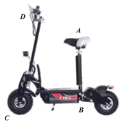
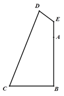

# Mathematics - 题目 2051

**ID**: 5d3e3cae9eef492dae742b82974fe71e
**年级**: Grade 9
**难度**: Medium-Hard
**题型**: Calculation

## 题目
如图，左图是一辆小型踏板电动车，右图为其示意图，点A为座垫，AB⊥BC，AB高度可调节，其初始高度为34cm，CD为车前柱，CD＝120cm，∠C＝70°，根据该款车提供信息表明，当骑行者手臂DE与车前柱DC夹角为80°时，骑行者最舒适，若某人手臂长60cm，肩膀到座垫的高度AE＝42cm，则座垫应调高多少厘米才能使得骑行最舒适？（参考数据sin70°＝0.​​​​​​​‌94，cos70°≈0.34，tan70°≈2.75，精确到lcm）

## 解答

1. 解：如图，作DF⊥BC、EG⊥DF、AH⊥DF，垂足分别为F、G、H，
2. 在Rt△DCF中，CD＝120cm，∠C＝70°，
3. ∴DF＝sin70°×120＝112.8cm，∠CDF＝20°．
4. ∵∠CDE＝80°，
5. ∴∠GDE＝60°．
6. 在Rt△DEG中，DE＝60cm，
7. ∴DG＝cos60°×60＝30（cm）．
8. ∵AB⊥BC，DF⊥BC，EG⊥DF，
9. ∴∠B＝90°，GFB＝90°，∠EGF＝90°，
10. ∴四边形EGFB为矩形.
11. ∴EB＝GF＝112.8－30＝82.8（cm），
12. ∴AB＝EB－EA＝82.8－42＝40.8（cm），40.8－34＝6.8≈7（cm）.
13. ∴座垫应调高7厘米才能使得骑行最舒适.
14. 

## 知识点

**中文**:
  - 矩形的判定与性质综合
  - 解直角三角形的实际应用

**English**:
  - Determination and Properties of Rectangles
  - Applications of Solving Right Triangles

---
