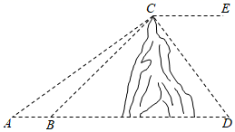

# Mathematics - 题目 2707

**ID**: 5e77818d460b4b80a3316c360cd62db8
**年级**: Grade 9
**难度**: Medium-Hard
**题型**: Calculation

## 题目
如图，在西山脚下的两个观察点 $A,B$ 测得山顶 $C$ 的仰角 $\angle DAC=37{}^\circ ,\angle DBC=45{}^\circ $ ，在山顶 $C$ 测得东山脚 $D$ 的俯角 $\angle ECD=64{}^\circ $ ．已知 $A,B,C,D$ 在同一平面上， $AB=600$ 米，如果在 $C,D$ 之间修一条索道，求索道 $CD$ 的长（参考数据： ${\sin}37{}^\circ \approx 0.​​​​​​​‌60,{\tan}37{}^\circ \approx 0.75,{\sin}64{}^\circ \approx 0.90,{\tan}64{}^\circ \approx 2.05$ ）

## 解答

1. 
2. 如图，过点 $C$ 作 $CH\bot AD$ 于点 $H$ ，
3. 在 $Rt\Delta ACH$ 中， ${\tan}37{}^\circ =\frac {CH}{AH}$ ，∴ $AH=\frac {CH}{{\tan}37^\circ }$ ，
4. 在 $Rt\Delta BCH$ 中， $\angle DBC=45{}^\circ $ ，∴ $BH=CH$ ，
5. ∴ $\frac {CH}{{\tan}37{}^\circ }-CH=600$ ，解得 $CH\approx 1800$ （米）．
6. ∵∠ECD=64°，CE∥AD，
7. ∴∠CDH=∠ECD=64°，
8. 在 $RtΔDCH$ 中， ${\sin}64^\circ =\frac {CH}{CD}$ ，∴ $CD=\frac {CH}{{\sin}64^\circ }$ ，
9. ∴ $CD\approx 2000$ （米），
10. 答：索道 $CD$ 的长约为2000米．

## 知识点

**中文**:
  - 三角函数综合
  - 平行线性质的应用
  - 解直角三角形的实际应用

**English**:
  - Comprehensive Trig Problems
  - Applications of Properties
  - Applications of Solving Right Triangles

---
