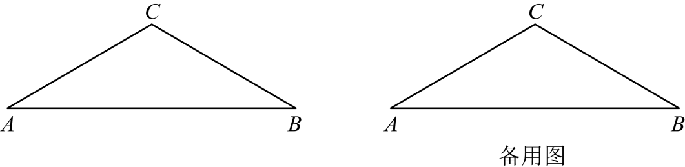

# Mathematics - 题目 2276

**ID**: 600016de615f44048b919cd6ac9a6e85
**年级**: Grade 9
**难度**: Medium-Hard
**题型**: Calculation

## 题目
某地举办中学生科技创新夏令营，小梧的团队要用轻型材料搭建几何艺术小展区，他们参考了各种屋顶桁架结构设计了含有“自相似形”的展区顶棚．顶棚由2个等腰三角形（顶角为钝角）桁架组成，他们要在每个桁架（如图的 $△CAB$ ）的左右两侧斜梁 $AC$ ， $BC$ 和横梁 $AB$ 之间对称安装若干连接杆，其中在左侧的操作步骤如下：①在横梁上确定点 $P{{}_{1}}$ ，使 $\vartriangle P{{}_{1}}AC$ 与 $△CAB$ 相似，且 $P{{}_{1}}$ 与点 $C$ 对应，得到连接杆 $P{{}_{1}}C$ ；②在斜梁上确定点 $P{{}_{2}}$ ，使 $\vartriangle P{{}_{2}}AP{{}_{1}}$ 与 $△CAB$ 相似，且 $P{{}_{2}}$ 与点 $C$ 对应，得到连接杆 $P{{}_{2}}P{{}_{1}}$ ；③在横梁上确定点 $P{{}_{3}}$ ，使 $\vartriangle P{{}_{3}}AP{{}_{2}}$ 与 $△CAB$ 相似，且 $P{{}_{3}}$ 与点 $C$ 对应，得到连接杆 $P{{}_{3}}P{{}_{2}}$ ；……依此类推．（1）如图是桁架的平面设计图，请在该图中作出点 $P{{}_{1}}$ ；（作图要求：尺规作图，不写作法，保留作图痕迹）（2）若他们设计的桁架斜梁长度为 $3{\rm{m}}$ ，且与横梁夹角为 $30{}\degree $ ．根据测算，为确保安全性和稳定性，每个桁架的左右两侧至少要各安装2个连接杆，每个桁架配 $5.​​​​​​​‌2{\rm{m}}$ 的连接杆材料是否够用？请说明理由；（3）从数学的角度，上述操作可不断进行．设 $∠CAB$ 为 $α$ ， $CA$ 为 $p$ ，直接写出表示左侧连接杆的线段的长度变化规律的代数式．

## 解答

1. （1）解：点 $P{{}_{1}}$ 如图所示；
2. ；
3. （2）解：如图，作 $CD\bot AB$ 于点 $D$ ，
4. 
5. ∵ $AC=BC=3$ ， $\mathrm{∠}A=\mathrm{∠}B=30{}\degree $ ，
6. ∴ $AD=AC\cdot {\cos}30{}\degree =\frac {3\sqrt {3}}{2}$ ，
7. ∴ $AB=2AD=3\sqrt {3}$ ，
8. ∵ $\vartriangle P{{}_{1}}AC∽△CAB$ ，
9. ∴ $\frac {P{{}_{1}}C}{BC}=\frac {AC}{AB}$ ，即 $\frac {P{{}_{1}}C}{3}=\frac {3}{3\sqrt {3}}$ ，
10. ∴ $P{{}_{1}}C=\sqrt {3}$ ，
11. ∴ $P{{}_{1}}A=P{{}_{1}}C=\sqrt {3}$ ，
12. ∵ $\vartriangle P{{}_{2}}AP{{}_{1}}∽△CAB$ ，
13. ∴ $\frac {P{{}_{1}}P{{}_{2}}}{BC}=\frac {AP{{}_{1}}}{AB}$ ，即 $\frac {P{{}_{1}}P{{}_{2}}}{3}=\frac {\sqrt {3}}{3\sqrt {3}}$ ，
14. ∴ $P{{}_{1}}P{{}_{2}}=1$ ，
15. 根据题意需要连接杆的长度为 $2\left ({P{{}_{1}}C+P{{}_{2}}P{{}_{1}}}\right )=2\sqrt {3}+2$ ，
16. ∵ $2\sqrt {3}+2>5.2$ ，
17. ∴每个桁架配 $5.2{\rm{m}}$ 的连接杆材料不够用；
18. （3）解：∵ $AC=BC=p$ ， $\angle A=\angle B=α$ ，如图，作 $CD\bot AB$ 于点 $D$ ，
19. 
20. ∴ $AD=AC\cdot {\cos}α=p{\cos}α$ ，
21. ∴ $AB=2AD=2p{\cos}α$ ，
22. ∵ $\vartriangle P{{}_{1}}AC∽△CAB$ ，
23. ∴ $\frac {P{{}_{1}}C}{BC}=\frac {AC}{AB}$ ，即 $\frac {P{{}_{1}}C}{p}=\frac {p}{2p{\cos}α}$ ，
24. ∴ $P{{}_{1}}C=\frac {p}{2{\cos}α}$ ，
25. ∴ $P{{}_{1}}A=P{{}_{1}}C=\frac {p}{2{\cos}α}$ ，
26. ∵ $\vartriangle P{{}_{2}}AP{{}_{1}}∽△CAB$ ，
27. ∴ $\frac {P{{}_{1}}P{{}_{2}}}{BC}=\frac {AP{{}_{1}}}{AB}$ ，即 $\frac {P{{}_{1}}P{{}_{2}}}{p}=\frac {\frac {p}{2{\cos}α}}{2p{\cos}α}$ ，
28. ∴ $P{{}_{1}}P{{}_{2}}=\frac {p}{{\left({2{\cos}α}\right)^{2}}}$ ，
29. $\cdots $ ，
30. ∴ $P{{}_{n}}P{{}_{n-1}}=\frac {p}{{\left({2{\rm{c}}{\rm{o}}{\rm{s}}α}\right)^{n}}}$ ．

## 知识点

**中文**:
  - 尺规作图——作线段垂直平分线
  - 规律型：图形的变化类
  - 相似三角形的判定与性质综合
  - 解直角三角形

**English**:
  - Construction: Perpendicular Bisector
  - Patterns: Geometric Variations
  - Determination and Properties
  - Solving Right Triangles

---
