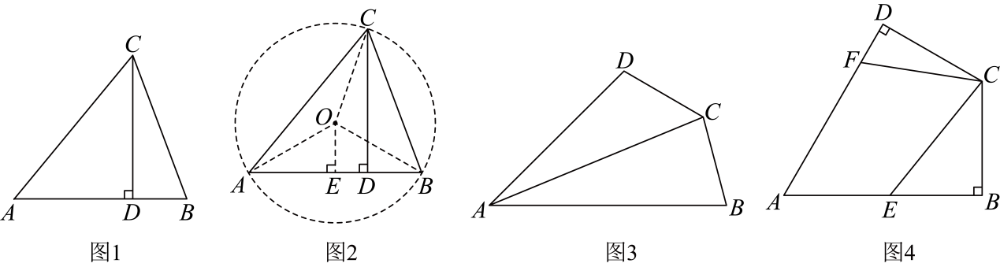

# Mathematics - 题目 1841

**ID**: 607292109c224be5b4cb287f78d11e5b
**年级**: Grade 9
**难度**: Medium-Hard
**题型**: Calculation

## 题目
（1）如图1，在 $\vartriangle ABC$ 中， $CD\bot AB$ 于点 $D$ ， $CD=6$ ， $\angle ACB=60{}\degree $ ，求 $\vartriangle ABC$ 外接圆半径的最小值，学习小组经过研究，给出模型分析：如图2，作 $\vartriangle ABC$ 的外接圆 $\mathrm{⊙}O$ ，连接 $OA$ ， $OB$ ， $OC$ ，作 $OE\bot AB$ 于E，设 $\mathrm{⊙}O$ 半径为 $r$ 可得出 $OC+OE\geqslant CD$ ，由 $\angle ACB=60{}\degree $ ，可得 $\angle AOE=60{}\degree $ ，因此 $OE=\frac {r}{2}，$ 进而得出  $r+\frac {r}{2}\geqslant 6$ ，进一步得出结果： $\vartriangle ABC$ 外接圆半径的最小值为；​​​​​​​‌（2）如图3，在四边形 $ABCD$ 中， $\angle BAD=45{}\degree $ ， $\angle BAD+\angle BCD=180{}\degree $ ， $CB=CD$ ， $AC=a$ ，求四边形 $ABCD$ 的面积；（3）如图4，四边形 $ABCD$ 是某小区内的一块空地，经测量， $\angle A=60{}\degree ，\angle B=\angle D=90{}\degree ，CB=CD=30{\rm{m}}$ ，现规划修两条小道 $CE$ ， $CF$ ( $E$ ， $F$ 分别在边 $AB$ ， $AD$ 上)，将该四边形空地划分为三个不同的活动区域，其中四边形 $AECF$ 作为健身活动区域，按照设计方案：既要使两条小道 $CE$ ， $CF$ 的夹角为  $60{}\degree (\angle ECF=60{}\degree )$ ，同时也要使健身活动区域四边形 $AECF$ 面积最大，请问此方案是否可行？若可行，求出此时这两条小道的总长(即 $CE+CF$ 的值)；若不可行，请说明理由．

## 解答

1. 解：（1）如图，作 $\vartriangle ABC$ 的外接圆 $\mathrm{⊙}O$ ，连接 $OA$ ， $OB$ ， $OC$ ，作 $OE\bot AB$ 于E，
2. 
3. ∴ $\angle AOB=2\angle ACB$ ， $\angle AOE=\frac {1}{2}\angle AOB$ ，
4. ∵ $\angle ACB=60{}\degree $ ，
5. ∴ $∠AOE=60{}\degree $ ，
6. ∴ $\angle OAE=30{}\degree $ ，
7. ∴ $OE=\frac {1}{2}OA=\frac {1}{2}r$ ，
8. ∵ $OC+OE\geqslant CD$ ，
9. ∴ $r+\frac {r}{2}\geqslant 6$ ，
10. ∴ $r\geqslant 4$ ，即 $\vartriangle ABC$ 外接圆半径的最小值为4；
11. （2）∵ $\angle BAD=45{}\degree $ ， $\angle BAD+\angle BCD=180{}\degree $ ，
12. ∴ $\angle BCD=180{}\degree -45{}\degree =135{}\degree $ ，
13. 如图3，将 $\vartriangle ABC$ 绕点 $C$ 旋转 $135{}\degree $ ，得 $\mathrm{△}KDC$ ，过点 $K$ 作 $KH\bot AC$ ，垂足为 $H$ ，
14. 
15. ∴ $\angle CDK=\angle CBA$ ， $KC=AC=a$ ， $\angle ACK=135{}\degree $ ，
16. ∴ $\angle ADC+\angle ABC=\angle ADC+\angle CDK=180{}\degree $ ， $\angle KCH=180{}\degree -\angle ACK=45{}\degree $ ，
17. ∴ $A$ ， $D$ ， $K$ 在同一直线上， $\mathrm{△}CHK$ 是等腰直角三角形，
18. ∴ $CH=HK=\frac {\sqrt {2}}{2}KC=\frac {\sqrt {2}}{2}a$ ，
19. ∴ $S{{}_{\mathrm{△}ACK}}=\frac {1}{2}AC\cdot KH=\frac {1}{2}a\cdot \frac {\sqrt {2}}{2}a=\frac {\sqrt {2}}{4}a{^{2}}$ ，
20. ∴四边形 $ABCD=S{{}_{\mathrm{△}ACD}}+S{{}_{\mathrm{△}ABC}}=S{{}_{\mathrm{△}ACD}}+S{{}_{\mathrm{△}DCK}}=S{{}_{\mathrm{△}ACK}}=\frac {\sqrt {2}}{4}a{^{2}}$ ；
21. （3）∵ $\angle A=60{}\degree ，\angle B=\angle D=90{}\degree $ ，
22. ∴ $\angle BCD=360{}\degree -90{}\degree -90{}\degree -60{}\degree =120{}\degree $ ，
23. 如图4，将 $\mathrm{△}EBC$ 绕点 $C$ 旋转 $120{}\degree $ ，得 $\mathrm{△}GDC$ ，
24. 
25. ∴ $\angle GCD=\angle ECB$ ， $CG=CE$ ， $∠ECG=120{}\degree $ ， $\angle CDG=\angle B=90{}\degree $ ，
26. ∴ $A$ ， $D$ ， $G$ 在同一直线上， $S{{}_{四边形ABCD}}=S{{}_{四边形AECG}}$ ，
27. ∴ $S{{}_{四边形AECF}}=S{{}_{四边形AECG}}-S{{}_{\mathrm{△}FCG}}=S{{}_{四边形ABCD}}-S{{}_{\mathrm{△}FCG}}$ ，
28. ∴当 $\mathrm{△}FCG$ 面积最小时， $S{{}_{四边形AECF}}$ 最大，
29. ∵ $\angle ECF=60{}\degree $ ，
30. ∴ $\angle GCF=60{}\degree $ ，
31. 由（1）可知，设 $\mathrm{△}FCG$ 外接圆半径为 $r$ ，当圆心在 $CD$ 上时，半径最小， $\angle FCG$ 所对弦最小， $\mathrm{△}FCG$ 的面积最小．
32. 此时 $r+\frac {r}{2}=CD=30{\rm{m}}$ ，解得 $r=20{\rm{m}}$ ，
33. 由垂径定理可知，此时 $CD$ 垂直平分 $FG$ ， $FG=DG=\sqrt {r{^{2}}-(\frac {1}{2}r){^{2}}}=\frac {\sqrt {3}}{2}r=10\sqrt {3}$ ， $CG=CF$ ，
34. ∴在 ${\rm{R}}{\rm{t}}\mathrm{△}CDG$ 中， $CG=\sqrt {CD{^{2}}+DG{^{2}}}=\sqrt {30{^{2}}+(10\sqrt {3}){^{2}}}=20\sqrt {3}{\rm{m}}$ ，
35. $CE+CF=2CG=40\sqrt {3}{\rm{m}}$ .

## 知识点

**中文**:
  - 三角形的外接圆
  - 垂径定理及其推论
  - 旋转的性质

**English**:
  - Circumcircle of Triangle
  - Perpendicular Chord Theorem
  - Properties of Rotation

---
