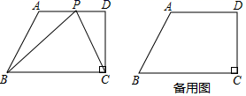

# Mathematics - 题目 2658

**ID**: 60a0a7797fcc41d682f666bf09baa420
**年级**: Grade 9
**难度**: Medium-Hard
**题型**: Calculation

## 题目
如图所示，在四边形ABCD中，AD∥BC，CD⊥BC，∠ABC＝60°，且AD＝12，BC＝18．动点P从点A出发，以每秒2个单位长度的速度向点D运动，设运动时间为t秒（0＜t⩽6）（1）当t＝6时，cos∠BPC＝；​​​​​​​‌（2）当△BPC的外接圆与AD相切时，求t的值；（3）在点P运动过程中，cos∠BPC是否存在最小值？若存在，请求出这个最小值；若不存在，请说明理由．

## 解答

1. 解：（1）如图1，过点A作AM⊥BC于M，
2. ∵CD⊥BC，
3. ∴∠DCB＝∠AMC＝90°，
4. ∵AD∥BC，
5. ∴∠D＝180°﹣90°＝90°，
6. ∴四边形AMCD为矩形，
7. ∴AD＝MC＝12，
8. ∴BM＝BC﹣MC＝6，
9. 在Rt△ABM中，BM＝6，∠ABC＝60°，
10. ∴AM＝ $\sqrt {3}$ BM＝6 $\sqrt {3}$ ，
11. ∴CD＝AM＝6 $\sqrt {3}$ ，
12. 当t＝6时，AP＝2t＝12，
13. ∴点P与点D重合，
14. 如图1，在Rt△BP'C中，P'C＝6 $\sqrt {3}$ ，BC＝18，
15. ∴BP'＝ $\sqrt {BC{^{2}}+CP{^{\prime }}{^{2}}}$ ＝12 $\sqrt {3}$ ，
16. ∴cos∠BP'C＝ $\frac {CP{^{\prime }}}{BP{^{\prime }}}$ ＝ $\frac {1}{2}$ ；
17. 故答案为： $\frac {1}{2}$ ；
18. （2）如图2，作BC的中垂线PH交BC于点H，交AD于点P'，连接BP'，CP'，作△BP'C的外接圆⊙O，
19. 则P'B＝P'C，圆心O在直线P'H上，
20. 又∵AD∥BC，
21. ∴P'H⊥AD，
22. ∴当点P运动到P'时，∴O与AD相切，
23. ∴∠DP'H＝∠P'HC＝∠HCD＝90°，
24. ∴四边形P'HCD为矩形，
25. ∴P'D＝HC＝ $\frac {1}{2}$ BC＝9，
26. 则AP'＝AD﹣P'D＝12﹣9＝3，
27. ∴t＝ $\frac {3}{2}$ ，
28. ∴当△BPC的外接圆与AD相切时，t＝ $\frac {3}{2}$ ；
29. （3）存在，
30. 如图3，由（2）知，
31. 当t＝ $\frac {3}{2}$ 秒时，△BPC的外接圆OO与AD相切于点P’
32. ∵P'H＝DC＝6 $\sqrt {3}$ > $\frac {1}{2}$ BC＝9，
33. ∴P'H>BH，
34. ∴∠BP'C<90°，圆心O在弦BC的上方，P是AD上一动点，
35. 连接PB，PC，设PB交⊙O于点N，连接NC，
36. 则∠BP'C＝∠BNC⩾∠BPC，
37. ∴当动点P处于P’处时，∠BPC最大，则cos∠BPC的值最小，
38. 此时，连接OB，则∠BOH＝2∠BP'H＝∠BP'C，
39. 由题意，知OB＝OP'＝P'H﹣OH＝6 $\sqrt {3}$ ﹣OH，
40. 在Rt△BOH中，OH^{2}+BH^{2}＝OB^{2}，
41. ∴OH^{2}+9^{2}＝（6 $\sqrt {3}$ ﹣OH）^{2}，
42. 解得，OH＝ $\frac {3\sqrt {3}}{4}$ ，
43. ∴OB＝6 $\sqrt {3}$ ﹣OH＝ $\frac {21\sqrt {3}}{4}$ ，
44. 在Rt△BOH中，
45. cos∠BOH＝ $\frac {OH}{OB}$ ＝ $\frac {1}{7}$ ，
46. ∵∠BOH＝∠BP'C，
47. ∴cos∠BPC的值最小为 $\frac {1}{7}$ ．
48. 
49. 
50. 

## 知识点

**中文**:
  - 余弦
  - 四边形综合
  - 圆的综合问题

**English**:
  - Cosine
  - Comprehensive Quadrilateral Problems
  - Comprehensive Circle Problems

---
