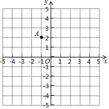

# Mathematics - 题目 610

**ID**: 617bd5b1b5464e11a474b309200559e7
**年级**: Grade 9
**难度**: Medium-Hard
**题型**: Calculation

## 题目
如图，在平面直角坐标系xOy中，A（﹣1，2）．（1）将点A向右平移3个单位长度，再向上平移1个单位长度，得到点B，则点B的坐标是．（2）点C与点A关于原点O对称，则点C的坐标是．（3）反比例函数的图象经过点B，则它的解析式是．（4）一次函数的图象经过A，C两点，则它的解析式是．​​​​​​​‌

## 解答

1. 解：（1）将点A向右平移3个单位长度，再向上平移1个单位长度，得到点B，则点B的坐标是（2，3）；
2. （2）点C与点A关于原点O对称，则点C的坐标是（1，﹣2）；
3. （3）设反比例函数解析式为y＝ $\frac {k}{x}$ ，
4. 把B（2，3）代入得：k＝6，
5. ∴反比例函数解析式为y＝ $\frac {6}{x}$ ；
6. （4）设一次函数解析式为y＝mx+n，
7. 把A（﹣1，2）与C（1，﹣2）代入得： $\begin{cases}-m+n=2\\m+n=-2\end{cases}$ 　，
8. 解得： $\begin{cases}m=-2\\n=0\end{cases}$ ，
9. 则一次函数解析式为 $y=-2x$ ．
10. 故答案为：（1）（2，3）；（2）（1，﹣2）；（3）y＝ $\frac {6}{x}$ ；（4）y＝﹣2x．

## 知识点

**中文**:
  - 几何变换——平移综合题
  - 反比例函数综合

**English**:
  - Translation Comprehensive Problems
  - Comprehensive Inverse Proportionality Problems

---
