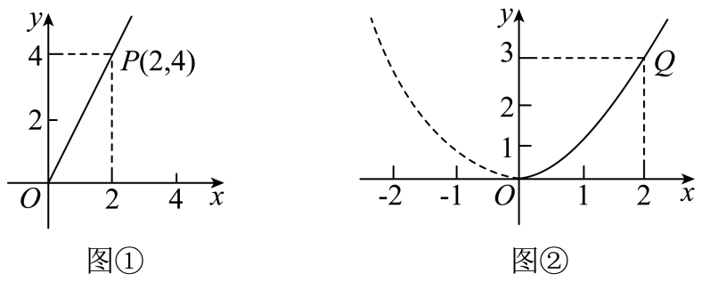

# Mathematics - 题目 2938

**ID**: 61e4c1f29b5c4f8e891980cca26dab94
**年级**: Grade 9
**难度**: Medium-Hard
**题型**: Calculation

## 题目
某工厂计划投资生产 $A、B$ 两种产品，根据市场调查与预测，产品 $A$ 的利润 $y{{}_{1}}$ （万元）与投资量 $x$ （万元）成正比例关系，如图①所示：产品 $B$ 的利润 $y{{}_{2}}$ （万元）与投资量 $x$ （万元）成顶点在原点的二次函数关系，如图②所示．(1)请直接写出利润 $y{{}_{1}}$ 与 $y{{}_{2}}$ 关于投资量 $x$ 的函数关系式 $y{{}_{1}}=$， $y{{}_{2}}=$；​​​​​​​‌(2)如果工厂以9万元资金投入生产 $A、B$ 两种产品，要求 $A$ 产品的投资金额不超过 $B$ 的2倍，且不少于3万元，则如何投资该工厂能获得最大利润？最大利润是多少？(3)在（2）问的情况下，工厂要获得不低于18万的利润，工厂要如何投资？

## 解答

1. （1）解：设 $y{{}_{1}}=kx$ ，
2. $\because $ 点 $P\left ({2，4}\right )$ 在该函数的图象上，
3. $\therefore 4=2k$ ，
4. $\therefore k=2$ ，
5. $\therefore y{{}_{1}}=2x$ ，
6. 设 $y{{}_{2}}=ax{^{2}}$ ，
7. $\because $ 点 $\mathbf{Q}\left ({2，3}\right )$ 在该函数图象上，
8. $\therefore 3=4a$ ，
9. $\therefore a=\frac {3}{4}$ ，
10. $\therefore y{{}_{2}}=\frac {3}{4}x{^{2}}$ ，
11. 故答案为： $2x$ ， $\frac {3}{4}x{^{2}}$ ；
12. （2）解：设投资 $A$ 产品 $x$ 万元，则投资 $B$ 产品 $\left ({9-x}\right )$ 万元，
13. 由题意可得：
14. $\begin{cases}x\leqslant 2\left ({9-x}\right )\\x\geqslant 3\end{cases}$ ，
15. 解得： $3\leqslant x\leqslant 6$ ，
16. $\therefore $ 该工厂能获得的利润为：
17. $y{{}_{1}}+y{{}_{2}}=2x+\frac {3}{4}{\left({9-x}\right)^{2}}=\frac {3}{4}{\left({x-\frac {23}{3}}\right)^{2}}+\frac {50}{3}$ ，
18. 对称轴为 $x=\frac {23}{3}$ ，
19. 当 $x<\frac {23}{3}$ 时，利润随着 $x$ 的增大而减小，
20. $\therefore $ 当 $x=3$ 时， $y{{}_{1}}+y{{}_{2}}$ 取得最大值，最大值是 $\frac {3}{4}\times {\left({3-\frac {23}{3}}\right)^{2}}+\frac {50}{3}=33$ 万元，
21. $\therefore $ 投资 $A$ 产品3万元，则投资 $B$ 产品6万元时，该工厂能获取最大利润，最大利润为33万元；
22. （3）解：由（2）可知， $3\leqslant x\leqslant 6$ ，
23. $y{{}_{1}}+y{{}_{2}}=2x+\frac {3}{4}{\left({9-x}\right)^{2}}=\frac {3}{4}{\left({x-\frac {23}{3}}\right)^{2}}+\frac {50}{3}\geqslant 18$ ，
24. $\therefore \frac {3}{4}{\left({x-\frac {23}{3}}\right)^{2}}\geqslant 18-\frac {50}{3}=\frac {4}{3}$ ，
25. $\therefore {\left({x-\frac {23}{3}}\right)^{2}}\geqslant {\left({\frac {4}{3}}\right)^{2}}$ ，
26. $\therefore x-\frac {23}{3}\geqslant \frac {4}{3}$ 或 $x-\frac {23}{3}\leqslant -\frac {4}{3}$ ，
27. $\therefore x\geqslant 9$ 或 $x\leqslant \frac {19}{3}$ ，
28. $\because 3\leqslant x\leqslant 6$ ，
29. $\therefore $ 当投资 $A$ 产品不少于3万元且不超过6万元时，工厂获得的利润不低于18万元．

## 知识点

**中文**:
  - 待定系数法求二次函数解析式
  - 正比例函数图象和性质
  - 销售问题

**English**:
  - Finding Quadratic Expressions by Undetermined Coefficients
  - Graphs and Properties of Direct Proportion Functions
  - Sales Problems

---
