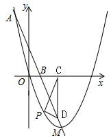

# Mathematics - 题目 580

**ID**: 62017f5066f44503b63ed7949c06e25d
**年级**: Grade 9
**难度**: Medium-Hard
**题型**: Calculation

## 题目
如图，已知抛物线的顶点为M(2，-4)，且过点A(-1，5)，连接AM交x轴于点B．(1)求这条抛物线的解析式；​​​​​​​‌(2)求点B的坐标；(3)设点P(x，y)是抛物线在x轴下方、顶点左方一段上的动点，连接PO，过以P为顶角顶点、PO为腰的等腰三角形的另一顶点C作x轴的垂线交直线AM于点D，连结PD，设△PCD的面积为S，求S与x之间的函数关系式；(4)在上述动点P(x，y)中，是否存在使 $S{{}_{\Delta PCD}}$ =2的点?若存在，求点P的坐标；若不存在，说明理由．

## 解答

1. 解：（1）设抛物线的解析式为y＝a(x﹣h)^{2}+k（a≠0），
2. ∵顶点为M（2，﹣4），
3. ∴y＝a(x﹣2)^{2}﹣4，
4. ∵根据抛物线过点A（﹣1，5），
5. ∴5＝a(﹣1﹣2)^{2}﹣4，
6. 解得：a＝1，
7. ∴y＝(x﹣2)^{2}﹣4＝x^{2}﹣4x，
8. ∴这条抛物线的解析式为y＝x^{2}﹣4x；
9. （2）设直线AM的解析式为y＝kx+b（k≠0），
10. 把M（2，﹣4），A（﹣1，5）两点代入，
11. 得 $\begin{cases}2k+b=-4\\-k+b=5\end{cases}$ ，
12. 解得 $\begin{cases}k=-3\\b=2\end{cases}$ ，
13. 故直线AM的解析式为y＝﹣3x+2，
14. 令y＝0，解得x＝ $\frac {2}{3}$ ，
15. 故B点坐标为（ $\frac {2}{3}$ ，0）；
16. （3）点P（x，y）是抛物线在x轴下方、对称轴左侧部分上的点，
17. 当0＜x＜ $\frac {1}{3}$ 时，
18. 设P（x，x^{2}﹣4x），
19. ∵以PO、PC为腰的等腰三角形的另一顶点C在x轴上，
20. ∴C的坐标是（2x，0），
21. ∵CD⊥x轴，
22. ∴D（2x，﹣6x+2），
23. ∴CD＝|﹣6x+2|＝﹣6x+2，h＝2x﹣x＝x，
24. ∴S_{△}_{PCD}＝ $\frac {1}{2}$ ×（﹣6x+2）×x＝﹣3x^{2}+x．
25. 当 $\frac {1}{3}$ ＜x＜2时，
26. 设P（x，x^{2}﹣4x），
27. ∵以PO、PC为腰的等腰三角形的另一顶点C在x轴上，
28. ∴C的坐标是（2x，0），
29. ∵CD⊥x轴，
30. ∴D（2x，﹣6x+2），
31. ∴CD＝|﹣6x+2|＝6x﹣2，h＝2x﹣x＝x，
32. ∴S_{△}_{PCD}＝ $\frac {1}{2}$ ×（6x﹣2）×x＝3x^{2}﹣x．
33. ∴S＝ $\begin{cases}-3x{^{2}}+x\left ({0<x<\frac {1}{3}}\right )\\3x{^{2}}-x\left ({\frac {1}{3}<x<2}\right )\end{cases}$ ；
34. （4）s＝2代入（3）中函数的解析式即可得
35. 2＝﹣3x^{2}+x或2＝3x^{2}﹣x，
36. 当2＝﹣3x^{2}+x，方程的△＜0，方程无解；
37. 当2＝3x^{2}﹣x，解得：x_{1}＝1，x_{2}＝﹣ $\frac {2}{3}$ ，
38. 当x＝1时y＝x^{2}﹣4x＝﹣3，即抛物线上的P点坐标为（1，﹣3）时，s＝2成立；
39. 当x＝﹣ $\frac {2}{3}$ ＜0（舍去），
40. ∴存在动点P，使S＝2，此时P点坐标为（1，﹣3）．

## 知识点

**中文**:
  - 待定系数法求一次函数解析式
  - 等腰三角形的性质
  - 待定系数法求二次函数解析式

**English**:
  - Finding Expressions by Undetermined Coefficients
  - Properties of Isosceles Triangles
  - Finding Quadratic Expressions by Undetermined Coefficients

---
