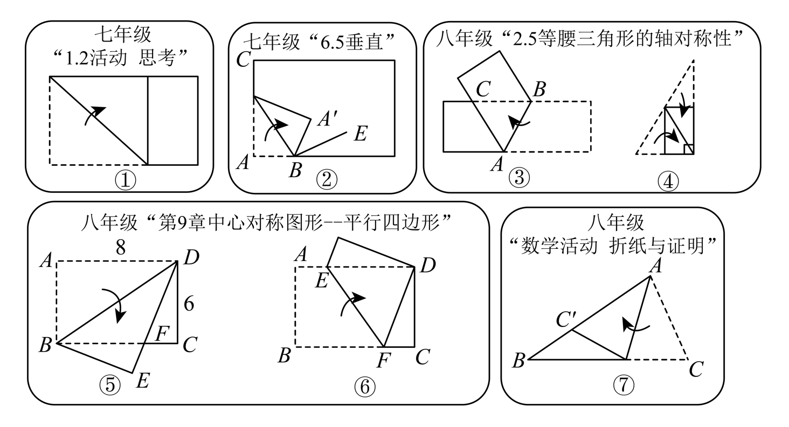
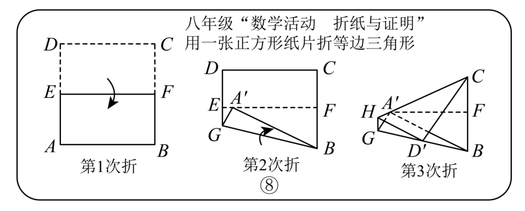
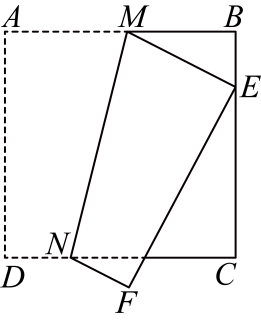

# Mathematics - 题目 2708

**ID**: 650f92132a5b4982890e70720f5d37fa
**年级**: Grade 9
**难度**: Medium-Hard
**题型**: Calculation

## 题目
如图①~⑧是课本上的折纸活动．【重温旧知】上述活动，有的是为了折出特殊图形，如图①、③和⑧；​​​​​​​‌有的是为了发现或证明定理，如图④和⑦；有的是计算角度，如图②；有的是计算长度，如图⑤和⑥．（1）图③中的 $\vartriangle ABC$ 的形状是；图④的活动发现了定理“”（注：填写定理完整的表述）；图⑤中的 $BF$ 的长是；【继续探索】（2）如图，将一个边长为4的正方形纸片 $ABCD$ 折叠，使点A落在边 $BC$ 上的点E处，点E不与B、C重合， $MN$ 为折痕．折叠后的梯形 $MNFE$ 的面积是否存在最小值？若存在，请求出最小值；若不存在，请说明理由．

## 解答

1. 解：（1）如图③ $\because $ 四边形 $EFGH$ 是矩形，
2. 
3. $\therefore EH/\mskip-4mu/FG$ ，
4. $\therefore \angle CBA=\angle GAB$ ，
5. 由折叠得 $\angle CAB=\angle GAB$ ，
6. $\therefore \angle CBA=\angle CAB$ ，
7. $\therefore AC=BC$ ，
8. $\therefore \vartriangle ABC$ 是等腰三角形，
9. 如图④， $\because \angle ACB=90{}^\circ $ ，
10. 
11. $\therefore \angle B+\angle A=90{}^\circ $ ， $\angle DCB+\angle DCA=90{}^\circ $ ，
12. 由折叠得 $CD=AD$ ， $\angle A=\angle DCA$ ，
13. $\therefore ∠B=∠DCB$ ，
14. $\therefore CD=BD$ ，
15. $\therefore CD=AD=BD=\frac {1}{2}AB$ ，
16. $\therefore $ 直角三角形斜边上的中线等于斜边的一半
17. 如图⑤， $\because $ 四边形 $ABCD$ 是矩形， $AD=8$ ， $CD=6$ ，
18. $\therefore BC=AD=8$ ， $BC/\mskip-4mu/AD$ ， $\angle C=90{}^\circ $ ，
19. $\therefore \angle CBD=\angle ADB$ ，
20. 由折叠得 $\angle EDB=\angle ADB$ ，
21. $\therefore \angle CBD=\angle EDB$ ，
22. $\therefore DF=BF$ ，
23. 在 ${\rm{R}}{\rm{t}}\vartriangle DCF$ 中， $\because CF{^{2}}+CD{^{2}}=DF{^{2}}$ ， $CF=8-BF$ ，
24. $\therefore (8-BF){^{2}}+6{^{2}}=BF{^{2}}$ ，
25. 解得 $BF=\frac {25}{4}$
26. （2）存在最小值，连接 $AE$ ，过点N作 $NG\bot AB$ 于点G，即 $\angle NGM=90{}^\circ $ ，
27. 
28. ∵正方形 $ABCD$ ，
29. ∴ $AB/\mskip-4mu/DC,\angle B=90{}^\circ ,AD\bot DC,AD=AB$ ，
30. ∴ $NG=AD$ ，
31. ∴ $NG=AB$ ，
32. ∵翻折，
33. ∴ $AE\bot MN$ ， $AM=ME$ ， $DN=FN$ ，
34. 即 $\angle 2=\angle 3=90{}^\circ $ ，
35. ∴ $\angle GNM+\angle GMN=90{}^\circ =\angle GMN+\angle BAE$ ，
36. ∴ $\angle BAE=\angle GNM$ ，
37. ∵ $NG=AB$ ， $\angle NGM=\angle B=90{}^\circ $ ，
38. ∴ $△NGM≌△ABE$ ，
39. ∴ $GM=BE$ ，
40. 设 $BE=x$ ，则在 ${\rm{R}}{\rm{t}}\vartriangle MBE$ 中，由勾股定理得： ${\left({4-ME}\right)^{2}}+x{^{2}}=ME{^{2}}$ ，
41. 则 $ME=AM=\frac {16+x{^{2}}}{8}$ ，
42. ∴ $DN=AG=AM-GM=\frac {16+x{^{2}}}{8}-x=\frac {16+x{^{2}}-8x}{8}$ ，
43. ∴ $S{{}_{四边形MNFE}}=S{{}_{四边形MNDA}}=\frac {1}{2}\left ({DN+AM}\right )\cdot AB=\frac {1}{2}\left ({\frac {16+x{^{2}}-8x}{8}+\frac {16+x{^{2}}}{8}}\right )\times 4$
44. $=\frac {x{^{2}}-4x+16}{2}=\frac {{\left({x-2}\right)^{2}}+12}{2}\geqslant 6$ ，当 $x=2$ 时，最小值为6．

## 知识点

**中文**:
  - 图形问题
  - 矩形的性质
  - 折叠问题

**English**:
  - Geometric Problems
  - Properties of Rectangles
  - Folding Problems

---
