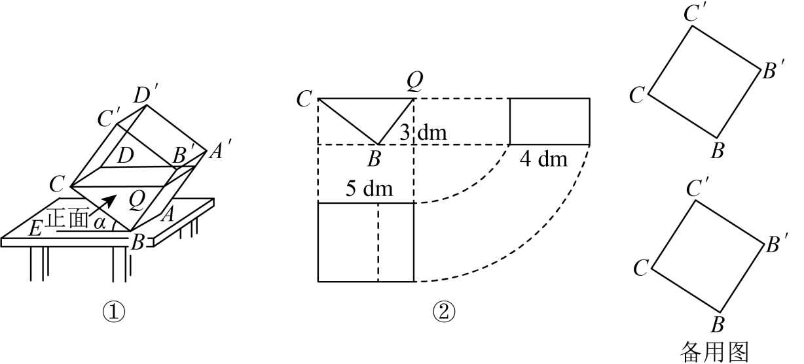

# Mathematics - 题目 833

**ID**: 6535af7430aa496ca2e9f69e68b3e6c0
**年级**: Grade 9
**难度**: Medium-Hard
**题型**: Calculation

## 题目
一透明的敞口正方体容器 $ABCD-A^{′}B^{′}C^{′}D^{′}$ 内装有一些有色液体，棱AB始终在水平桌面上，容器底部的倾斜角为α．（注：图①中 $\angle CBE=α$ ，图②中 $BQ=3{\rm{d}}{\rm{m}}$ ）探究：如图①，液面刚好过棱 $CD$ ，并与棱 $BB^{′}$ 交于点Q，此时液体的三视图及尺寸如图②所示，那么图①中，液体形状为（填几何体的名称）；​​​​​​​‌利用图②中数据，计算出图①中液体的体积为多少？（提示：V＝底面积×高）拓展：在图①的基础上，以棱 $AB$ 为轴将容器向左或向右旋转，但不能使液体溢出．若从正面看，液面与棱 $CC^{′}$ 或 $CB$ 交于点P，点Q始终在棱 $BB^{′}$ 上，设 $PC=x{\rm{d}}{\rm{m}}$ ，则 $BQ$ 的长度为（用含x的代数式表示）．

## 解答

1. 解：探究：通过观察图形可知，几何体为三棱柱，
2. ∵ $BQ=3{\rm{d}}{\rm{m}}$ ， $CQ=5{\rm{d}}{\rm{m}}$ ，正方体容器 $ABCD-A^{′}B^{′}C^{′}D^{′}$ ，
3. ∴ $CB=4{\rm{d}}{\rm{m}}$ ，
4. ∴ $S{{}_{\vartriangle CBQ}}=\frac {1}{2}\times 4\times 3=6{\rm{d}}{\rm{m}}{^{2}}$ ，
5. ∴图①中液体的体积： $6\times 4=24$  ${\rm{d}}{\rm{m}}{^{3}}$ ；
6. 拓展：若容器向左旋转，主视图如图①
7. 
8. ∵液体体积不变，
9. ∴ $\frac {1}{2}(x+BQ)\times 4\times 4=24$ ，
10. ∴ $BQ=(-x+3){\rm{d}}{\rm{m}}$ ，
11. 若容器向右旋转，主视图如图②，
12. 
13. 同理可知 $\frac {1}{2}\times (4-x)\cdot BQ\times 4=24$ ，
14. ∴ $BQ=\frac {12}{4-x}{\rm{d}}{\rm{m}}$ ．

## 知识点

**中文**:
  - 三视图的相关计算

**English**:
  - Calculations with Three Views

---
