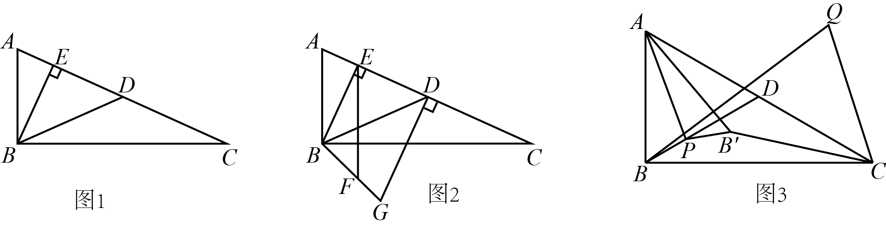

# Mathematics - 题目 1882

**ID**: 6594ccfc5b98436eaa3b4dde45c948a8
**年级**: Grade 9
**难度**: Medium-Hard
**题型**: Calculation

## 题目
在 ${\rm{R}}{\rm{t}}\mathrm{△}ABC$ 中， $\angle ABC=90{}^\circ $ ，过B点作 $BE\bot AC$ 于点E，点D为线段 $AC$ 的中点，连接 $BD$ ．(1)如图1， $AB=2{\rm{，}}AC=6$ ，求 $ED$ 的长度；​​​​​​​‌(2)如图2，将线段 $DB$ 绕着点D逆时针旋转 $45{}^\circ $ 得到线段 $DG$ ，此时 $DG\bot AC$ ，连接 $BG$ ，点F为 $BG$ 的中点，连接 $EF$ ，求证： $BC=2EF$ ；(3)如图3， $\angle ACB=30{}^\circ {\rm{，}}AB=3$ ，点P是线段 $BD$ 上一点，连接 $AP$ ，将 $△APB$ 沿 $AP$ 翻折到同一平面内得到 $\vartriangle APB^{′}$ ，连接 $CB^{′}$ ，将线段绕点 $CB^{′}$ 顺时针旋转 $60{}^\circ $ 得线段 $CQ$ ，连接 $BQ$ ，当 $BQ$ 最小时，直接写出 $\mathrm{△}BCQ$ 的面积．

## 解答

1. （1）解：∵ $BE\bot AC$ ，
2. ∴ $\angle AEB=\angle CEB=90{}^\circ $ ，
3. ∵ $\angle A=\angle A，\angle AEB=\angle ABC=90{}^\circ $ ，
4. ∴ $\vartriangle ABE∽\vartriangle ACB$ ，
5. ∴ $\frac {AB}{AE}=\frac {AC}{AB}$ ，即 $\frac {2}{AE}=\frac {6}{2}$
6. ∴ $AE=\frac {2}{3}$ ，
7. ∵点D为线段 $AC$ 的中点，
8. ∴ $AD=DC=\frac {1}{2}AC=3$ ，
9. ∴ $DE=AD-AE=\frac {7}{3}$ ；
10. （2）证明：过点D作 $DH\bot BC$ 于点H，过点F作 $FJ\bot AC$ 于点J．连接 $FD$ ．
11. 
12. ∵ $BE\bot AC，FJ\bot AC，DG\bot AC$ ，
13. ∴ $BE/\mskip-4mu/FJ/\mskip-4mu/GD$ ，
14. ∵ $BF=FG$ ，
15. ∴ $EJ=JD$ ，
16. ∴ $FE=DF$ ，
17. ∵ $\angle BDG=45{}^\circ ，\angle ADG=90{}^\circ $ ，
18. ∴ $\angle EDB=45{}^\circ $ ，
19. ∵ $\angle ABC=90{}^\circ ，AD=DC$ ，
20. ∴ $BD=AD=DC$ ，
21. ∵ $\angle ADB=\angle DBC+\angle DCB=45{}^\circ $ ，
22. ∴ $\angle DBC=\angle DCB=22.5{}^\circ $ ，
23. ∵ $DB=DG，DF\bot BG$ ，
24. ∴ $\angle BDF=\angle GDF=22.5{}^\circ $ ，
25. ∴ $\angle DBH=\angle BDF=22.5{}^\circ $ ，
26. ∵ $BD=DB，\angle BFD=\angle BHD=90{}^\circ $ ，
27. ∴ $\vartriangle BFD≌\vartriangle DHB\left ({{\rm{A}}{\rm{A}}{\rm{S}}}\right )$ ，
28. ∴ $DF=BH$ ，
29. ∴ $BH=EF$ ，
30. ∵ $DB=DC，DH\bot BC$ ，
31. ∴B$H=HC$ ，
32. ∴ $BC=2EF$ ；
33. （3）解：如图3中，以 $AC$ 为边向上作等边三角形 $ACK$ ，连接．
34. 
35. ∵ $\angle B^{′}CQ=\angle ACK=60{}^\circ $ ，
36. ∴ $\angle ACB^{′}=\angle KCQ$ ，
37. ∵ $CA=CK，CB^{′}=CQ$ ，
38. ∴ $\vartriangle ACB^{′}≌\vartriangle KCQ\left ({{\rm{S}}{\rm{A}}{\rm{S}}}\right )$ ，
39. ∴ $AB^{′}=QK$ ，
40. ∵ $AB=AB{{}^{\prime }}=3$ ，
41. ∴ $QK=3$ ，
42. ∵ $\angle ABC=90{}^\circ ，\angle ACB=30{}^\circ $ ，
43. ∴ $AC=CK=2AB=6，BC=\sqrt {3}AB=3\sqrt {3}，\angle BCK=90{}^\circ $ ，
44. ∴ $BK=\sqrt {CK{{}^{2}}+BC{{}^{2}}}=3\sqrt {7}$ ，
45. ∵ $BQ\geqslant BK-QK=3\sqrt {7}-3$ ，
46. ∴ $BQ$ 的最小值为 $3\sqrt {7}-3$ ，此时B．Q．K共线，
47. 作 $CJ\bot BK$ 于点J，
48. ∵ $\frac {1}{2}\cdot CB\cdot CK=\frac {1}{2}\cdot BK\cdot CJ$ ，
49. ∴ $CJ=\frac {3\sqrt {3}\times 6}{3\sqrt {7}}=\frac {6\sqrt {21}}{7}$ ，
50. ∴此时 $\mathrm{△}BCQ$ 的面积 $=\frac {1}{2}\times \left ({3\sqrt {7}-3}\right )\times \frac {6\sqrt {21}}{7}=9\sqrt {3}-\frac {9\sqrt {21}}{7}$ ．

## 知识点

**中文**:
  - 三角形的综合
  - 相似三角形的判定与性质综合

**English**:
  - Comprehensive Triangle Problems
  - Determination and Properties

---
