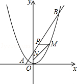

# Mathematics - 题目 1505

**ID**: 66c27b9a7e2741d9826553b6f316f38b
**年级**: Grade 9
**难度**: Medium-Hard
**题型**: Calculation

## 题目
如图，已知直线AB经过点（0，4），与抛物线y= $\frac {1}{4}$ x^{2}交于A，B两点，其中点A的横坐标是 $-2$ ．(1）求这条直线的函数关系式及点B的坐标．(2）在x轴上是否存在点C，使得△ABC是直角三角形？若存在，求出点C的坐标，若不存在请说明理由．(3）过线段AB上一点P，作PM∥x轴，交抛物线于点M，点M在第一象限，点N（0，1），当点M的横坐标为何值时，MN+3MP的长度最大？最大值是多少？​​​​​​​‌

## 解答

1. （1）∵点A是直线与抛物线的交点，且横坐标为-2，
2. $y=\frac {1}{4}\times (-2){^{2}}=1$ ,A点的坐标为（-2，1），
3. 设直线的函数关系式为y=kx+b，
4. 将（0，4），（-2，1）代入得 $\begin{cases}b=4\\-2k+b=1\end{cases}$
5. 解得 $\begin{cases}k=\frac {3}{2}\\b=4\end{cases}$
6. ∴y＝ $\frac {3}{2}$x＋4
7. ∵直线与抛物线相交，
8. $\therefore \frac {3}{2}x+4=\frac {1}{4}x{^{2}}$
9. 解得：x=-2或x=8，
10. 当x=8时，y=16，
11. ∴点B的坐标为（8，16）；
12. （2）存在．
13. ∵由A(－2，1)，B(8，16)可求得AB^{2}＝ $(8+2){^{2}}+(16-1){^{2}}$ =325
14. 设点C(m，0)，
15. 同理可得AC^{2}＝(m＋2)^{2}＋1^{2}＝m^{2}＋4m＋5，
16. BC^{2}＝(m－8)^{2}＋16^{2}＝m^{2}－16m＋320，
17. ①若∠BAC＝90°，则AB^{2}＋AC^{2}＝BC^{2}，即325＋m^{2}＋4m＋5＝m^{2}－16m＋320，解得m＝－ $\frac {1}{2}$ ；
18. ②若∠ACB＝90°，则AB^{2}＝AC^{2}＋BC^{2}，即325＝m^{2}＋4m＋5＋m^{2}－16m＋320，解得m＝0或m＝6；
19. ③若∠ABC＝90°，则AB^{2}＋BC^{2}＝AC^{2}，即m^{2}＋4m＋5＝m^{2}－16m＋320＋325，解得m＝32，
20. ∴点C的坐标为(－ $\frac {1}{2}$ ，0)，(0，0)，(6，0)，(32，0)
21. （3）设M(a， $\frac {1}{4}$a^{2})，
22. 则MN＝ $\sqrt {a{^{2}}+{\left({\frac {1}{4}a{^{2}}-1}\right)^{2}}}=\frac {1}{4}a{^{2}}+1$ ，
23. 又∵点P与点M纵坐标相同，
24. ∴ $\frac {3}{2}$x＋4＝ $\frac {1}{4}$a^{2}，
25. ∴x= $\frac {a{^{2}}-16}{6}$  ，
26. ∴点P的横坐标为 $\frac {a{^{2}}-16}{6}$ ，
27. ∴MP＝a－ $\frac {a{^{2}}-16}{6}$ ，
28. ∴MN＋3PM＝ $\frac {1}{4}$a^{2}＋1＋3(a－ $\frac {a{^{2}}-16}{6}$ )＝－ $\frac {1}{4}$a^{2}＋3a＋9＝－ $\frac {1}{4}$  (a－6)^{2}＋18，
29. ∵－2⩽6⩽8，
30. ∴当a＝6时，取最大值18，
31. ∴当M的横坐标为6时，MN＋3PM的长度的最大值是18

## 知识点

**中文**:
  - y=ax²的图象与性质
  - 二次函数的综合
  - 勾股定理的逆定理
  - 待定系数法求一次函数解析式

**English**:
  - Graph and Properties of y=ax²
  - Comprehensive Quadratic Function Problems
  - Converse of Pythagorean Theorem
  - Finding Expressions by Undetermined Coefficients

---
