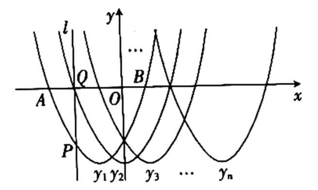

# Mathematics - 题目 2712

**ID**: 670eca6d513f439db328f9ae3af5a449
**年级**: Grade 9
**难度**: Medium-Hard
**题型**: Calculation

## 题目
如图，抛物线 $y{{}_{1}}=(x-a)(x-a-4)$ 与x轴交于A，B两点（点A在点B的左侧），平行于y轴的直线l过点 $Q(-2,0)$ ，与抛物线 $y{{}_{1}}$ 交于点P．（1）直接写出 $AB$ 的长，并求当 $a=1$ 时抛物线 $y{{}_{1}}$ 的对称轴．（2）将抛物线 $y{{}_{1}}$ 向右平移1个单位得到抛物线 $y{{}_{2}}$ ，向右平移2个单位得到抛物线 $y{{}_{3}}$ ，…，向右平移 $n-1$ （n为正整数）个单位得到抛物线 $y{{}_{n}}$ ，抛物线 $y{{}_{2}}$ 与直线l交于点Q．①直线l与所有抛物线的交点个数为，所有抛物线的顶点所在直线是；​​​​​​​‌②当 $a=-3$ 时，抛物线 $y{{}_{n}}$ 与直线l交于点R，若四边形 $PARB$ 的面积为70，求n的值．

## 解答

1. （1） $\because $ 抛物线 $y{{}_{1}}=(x-a)(x-a-4)$ 与x轴交于A，B两点
2. $\therefore A(a，{\rm{0}})B(a+4，{\rm{0}})$
3. $\therefore AB=4$
4. 当 $a=1$ 时 $A(1，{\rm{0}})B(5，{\rm{0}})$
5. 抛物线 $y{{}_{1}}$ 的对称轴 $x=3$
6. （2）①因为抛物线图象开口向上，无限延申，故每个抛物线图象都与直线l有一个交点，
7. 所以直线l与所有抛物线的交点个数为n个，
8. 每个抛物线的顶点都由抛物线 $y{{}_{1}}$ 的顶点 $(a+2，-{\rm{4}})$ 向右移动，故这些顶点都在直线 $y=-4$ 上，
9. 故答案为：n， $y=-4$ ；
10. ② $S{{}_{\square PARB}}=S{{}_{\vartriangle ABR}}+S{{}_{\vartriangle ABP}}=\frac {1}{2}\cdot AB\cdot OR+\frac {1}{2}\cdot AB\cdot OP$
11. $=\frac {1}{2}\cdot AB\cdot (OR+OP)$
12. $=70$
13. $\therefore \frac {1}{2}\times 4\times PR=70$
14. $PR=35$
15. 当 $x{\rm{=}}-{\rm{2}}$ ， $a=-3$ 时，
16. $y{{}_{1}}=(-2-a)(-2-a-4)=(-2-a)(-6-a){\rm{=}}a{^{2}}+8a+12$
17. $\therefore P(-2，{\rm{-}}{\rm{3}})$
18. $y{{}_{{\rm{1}}}}=(x-a-2){^{2}}-4$ ，
19. $y{{}_{{\rm{n}}}}=(x-a-2-n{\rm{+}}{\rm{1}}){^{2}}-4$
20. $\therefore R(-2，n{^{{\rm{2}}}}-4)$
21. $PR=n{^{{\rm{2}}}}-4{\rm{+}}{\rm{3}}=35$
22. 解得 $n{{}_{1}}={\rm{6}}，n{{}_{2}}=-6$ （舍去）
23. $\therefore n={\rm{6}}$

## 知识点

**中文**:
  - 两点间的距离公式
  - 二次函数的综合
  - 几何问题

**English**:
  - Distance Formula
  - Comprehensive Quadratic Function Problems
  - Geometry Problems

---
