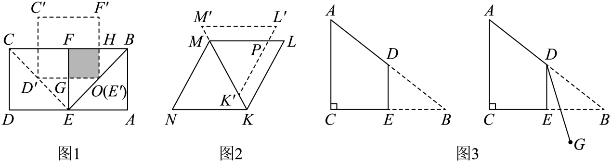

# Mathematics - 题目 2743

**ID**: 6717fbb58c824f7d94f2a483ee63bff2
**年级**: Grade 9
**难度**: Medium-Hard
**题型**: Calculation

## 题目
“综合与实践”课上，同学们通过剪拼图形，用数学的眼光看问题，感受图形的变换美！【特例感知】(1)如图1，纸片 $ABCD$ 为矩形，且 $AD=20$ 厘米， $AB=10$ 厘米，点 $E$ ， $F$ 分别为边 $AD$ ， $BC$ 的中点，沿 $EF$ 将纸片剪成两部分，将纸片 $DEFC$ 沿纸片 $ABFE$ 的对角线 $EB$ 方向向上平移．①当纸片 $DEFC$ 平移至点 $E^{′}$ 与 $EB$ 的中点 $O$ 重合时，两个纸片重叠部分 $FGE^{′}H$ 的面积与原矩形纸片 $ABCD$ 的面积之比是；​​​​​​​‌②当两个纸片重叠部分 $FGE^{′}H$ 的面积与原矩形纸片 $ABCD$ 的面积之比是 $\frac {1}{16}$ 时，则平移距离 $EE^{′}$ 为；【类比探究】(2)如图2，当纸片 $KLMN$ 为菱形， $KN=a\left ({a>2}\right )$ ， $\angle N=60{^{\circ }}$ 时，将纸片 $KLMN$ 沿其对角线 $KM$ 剪开，将纸片 $F(\frac {π}{6})\cdot F(\frac {7π}{6})<0$ 沿 $KM$ 方向向上平移．当两个纸片重叠部分 $K^{′}PM$ 的面积与纸片 $F(\frac {π}{6})\cdot F(\frac {7π}{6})<0$ 的面积之比为 $\frac {1}{2}$ 时，求平移距离 $KK^{′}$ （用含 $a$ 的式子表示）；【拓展延伸】(3)如图3，在直角三角形纸片 $\vartriangle ABC$ 中， $∠C=90{^{\circ }}$ ， $AC=18$ 厘米， $BC=24$ 厘米，取 $AB$ ， $BC$ 中点 $D$ ， $E$ ，将 $\vartriangle ABC$ 沿 $DE$ 剪开，得到四边形 $ACED$ 和 $\vartriangle DEB$ ，将 $\vartriangle DEB$ 绕点 $D$ 顺时针旋转得到 $\vartriangle DFG$ ．在 $\vartriangle DFG$ 旋转一周的过程中，求 $\mathrm{△}CFG$ 面积的最大值．

## 解答

1. （1）解：① $\because ABCD$ 为矩形，
2. $\therefore BC=AD=20$ 厘米， $\angle A=90{}\degree $ ， $BC{\rm{/\mskip-4mu/}}AD$ ，
3. $\because $ 点 $E$ ， $F$ 分别为边 $AD$ ， $BC$ 的中点，
4. $\therefore BF=\frac {1}{2}BC=10$ 厘米， $AE=\frac {1}{2}AD=10$ 厘米，
5. $\therefore BF=AE$ ，
6. $\because BF{\rm{/\mskip-4mu/}}AE$ ， $\angle A=90{}\degree $ ，
7. $\therefore $ 四边形 $ABFE$ 是矩形，
8. 又 $\because BF=AB=10$ 厘米，
9. $\therefore $ 矩形 $ABFE$ 是正方形，
10. $\therefore \angle EBF=\angle BEF=45{}\degree $ ， $\angle EFB=90{}\degree $ ， $BE=\sqrt {2}AB=10\sqrt {2}$ 厘米，
11. 由平移的性质得， $E^{′}F^{′}{{\rm{/\mskip-4mu/}}}EF$ ， $D^{′}E^{′}{{\rm{/\mskip-4mu/}}}DE$ ，
12. $\because DE{\rm{/\mskip-4mu/}}FH$ ，
13. $\therefore D^{′}E^{′}{{\rm{/\mskip-4mu/}}}FH$ ，
14. 又 $\because \angle GFH=90{}\degree $ ，
15. $\therefore $ 四边形 $FGE^{′}H$ 是矩形，
16. $\because $ 点 $E^{′}$ 与 $EB$ 的中点 $O$ 重合，
17. $\therefore BE^{′}=EE^{′}=\frac {1}{2}BE=5\sqrt {2}$ 厘米，
18. $\because \angle E^{′}HB=\angle E^{′}GE=90{}\degree $ ， $\angle EBF=\angle BEF=45{}\degree $ ，
19. $\therefore \vartriangle BE^{′}H$ 和 $\vartriangle E^{′}EG$ 都是等腰直角三角形， $HE^{′}=\frac {BE^{′}}{\sqrt {2}}=5$ 厘米， $E^{′}G=\frac {EE^{′}}{\sqrt {2}}=5$ 厘米，
20. $\therefore S{{}_{矩形FGE^{′}H}}=HE^{′}{\cdot }E^{′}G=25$ 平方厘米，
21. $\because S{{}_{矩形ABCD}}=AD\cdot AB=200$ 平方厘米，
22. $\therefore FGE^{′}H$ 的面积与原矩形纸片 $ABCD$ 的面积之比是 $\frac {25}{200}=\frac {1}{8}$ ．
23. 故答案为： $\frac {1}{8}$ ．
24. ②由①中的结论得，四边形 $FGE^{′}H$ 是矩形， $\vartriangle BE^{′}H$ 和 $\vartriangle E^{′}EG$ 都是等腰直角三角形，
25. 设 $EE^{′}=a$ 厘米，则 $BE^{′}=\left ({10\sqrt {2}-a}\right )$ 厘米，
26. $\therefore E^{′}G=\frac {EE^{′}}{\sqrt {2}}=\frac {a}{\sqrt {2}}$ 厘米， $HE^{′}=\frac {BE^{′}}{\sqrt {2}}=\left ({10-\frac {a}{\sqrt {2}}}\right )$ 厘米，
27. $\therefore S{{}_{矩形FGE^{′}H}}=HE^{′}{\cdot }E^{′}G=\frac {a}{\sqrt {2}}\left ({10-\frac {a}{\sqrt {2}}}\right )$ ，
28. $\because FGE^{′}H$ 的面积与原矩形纸片 $ABCD$ 的面积之比是 $\frac {1}{16}$ ， $S{{}_{矩形ABCD}}=200$ 平方厘米，
29. $\therefore \frac {\frac {a}{\sqrt {2}}\left ({10-\frac {a}{\sqrt {2}}}\right )}{200}=\frac {1}{16}$ ，
30. 解得： $a{{}_{1}}=5\sqrt {2}-5$ ， $a{{}_{1}}=5\sqrt {2}+5$ ，
31. $\therefore $ 平移距离 $EE^{′}$ 为 $5\sqrt {2}-5$ 或 $5\sqrt {2}+5$ ．
32. 故答案为： $5\sqrt {2}-5$ 或 $5\sqrt {2}+5$ ．
33. （2）解： $\because $ 纸片 $KLMN$ 为菱形， $\angle N=60{^{\circ }}$ ，
34. $\therefore S{{}_{\vartriangle MNK}}=S{{}_{\vartriangle MKL}}=\frac {1}{2}S{{}_{菱形KLMN}}$ ， $\mathrm{△}MNK$ 和 $\mathrm{△}MKL$ 为等边三角形，
35. $\because $ 纸片 $F(\frac {π}{6})\cdot F(\frac {7π}{6})<0$ 沿 $KM$ 方向向上平移，
36. $\therefore K^{′}P{\rm{/\mskip-4mu/}}KL$ ，
37. $\therefore \vartriangle MK^{′}P∽\vartriangle MKL$ ，
38. $\because $ 两个纸片重叠部分 $K^{′}PM$ 的面积与纸片 $F(\frac {π}{6})\cdot F(\frac {7π}{6})<0$ 的面积之比为 $\frac {1}{2}$ ，
39. $\therefore \frac {S{{}_{\vartriangle MK^{′}P}}}{S{{}_{\vartriangle MNK}}}={\left({\frac {MK^{′}}{MK}}\right)^{2}}={\left({\frac {MK^{′}}{a}}\right)^{2}}=\frac {1}{2}$ ，
40. $\therefore MK^{′}=\frac {\sqrt {2}}{2}a$ ，
41. $\therefore KK^{′}=MK-MK^{′}=a-\frac {\sqrt {2}}{2}a=\frac {2-\sqrt {2}}{2}a$ ．
42. （3）解：如图，过点 $C$ 作 $CN\bot FG$ 于点 $N$ ，
43. $\because \angle C=90{^{\circ }}$ ， $AC=18$ 厘米， $BC=24$ 厘米，
44. $\therefore AB=\sqrt {AC{^{2}}+BC{^{2}}}=\sqrt {18{^{2}}+24{^{2}}}=30$ 厘米，
45. $\because $ 点 $D$ ， $E$ 是 $AB$ ， $BC$ 的中点，
46. $\therefore CD=\frac {1}{2}AB=15$ 厘米， $BE=\frac {1}{2}BC=12$ 厘米， $DE=\frac {1}{2}AC=9$ 厘米，
47. 由旋转的性质得， $FG=BE=12$ 厘米， $DF=DE=9$ 厘米，
48. $\because S{{}_{\vartriangle CFG}}=\frac {1}{2}FG\cdot CN=6CN$ ，
49. $\therefore $ 当 $FG$ 上的高线 $CN$ 最大时，则 $\mathrm{△}CFG$ 面积最大，
50. $\because CN\leqslant CF$ ，
51. $\therefore $ 当点 $N$ 和点 $F$ 重合时，且 $\vartriangle DFG$ 旋转到 $AB$ 外侧时，此时 $CN$ 最大，
52. $\because DF\bot FG$ ，
53. $\therefore $ 此时 $C$ 、 $D$ 、 $F$ 三点共线，
54. 即 $CN=CF=CD+DF=15+9=24$ 厘米，
55. $\therefore S{{}_{\vartriangle CFG}}=\frac {1}{2}FG\cdot CN=\frac {1}{2}\times 12\times 24=144$ 平方厘米，
56. 即 $\mathrm{△}CFG$ 面积的最大值为144平方厘米．
57. 

## 知识点

**中文**:
  - 平移的性质
  - 旋转的性质
  - 相似三角形的判定与性质综合

**English**:
  - Properties of Translation
  - Properties of Rotation
  - Determination and Properties

---
