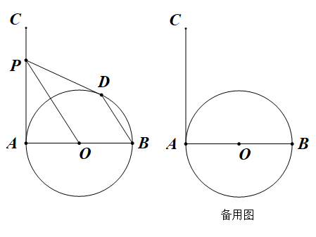

# Mathematics - 题目 999

**ID**: 67b792c45abb4c08bc1a9e50b514486b
**年级**: Grade 9
**难度**: Medium-Hard
**题型**: Calculation

## 题目
如图， $AB$ 是⊙O的直径，过点A作⊙O的切线 $AC$ ，点P是射线 $AC$ 上的动点，连接 $OP$ ，过点B作 $BD{\rm{/}}{\rm{/}}OP$ ，交⊙O于点D，连接 $PD$ ．（1）求证： $PD$ 是⊙O的切线（2）当四边形 $POBD$ 是平行四边形时，求 $\angle APO$ 的度数．​​​​​​​‌

## 解答

1. （1）如图，连接OD，则 $OD=OA=OB$
2. $\because $  $AC$ 是⊙O的切线
3. $\therefore \angle A=90{}^\circ $
4. $\because $  $BD{\rm{/}}{\rm{/}}OP$
5. $\therefore \angle 1=\angle 3,\angle B=\angle 2$
6. 又 $\because OD=OB$
7. $\therefore \angle B=\angle 1$
8. $\therefore \angle 2=\angle 3$
9. 在 $\vartriangle PAO$ 和 $△PDO$ 中
10. $\begin{cases}PO=PO\\\angle 2=\angle 3\\OA=OD\end{cases}$
11. $\therefore △PAO≌△PDO(SAS)$
12. $\therefore \angle PDO=\angle A{\rm{=}}90{}^\circ $
13. $\therefore $  $PD$ 是⊙O的切线．
14. 
15. （2）如图，连接OD$\because $ 四边形 $POBD$ 是平行四边形
16. $\therefore PD=OB$ , $PD{\rm{/}}{\rm{/}}OB$
17. $\because OB=OA$
18. $\therefore PD=OA$
19. $\therefore $ 四边形 $PAOD$ 是平行四边形
20. 又 $\because OD=OA$
21. $\therefore $ 四边形 $PAOD$ 是菱形
22. $\because \angle A=90{}^\circ $
23. $\therefore $ 四边形 $PAOD$ 是正方形
24. $\therefore \angle APO{\rm{=}}45{}^\circ $ ．
25. 

## 知识点

**中文**:
  - 圆的综合问题

**English**:
  - Comprehensive Circle Problems

---
