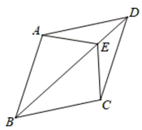

# Mathematics - 题目 2587

**ID**: 67e39d6fe90f47e9babea3bcce5efc96
**年级**: Grade 9
**难度**: Medium-Hard
**题型**: Calculation

## 题目
如图，四边形 $ABCD$ 中， $AD{\rm{/}}{\rm{/}}BC$ ， $AD=CD$ ，E是对角线 $BD$ 上一点，且 $EA=EC$ ．（1）求证：四边形 $ABCD$ 是菱形．（2）若 ${\tan}\angle BDC=\frac {1}{2}$ ， $DE=EC=2$ ，则 $CD$ 的长为．​​​​​​​‌

## 解答

1. （1）证明：∵ $AD=CD$ ， $EA=EC$ ， $DE=DE$ ，
2. ∴ $\mathrm{△}ADE≌\mathrm{△}CDE$ ．
3. ∴ $\angle ADE=\angle CDE$ ．
4. ∵ $AD{\rm{/}}{\rm{/}}BC$ ，
5. ∴ $\angle ADB=\angle DBC$ ．
6. ∴ $\angle DBC=\angle BDC$ ．
7. ∴ $BC=CD$ ．
8. ∴ $AD=BC$ ．
9. 又∵ $AD{\rm{/}}{\rm{/}}BC$ ，
10. ∴四边形 $ABCD$ 是平行四边形．
11. ∵ $AD=CD$ ，
12. ∴四边形 $ABCD$ 是菱形．
13. （2）解：如图，过点E作EF⊥CD于点F，
14. 
15. ∵ $DE=EC$ ，
16. ∴ $DF=FC=\frac {1}{2}CD$ ，
17. ∵ ${\tan}\angle BDC=\frac {1}{2}=\frac {EF}{DF}$ ，
18. ∴ $DF=2EF$ ，
19. 在Rt△DEF中， $DE=2$ ，
20. 由勾股定理得： $DE{^{2}}=EF{^{2}}+DF{^{2}}$ ，
21. 即 $2{^{2}}=EF{^{2}}+{\left({2EF}\right)^{2}}$ ，
22. 解得 $EF=\frac {2\sqrt {5}}{5}$ ，
23. ∴ $DF=\frac {4\sqrt {5}}{5}$ ，
24. ∴ $CD=\frac {8\sqrt {5}}{5}$ ．
25. 故答案为： $\frac {8\sqrt {5}}{5}$ ．

## 知识点

**中文**:
  - 菱形的判定
  - 解直角三角形

**English**:
  - Determination of Rhombuses
  - Solving Right Triangles

---
