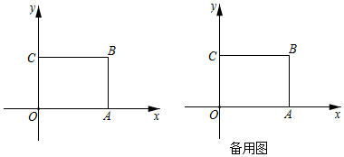

# Mathematics - 题目 1778

**ID**: 6907978953ea41a1989f40085e591e92
**年级**: Grade 9
**难度**: Medium-Hard
**题型**: Calculation

## 题目
在平面直角坐标系中，矩形OABC的边OA任x轴上，OC在y轴上，B（4，3），点M从点A开始，以每秒1个单位长度的速度沿AB→BC→CO运动，设△AOM的面积为S，点M运动的时间为t．（1）当0＜t＜3时，AM＝，当7＜t＜10时，OM＝；​​​​​​​‌（用t的代数式表示）（2）当△AOM为等腰三角形时，t＝；（3）当7＜t＜10时，求S关于t的函数关系式；（4）当S＝4时，求t的值．

## 解答

1. 解：（1）当0<t<3时，点M在线段AB上，即AM=t
2. 当7＜t<10时，点M在线段OC上，OM=10-t
3. 故填：t，10-t；
4. （2）∵四边形ABCO是矩形，B（4，3）
5. ∴OA=BC=4，AB=OC=3，
6. ∵△AOM为等腰三角形，
7. ∴只有当MA=MO，此时点M在线段BC上，CM=BM=2，
8. ∴t=3+2=5
9. 故填：5；
10. （3）∵当7<t<10时，点M在线段OC上
11. ∴ ${\rm S=\frac {1}{2}\cdot OA\cdot OM=\frac {1}{2}\times 4\times (10-t)=20-2t}$ ；
12. （4）①当点M在线段AB上时，4= $\frac {1}{2}$ ×4t，解得t=2；
13. ②当点M在线段BC上时，S=6，不符合题意；
14. 当点M在线段OC上时，4=20-2t，解得t=8．
15. 综上所述，满足条件的的值为2或8．

## 知识点

**中文**:
  - 矩形的性质
  - 等腰三角形的判定与性质

**English**:
  - Properties of Rectangles
  - Determination and Properties

---
